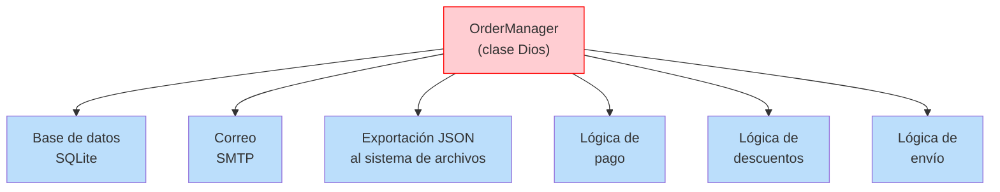
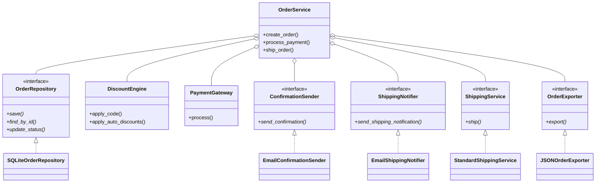

# SOLID en la práctica

Esta lección reúne los cinco principios SOLID en un caso de estudio realista. Verás un sistema de gestión de pedidos desordenado y muy acoplado, y lo refactorizarás paso a paso aplicando los principios SOLID.

## El caso de estudio: sistema de gestión de pedidos

Tenemos un sistema heredado que procesa pedidos de comercio electrónico. Es funcional, pero sufre todas las violaciones SOLID imaginables. Vamos a analizarlo, identificar los problemas y refactorizarlo sistemáticamente.

### ANTES: el monolito heredado

```python
import json
import smtplib
import sqlite3
from email.message import EmailMessage
from pathlib import Path
from typing import Any

class OrderManager:
    def __init__(self):
        self.db_path = "orders.db"
        self._init_db()

    def _init_db(self) -> None:
        with sqlite3.connect(self.db_path) as conn:
            conn.execute("""
                CREATE TABLE IF NOT EXISTS orders (
                    id INTEGER PRIMARY KEY AUTOINCREMENT,
                    customer_email TEXT NOT NULL,
                    items TEXT NOT NULL,
                    total REAL NOT NULL,
                    status TEXT DEFAULT 'pending',
                    discount_code TEXT
                )
            """)

    def create_order(self, customer_email: str,
                     items: list[dict[str, Any]],
                     discount_code: str | None = None) -> int:
        total = 0.0
        for item in items:
            total += item["price"] * item["quantity"]

        if discount_code:
            if discount_code == "SAVE10":
                total *= 0.9
            elif discount_code == "SAVE20":
                total *= 0.8
            elif discount_code == "FREESHIP":
                pass
            else:
                raise ValueError(f"Unknown discount code: {discount_code}")

        if total > 1000:
            total *= 0.95

        items_json = json.dumps(items)
        with sqlite3.connect(self.db_path) as conn:
            cur = conn.execute(
                "INSERT INTO orders (customer_email, items, total, discount_code) VALUES (?, ?, ?, ?)",
                (customer_email, items_json, total, discount_code)
            )
            order_id = cur.lastrowid

        html = f"""<html><body>
<h1>Order #{order_id} Confirmation</h1>
<p>Thank you for your order!</p>
<p>Total: ${total:.2f}</p>
</body></html>"""
        msg = EmailMessage()
        msg["Subject"] = f"Order #{order_id} Confirmation"
        msg["From"] = "orders@store.com"
        msg["To"] = customer_email
        msg.set_content(html, subtype="html")

        with smtplib.SMTP("smtp.store.com") as server:
            server.send_message(msg)

        with open(f"order_{order_id}.json", "w") as f:
            json.dump({
                "order_id": order_id,
                "customer": customer_email,
                "items": items,
                "total": total,
                "status": "pending"
            }, f, indent=2)

        print(f"Order {order_id} created. Total: ${total:.2f}")
        return order_id

    def process_payment(self, order_id: int, payment_type: str,
                        payment_details: dict[str, Any]) -> str:
        with sqlite3.connect(self.db_path) as conn:
            row = conn.execute(
                "SELECT total, status FROM orders WHERE id = ?", (order_id,)
            ).fetchone()
            if not row:
                raise ValueError(f"Order {order_id} not found")
            total, status = row
            if status == "paid":
                raise ValueError(f"Order {order_id} already paid")

        if payment_type == "credit_card":
            card = payment_details.get("card_number", "")
            if len(str(card)) != 16:
                raise ValueError("Invalid card number")
            txn = f"cc_{hash(card)}_{order_id}"
            print(f"Processing credit card payment: ${total:.2f}")

        elif payment_type == "paypal":
            email = payment_details.get("email", "")
            if "@" not in email:
                raise ValueError("Invalid PayPal email")
            txn = f"pp_{hash(email)}_{order_id}"
            print(f"Processing PayPal payment: ${total:.2f}")

        elif payment_type == "bank_transfer":
            acct = payment_details.get("account_number", "")
            if len(str(acct)) < 8:
                raise ValueError("Invalid account number")
            txn = f"bt_{hash(acct)}_{order_id}"
            print(f"Processing bank transfer: ${total:.2f}")

        else:
            raise ValueError(f"Unknown payment type: {payment_type}")

        with sqlite3.connect(self.db_path) as conn:
            conn.execute(
                "UPDATE orders SET status = 'paid' WHERE id = ?",
                (order_id,)
            )
        return txn

    def ship_order(self, order_id: int) -> str:
        with sqlite3.connect(self.db_path) as conn:
            row = conn.execute(
                "SELECT status, customer_email FROM orders WHERE id = ?",
                (order_id,)
            ).fetchone()
            if not row:
                raise ValueError(f"Order {order_id} not found")
            status, email = row
            if status != "paid":
                raise ValueError(f"Order {order_id} not paid yet")

        tracking = f"TRACK{order_id:06d}"
        with sqlite3.connect(self.db_path) as conn:
            conn.execute(
                "UPDATE orders SET status = 'shipped' WHERE id = ?",
                (order_id,)
            )

        msg = EmailMessage()
        msg["Subject"] = f"Order #{order_id} Shipped!"
        msg["From"] = "orders@store.com"
        msg["To"] = email
        msg.set_content(f"Your order #{order_id} has been shipped. Tracking: {tracking}")
        with smtplib.SMTP("smtp.store.com") as server:
            server.send_message(msg)

        print(f"Order {order_id} shipped. Tracking: {tracking}")
        return tracking

manager = OrderManager()
order_id = manager.create_order("alice@example.com", [
    {"name": "Laptop", "price": 1200, "quantity": 1},
    {"name": "Mouse", "price": 25, "quantity": 2},
], "SAVE10")
manager.process_payment(order_id, "credit_card", {"card_number": 1234567812345678})
manager.ship_order(order_id)
```

> [!WARNING]
> Esta clase `OrderManager` viola los cinco principios SOLID. Identifiquemos cada violación.

### Identificación de violaciones de SOLID

| Principio | Violación | Evidencia |
|-----------|-----------|----------|
| **SRP** | 5 o más responsabilidades | Base de datos, descuentos, correo, exportación a archivo, pago y envío: todo en una sola clase |
| **OCP** | Cadenas if/elif para tipos de pago y descuentos | Añadir un nuevo tipo de pago o un descuento obliga a modificar el código existente |
| **LSP** | Aún no es aplicable de forma directa, pero sería potencial si creamos subclases ingenuas | Cualquier subclase de este monolito sería imposible |
| **ISP** | Todos los clientes dependen de la interfaz completa | Un generador de informes de solo lectura necesitaría todos los métodos |
| **DIP** | La lógica de alto nivel depende directamente de SQLite, SMTP y el sistema de archivos | No se puede probar la lógica de negocio sin una base de datos o un servidor de correo real |



## Paso 1: aplicar SRP — separar las responsabilidades

```python
from abc import ABC, abstractmethod
from dataclasses import dataclass, field
from typing import Any, Optional
from pathlib import Path
import json

# --- Domain Models ---

@dataclass
class OrderItem:
    name: str
    price: float
    quantity: int

    def total(self) -> float:
        return self.price * self.quantity

@dataclass
class Order:
    id: Optional[int] = None
    customer_email: str = ""
    items: list[OrderItem] = field(default_factory=list)
    total: float = 0.0
    status: str = "pending"
    discount_code: Optional[str] = None

    def add_item(self, name: str, price: float, quantity: int) -> None:
        self.items.append(OrderItem(name, price, quantity))

    def calculate_total(self) -> float:
        return sum(item.total() for item in self.items)

# --- Responsibility 1: Repository (Persistence) ---

class OrderRepository(ABC):
    @abstractmethod
    def save(self, order: Order) -> int:
        pass

    @abstractmethod
    def find_by_id(self, order_id: int) -> Optional[Order]:
        pass

    @abstractmethod
    def update_status(self, order_id: int, status: str) -> None:
        pass

class SQLiteOrderRepository(OrderRepository):
    def __init__(self, db_path: str = "orders.db"):
        self.db_path = db_path
        self._init_db()

    def _init_db(self) -> None:
        import sqlite3
        with sqlite3.connect(self.db_path) as conn:
            conn.execute("""
                CREATE TABLE IF NOT EXISTS orders (
                    id INTEGER PRIMARY KEY AUTOINCREMENT,
                    customer_email TEXT NOT NULL,
                    items TEXT NOT NULL,
                    total REAL NOT NULL,
                    status TEXT DEFAULT 'pending',
                    discount_code TEXT
                )
            """)

    def save(self, order: Order) -> int:
        import sqlite3
        items_json = json.dumps([
            {"name": i.name, "price": i.price, "quantity": i.quantity}
            for i in order.items
        ])
        with sqlite3.connect(self.db_path) as conn:
            cur = conn.execute(
                "INSERT INTO orders (customer_email, items, total, discount_code) VALUES (?, ?, ?, ?)",
                (order.customer_email, items_json, order.total, order.discount_code)
            )
            return cur.lastrowid

    def find_by_id(self, order_id: int) -> Optional[Order]:
        import sqlite3
        with sqlite3.connect(self.db_path) as conn:
            row = conn.execute(
                "SELECT id, customer_email, items, total, status, discount_code FROM orders WHERE id = ?",
                (order_id,)
            ).fetchone()
            if not row:
                return None
            items_data = json.loads(row[2])
            items = [OrderItem(**i) for i in items_data]
            return Order(
                id=row[0], customer_email=row[1], items=items,
                total=row[3], status=row[4], discount_code=row[5]
            )

    def update_status(self, order_id: int, status: str) -> None:
        import sqlite3
        with sqlite3.connect(self.db_path) as conn:
            conn.execute(
                "UPDATE orders SET status = ? WHERE id = ?",
                (status, order_id)
            )

# --- Responsibility 2: Discounts (strategy pattern, OCP) ---

class DiscountStrategy(ABC):
    @abstractmethod
    def apply(self, total: float) -> float:
        pass

    @abstractmethod
    def code(self) -> str:
        pass

class Save10Discount(DiscountStrategy):
    def code(self) -> str:
        return "SAVE10"

    def apply(self, total: float) -> float:
        return total * 0.9

class Save20Discount(DiscountStrategy):
    def code(self) -> str:
        return "SAVE20"

    def apply(self, total: float) -> float:
        return total * 0.8

class FreeShipDiscount(DiscountStrategy):
    def code(self) -> str:
        return "FREESHIP"

    def apply(self, total: float) -> float:
        return total  # Free shipping — no discount on items

class BulkDiscount(DiscountStrategy):
    """Discount for orders over $1000."""

    def code(self) -> str:
        return "BULK5"

    def apply(self, total: float) -> float:
        return total * 0.95 if total > 1000 else total

class DiscountEngine:
    def __init__(self):
        self._strategies: dict[str, DiscountStrategy] = {}
        self._auto_discounts: list[DiscountStrategy] = []

    def register(self, strategy: DiscountStrategy) -> None:
        self._strategies[strategy.code()] = strategy

    def add_auto_discount(self, strategy: DiscountStrategy) -> None:
        self._auto_discounts.append(strategy)

    def apply_code(self, code: str, total: float) -> float:
        strategy = self._strategies.get(code.upper())
        if not strategy:
            raise ValueError(f"Unknown discount code: {code}")
        return strategy.apply(total)

    def apply_auto_discounts(self, total: float) -> float:
        for strategy in self._auto_discounts:
            total = strategy.apply(total)
        return total
```

> [!SUCCESS]
> **SRP cumplido**: cada clase tiene una única responsabilidad. **OCP cumplido**: los nuevos descuentos se añaden creando nuevas clases de estrategia, no modificando el código existente.

## Paso 2: aplicar OCP — métodos de pago

```python
# --- Responsibility 3: Payment (OCP, strategy pattern) ---

class PaymentMethod(ABC):
    @abstractmethod
    def charge(self, amount: float, details: dict[str, Any]) -> str:
        pass

    @abstractmethod
    def validate(self, details: dict[str, Any]) -> None:
        pass

class CreditCardPayment(PaymentMethod):
    def validate(self, details: dict[str, Any]) -> None:
        card = details.get("card_number")
        if not card or len(str(card)) != 16:
            raise ValueError("Invalid card number")
        if not details.get("cvv"):
            raise ValueError("Missing CVV")

    def charge(self, amount: float, details: dict[str, Any]) -> str:
        self.validate(details)
        card = str(details["card_number"])
        print(f"Charging ${amount:.2f} to card ending in {card[-4:]}")
        return f"cc_{hash(card)}"

class PayPalPayment(PaymentMethod):
    def validate(self, details: dict[str, Any]) -> None:
        email = details.get("email", "")
        if "@" not in email:
            raise ValueError("Invalid PayPal email")

    def charge(self, amount: float, details: dict[str, Any]) -> str:
        self.validate(details)
        print(f"Processing ${amount:.2f} via PayPal for {details['email']}")
        return f"pp_{hash(details['email'])}"

class BankTransferPayment(PaymentMethod):
    def validate(self, details: dict[str, Any]) -> None:
        acct = details.get("account_number", "")
        if len(str(acct)) < 8:
            raise ValueError("Invalid account number")

    def charge(self, amount: float, details: dict[str, Any]) -> str:
        self.validate(details)
        print(f"Transferring ${amount:.2f} from {details['account_number'][-4:]}")
        return f"bt_{hash(str(details['account_number']))}"

class PaymentGateway:
    def __init__(self):
        self._methods: dict[str, PaymentMethod] = {}

    def register_method(self, name: str, method: PaymentMethod) -> None:
        self._methods[name] = method

    def process(self, method_name: str, amount: float,
                details: dict[str, Any]) -> str:
        method = self._methods.get(method_name)
        if not method:
            raise ValueError(f"Unknown payment method: {method_name}")
        return method.charge(amount, details)
```

> [!SUCCESS]
> **OCP cumplido**: los nuevos métodos de pago se añaden creando nuevas subclases y registrándolas. No se modifica ningún código existente.

## Paso 3: aplicar ISP — interfaces segregadas

```python
# --- Responsibility 4: Notifications (ISP) ---

class ConfirmationSender(ABC):
    @abstractmethod
    def send_confirmation(self, order: Order) -> None:
        pass

class ShippingNotifier(ABC):
    @abstractmethod
    def send_shipping_notification(self, order: Order, tracking: str) -> None:
        pass

class EmailConfirmationSender(ConfirmationSender):
    def __init__(self, smtp_host: str = "smtp.store.com",
                 from_addr: str = "orders@store.com"):
        self.smtp_host = smtp_host
        self.from_addr = from_addr

    def send_confirmation(self, order: Order) -> None:
        import smtplib
        from email.message import EmailMessage
        msg = EmailMessage()
        msg["Subject"] = f"Order #{order.id} Confirmation"
        msg["From"] = self.from_addr
        msg["To"] = order.customer_email
        items_html = "".join(
            f"<tr><td>{i.name}</td><td>{i.quantity}</td><td>${i.price:.2f}</td></tr>"
            for i in order.items
        )
        html = f"""<html><body>
<h1>Order #{order.id} Confirmation</h1>
<p>Thank you for your order!</p>
<table><tr><th>Item</th><th>Qty</th><th>Price</th></tr>{items_html}</table>
<p><strong>Total: ${order.total:.2f}</strong></p>
</body></html>"""
        msg.set_content(html, subtype="html")
        with smtplib.SMTP(self.smtp_host) as server:
            server.send_message(msg)

class EmailShippingNotifier(ShippingNotifier):
    def __init__(self, smtp_host: str = "smtp.store.com",
                 from_addr: str = "orders@store.com"):
        self.smtp_host = smtp_host
        self.from_addr = from_addr

    def send_shipping_notification(self, order: Order, tracking: str) -> None:
        import smtplib
        from email.message import EmailMessage
        msg = EmailMessage()
        msg["Subject"] = f"Order #{order.id} Shipped!"
        msg["From"] = self.from_addr
        msg["To"] = order.customer_email
        msg.set_content(
            f"Your order #{order.id} has been shipped!\n"
            f"Tracking number: {tracking}"
        )
        with smtplib.SMTP(self.smtp_host) as server:
            server.send_message(msg)

# --- Responsibility 5: File Export (ISP, SRP) ---

class OrderExporter(ABC):
    @abstractmethod
    def export(self, order: Order) -> None:
        pass

class JSONOrderExporter(OrderExporter):
    def __init__(self, output_dir: str = "."):
        self.output_dir = Path(output_dir)

    def export(self, order: Order) -> None:
        data = {
            "order_id": order.id,
            "customer": order.customer_email,
            "items": [
                {"name": i.name, "price": i.price, "quantity": i.quantity}
                for i in order.items
            ],
            "total": order.total,
            "status": order.status
        }
        path = self.output_dir / f"order_{order.id}.json"
        path.write_text(json.dumps(data, indent=2))
        print(f"Order exported to {path}")

# --- Responsibility 6: Shipping ---

class ShippingService(ABC):
    @abstractmethod
    def ship(self, order: Order) -> str:
        pass

class StandardShippingService(ShippingService):
    def ship(self, order: Order) -> str:
        tracking = f"TRACK{order.id:06d}"
        print(f"Shipping order {order.id} via standard. Tracking: {tracking}")
        return tracking
```

> [!SUCCESS]
> **ISP cumplido**: cada interfaz es pequeña y está enfocada. Los emisores de notificaciones y los exportadores tienen exactamente los métodos que necesitan.

## Paso 4: aplicar DIP — componerlo todo

```python
# --- Responsibility 7: Business Logic (high-level, depends on abstractions) ---

class OrderService:
    """High-level business logic — depends only on abstractions."""

    def __init__(
        self,
        repo: OrderRepository,
        discount_engine: DiscountEngine,
        payment_gateway: PaymentGateway,
        confirmation_sender: ConfirmationSender,
        shipping_notifier: ShippingNotifier,
        shipping_service: ShippingService,
        exporter: OrderExporter,
    ):
        self._repo = repo
        self._discounts = discount_engine
        self._payment = payment_gateway
        self._confirmation = confirmation_sender
        self._shipping_notifier = shipping_notifier
        self._shipping = shipping_service
        self._exporter = exporter

    def create_order(
        self,
        customer_email: str,
        items_data: list[dict[str, Any]],
        discount_code: str | None = None,
    ) -> Order:
        order = Order(customer_email=customer_email, discount_code=discount_code)
        for item in items_data:
            order.add_item(item["name"], item["price"], item["quantity"])

        total = order.calculate_total()
        total = self._discounts.apply_auto_discounts(total)
        if discount_code:
            total = self._discounts.apply_code(discount_code, total)
        order.total = total

        order.id = self._repo.save(order)
        self._exporter.export(order)
        self._confirmation.send_confirmation(order)
        print(f"Order {order.id} created. Total: ${order.total:.2f}")
        return order

    def process_payment(self, order_id: int, method: str,
                        details: dict[str, Any]) -> str:
        order = self._repo.find_by_id(order_id)
        if not order:
            raise ValueError(f"Order {order_id} not found")
        if order.status == "paid":
            raise ValueError(f"Order {order_id} already paid")

        txn_id = self._payment.process(method, order.total, details)
        self._repo.update_status(order_id, "paid")
        print(f"Order {order_id} paid (txn: {txn_id})")
        return txn_id

    def ship_order(self, order_id: int) -> str:
        order = self._repo.find_by_id(order_id)
        if not order:
            raise ValueError(f"Order {order_id} not found")
        if order.status != "paid":
            raise ValueError(f"Order {order_id} not paid yet")

        tracking = self._shipping.ship(order)
        self._repo.update_status(order_id, "shipped")
        self._shipping_notifier.send_shipping_notification(order, tracking)
        return tracking
```

> [!SUCCESS]
> **DIP cumplido**: `OrderService` depende solo de abstracciones (interfaces/ABCs), nunca de implementaciones concretas.



## Paso 5: conectar todo (Composition Root)

```python
def create_order_system() -> OrderService:
    """Composition Root — the single place where we wire dependencies."""

    # Infrastructure
    repo = SQLiteOrderRepository("orders.db")
    payment_gateway = PaymentGateway()
    payment_gateway.register_method("credit_card", CreditCardPayment())
    payment_gateway.register_method("paypal", PayPalPayment())
    payment_gateway.register_method("bank_transfer", BankTransferPayment())

    confirmation_sender = EmailConfirmationSender("smtp.store.com")
    shipping_notifier = EmailShippingNotifier("smtp.store.com")
    shipping_service = StandardShippingService()
    exporter = JSONOrderExporter(".")

    # Discounts
    discount_engine = DiscountEngine()
    discount_engine.register(Save10Discount())
    discount_engine.register(Save20Discount())
    discount_engine.register(FreeShipDiscount())
    discount_engine.register(BulkDiscount())

    return OrderService(
        repo=repo,
        discount_engine=discount_engine,
        payment_gateway=payment_gateway,
        confirmation_sender=confirmation_sender,
        shipping_notifier=shipping_notifier,
        shipping_service=shipping_service,
        exporter=exporter,
    )

# --- Usage ---
order_system = create_order_system()

order = order_system.create_order(
    customer_email="alice@example.com",
    items_data=[
        {"name": "Laptop", "price": 1200, "quantity": 1},
        {"name": "Mouse", "price": 25, "quantity": 2},
    ],
    discount_code="SAVE10",
)

order_system.process_payment(order.id, "credit_card", {
    "card_number": 1234567812345678,
    "cvv": "123",
})

order_system.ship_order(order.id)
```

## Paso 6: pruebas con DIP

```python
# test_order_service.py — testing with mock implementations

def test_create_order_with_discount():
    # Arrange — use in-memory implementations
    repo = InMemoryOrderRepository()
    discount_engine = DiscountEngine()
    discount_engine.register(Save10Discount())

    payment_gateway = PaymentGateway()
    mock_sender = MockConfirmationSender()
    mock_notifier = MockShippingNotifier()
    mock_shipping = MockShippingService()
    mock_exporter = MockOrderExporter()

    service = OrderService(
        repo=repo,
        discount_engine=discount_engine,
        payment_gateway=payment_gateway,
        confirmation_sender=mock_sender,
        shipping_notifier=mock_notifier,
        shipping_service=mock_shipping,
        exporter=mock_exporter,
    )

    # Act
    order = service.create_order("test@example.com", [
        {"name": "Item", "price": 100, "quantity": 2},
    ], "SAVE10")

    # Assert
    assert order.total == 180.0  # 200 * 0.9
    assert order.status == "pending"
    assert mock_sender.sent_count == 1
    assert mock_exporter.exported_count == 1

# Mock implementations (in-memory + recording)
class InMemoryOrderRepository(OrderRepository):
    def __init__(self):
        self._orders: dict[int, Order] = {}
        self._next_id = 1

    def save(self, order: Order) -> int:
        order_id = self._next_id
        self._next_id += 1
        order.id = order_id
        self._orders[order_id] = order
        return order_id

    def find_by_id(self, order_id: int) -> Optional[Order]:
        return self._orders.get(order_id)

    def update_status(self, order_id: int, status: str) -> None:
        if order_id in self._orders:
            self._orders[order_id].status = status

class MockConfirmationSender(ConfirmationSender):
    def __init__(self):
        self.sent_count = 0
    def send_confirmation(self, order: Order) -> None:
        self.sent_count += 1

class MockShippingNotifier(ShippingNotifier):
    def __init__(self):
        self.sent_count = 0
    def send_shipping_notification(self, order: Order, tracking: str) -> None:
        self.sent_count += 1

class MockShippingService(ShippingService):
    def ship(self, order: Order) -> str:
        return f"MOCK{order.id:06d}"

class MockOrderExporter(OrderExporter):
    def __init__(self):
        self.exported_count = 0
    def export(self, order: Order) -> None:
        self.exported_count += 1
```

## Comparación entre el antes y el después

| Aspecto | Antes (monolito) | Después (SOLID) |
|--------|------------------|---------------|
| **Líneas por clase** | ~180 líneas (una clase) | ~20-40 líneas cada una |
| **Testeabilidad** | Imposible sin base de datos/correo real | Pruebas unitarias completas con mocks |
| **Añadir métodos de pago** | Modificar `OrderManager`, añadir un elif | Crear una nueva subclase de `PaymentMethod` y registrarla |
| **Añadir códigos de descuento** | Modificar `OrderManager`, añadir un elif | Crear una nueva subclase de `DiscountStrategy` y registrarla |
| **Cambiar de base de datos** | Reescribir `OrderManager` | Implementar un nuevo `OrderRepository` |
| **Cambiar de proveedor de correo** | Reescribir `OrderManager` | Implementar un nuevo `ConfirmationSender` |
| **Dependencias** | Todas fijas en el código | Todas inyectadas (DIP) |
| **Número de clases** | 1 clase | 15 o más clases enfocadas |

> [!NOTE]
> La versión refactorizada con SOLID tiene más clases, pero cada una es más simple, más enfocada y testeable de forma independiente. El total de líneas de código puede ser mayor, pero la carga cognitiva por clase es drásticamente menor.

## Añadir nuevas funcionalidades (demostrando el OCP)

```python
# --- New payment method: no existing code changes ---
class ApplePayPayment(PaymentMethod):
    def validate(self, details: dict[str, Any]) -> None:
        if not details.get("device_token"):
            raise ValueError("Missing Apple Pay device token")

    def charge(self, amount: float, details: dict[str, Any]) -> str:
        self.validate(details)
        token = details["device_token"]
        print(f"Processing ${amount:.2f} via Apple Pay")
        return f"ap_{hash(token)}"

# Register it
order_system = create_order_system()
order_system._payment.register_method("apple_pay", ApplePayPayment())

# --- New discount code: no existing code changes ---
class FreeShippingDiscount(DiscountStrategy):
    def code(self) -> str:
        return "FREESHIPPING"
    def apply(self, total: float) -> float:
        return total  # Free shipping applied elsewhere

order_system._discounts.register(FreeShippingDiscount())
```

> [!SUCCESS]
> Añadir `ApplePayPayment` y `FreeShippingDiscount` exigió cero cambios en las clases existentes: solo nuevas subclases y registro. Ese es el poder del diseño SOLID.

## Ejercicios prácticos

1. Refactoriza este código paso a paso usando los principios SOLID. Empieza por SRP, luego OCP, después ISP y por último DIP:
   ```python
   class DataExporter:
       def export(self, data, format, destination):
           if format == "csv":
               # convert to CSV
               pass
           elif format == "json":
               # convert to JSON
               pass
           if destination == "file":
               with open("output.txt", "w") as f:
                   f.write(data)
           elif destination == "email":
               # send via email
               pass
           elif destination == "s3":
               # upload to S3
               pass
   ```

2. Identifica todas las violaciones SOLID de la clase heredada `OrderManager` de esta lección. Para cada violación, explica qué principio se viola y cómo.

3. En el sistema refactorizado, añade un método `CryptoPayment` y un descuento `SAVE50`. Demuestra que no hace falta modificar ningún código existente.

4. Crea un `PostgreSQLOrderRepository` que implemente `OrderRepository`. ¿Qué te dice esto sobre el DIP?

5. Escribe una prueba unitaria para el método `OrderService.create_order()` que verifique que `ConfirmationSender.send_confirmation()` se llama exactamente una vez.

6. El sistema actual usa notificaciones por correo. Añade un `SMSConfirmationSender` usando el ISP: solo debe implementar las interfaces de notificación que necesita.

7. ¿Cómo añadirías una función de registro de auditoría al sistema de pedidos? Cada creación de pedido, cada pago y cada envío deberían registrarse. Diseña la función aplicando los principios SOLID.

8. Explica por qué el sistema refactorizado es más mantenible que la versión monolítica. Da al menos tres escenarios concretos en los que la versión SOLID sería más fácil de modificar.

## Resumen

- **SRP**: separar la base de datos, los descuentos, los pagos, las notificaciones, el envío y la exportación en clases distintas
- **OCP**: los nuevos métodos de pago y los nuevos códigos de descuento se añaden con nuevas subclases, no con modificaciones
- **ISP**: cada interfaz (`OrderRepository`, `ConfirmationSender`, `ShippingNotifier`) es ligera y está enfocada
- **DIP**: `OrderService` depende solo de abstracciones; las implementaciones concretas se inyectan
- **Composition Root**: el único lugar donde se conectan todas las dependencias
- **Testeabilidad**: cada componente puede probarse de forma aislada con implementaciones mock
- **Extensibilidad**: las nuevas funcionalidades se añaden por extensión, no por modificación

> [!SUCCESS]
> Los principios SOLID no son teoría académica: son herramientas prácticas que transforman monolitos enredados en sistemas limpios, mantenibles y extensibles. Este caso de estudio muestra exactamente cómo aplicarlos en código del mundo real.
