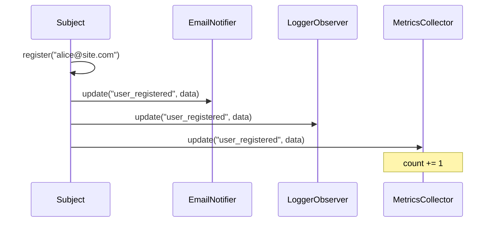

# Mejores prácticas de diseño OOP

Esta lección final cubre las mejores prácticas esenciales de diseño OOP que se apoyan en los principios SOLID. Aprenderás cuándo usar (y cuándo no) la herencia, cómo aplicar los patrones de diseño y los principios para un código orientado a objetos limpio y mantenible.

## 1. Preferir la composición sobre la herencia

La herencia crea un acoplamiento excesivo: una clase hija queda atada de forma permanente a su clase madre. La composición te permite intercambiar comportamientos en tiempo de ejecución.

### Herencia (acoplamiento excesivo)

```python
class MailService:
    def send(self, to: str, subject: str, body: str) -> None:
        print(f"Sending mail to {to}: {subject}")

class WelcomeMailService(MailService):  # "Is-a" inheritance
    def send_welcome(self, email: str) -> None:
        self.send(email, "Welcome!", "Thanks for joining!")

# Problem: Can't reuse send logic without inheritance
```

### Composición (flexible)

```python
class SmtpMailer:
    def __init__(self, host: str = "smtp.example.com"):
        self.host = host

    def send(self, to: str, subject: str, body: str) -> None:
        import smtplib
        from email.message import EmailMessage
        msg = EmailMessage()
        msg["Subject"] = subject
        msg["To"] = to
        msg.set_content(body)
        with smtplib.SMTP(self.host) as server:
            server.send_message(msg)

class WelcomeService:
    def __init__(self, mailer: SmtpMailer):  # "Has-a" composition
        self.mailer = mailer

    def send_welcome(self, email: str) -> None:
        self.mailer.send(email, "Welcome!", "Thanks for joining!")

class PasswordResetService:
    def __init__(self, mailer: SmtpMailer):
        self.mailer = mailer

    def send_reset(self, email: str, token: str) -> None:
        self.mailer.send(email, "Password Reset", f"Token: {token}")
```

| Aspecto | Herencia | Composición |
|--------|------------|-------------|
| **Relación** | "Es-un" (un perro es-un animal) | "Tiene-un" (un coche tiene-un motor) |
| **Acoplamiento** | Estrecho (la hija conoce a la madre) | Flojo (depende de una interfaz) |
| **Cambio en tiempo de ejecución** | Imposible | Fácil (intercambiar componentes) |
| **Reutilización de código** | Por extensión | Por delegación |
| **Pruebas** | Más difícil (estado de la clase madre) | Más fácil (componentes mock) |
| **Flexibilidad** | Baja | Alta |

> [!TIP]
> Usa la herencia cuando exista una relación genuina de "es-un" Y la subclase realmente necesite el comportamiento de la clase madre. Usa la composición cuando solo necesites reutilizar funcionalidad.

## 2. DRY (No te repitas)

Cada pieza de conocimiento debe tener una única representación, sin ambigüedad, en el sistema.

### ANTES: duplicación

```python
class OrderProcessor:
    def validate_order(self, order: dict) -> bool:
        if not order.get("customer_email"):
            raise ValueError("Email required")
        if "@" not in order.get("customer_email", ""):
            raise ValueError("Invalid email")
        if order.get("total", 0) <= 0:
            raise ValueError("Total must be positive")
        return True

class CustomerProcessor:
    def validate_customer(self, customer: dict) -> bool:
        if not customer.get("email"):
            raise ValueError("Email required")
        if "@" not in customer.get("email", ""):
            raise ValueError("Invalid email")
        if not customer.get("name"):
            raise ValueError("Name required")
        return True
```

### DESPUÉS: responsabilidad única

```python
import re

class EmailValidator:
    @staticmethod
    def validate(email: str) -> str:
        if not email:
            raise ValueError("Email is required")
        if not re.match(r"[^@]+@[^@]+\.[^@]+", email):
            raise ValueError(f"Invalid email format: {email}")
        return email

class OrderValidator:
    def __init__(self, email_validator: EmailValidator):
        self._email_validator = email_validator

    def validate(self, order: dict) -> bool:
        self._email_validator.validate(order.get("customer_email", ""))
        if order.get("total", 0) <= 0:
            raise ValueError("Total must be positive")
        return True

class CustomerValidator:
    def __init__(self, email_validator: EmailValidator):
        self._email_validator = email_validator

    def validate(self, customer: dict) -> bool:
        self._email_validator.validate(customer.get("email", ""))
        if not customer.get("name"):
            raise ValueError("Name is required")
        return True
```

## 3. KISS (mantenlo simple, estúpido)

El código simple es más fácil de entender, probar y mantener.

### ANTES: con sobreingeniería

```python
from typing import Any
from abc import ABC, abstractmethod

class NameFormatter(ABC):
    @abstractmethod
    def format(self, first: str, last: str) -> str:
        pass

class FullNameFormatter(NameFormatter):
    def format(self, first: str, last: str) -> str:
        return f"{first} {last}"

class LastNameFirstFormatter(NameFormatter):
    def format(self, first: str, last: str) -> str:
        return f"{last}, {first}"

class NameFormatterFactory:
    def __init__(self):
        self._formatters = {
            "full": FullNameFormatter(),
            "last_first": LastNameFirstFormatter(),
        }

    def get_formatter(self, style: str) -> NameFormatter:
        return self._formatters.get(style, FullNameFormatter())

class Person:
    def __init__(self, first: str, last: str, formatter: NameFormatterFactory):
        self.first = first
        self.last = last
        self.formatter = formatter

    def display_name(self, style: str = "full") -> str:
        fmt = self.formatter.get_formatter(style)
        return fmt.format(self.first, self.last)
```

### DESPUÉS: simple

```python
class Person:
    def __init__(self, first: str, last: str):
        self.first = first
        self.last = last

    def full_name(self) -> str:
        return f"{self.first} {self.last}"

    def last_first_name(self) -> str:
        return f"{self.last}, {self.first}"
```

> [!WARNING]
> La sobreingeniería es una trampa común. No añadas abstracciones hasta que realmente las necesites. YAGNI también aplica aquí.

## 4. YAGNI (no lo vas a necesitar)

No añadas funcionalidad hasta que sea necesaria.

```python
# BAD: Adding features "just in case"
class Config:
    def __init__(self):
        self.values = {}
        self.backends = ["file", "database", "redis", "s3"]  # YAGNI!
        self.encryption = ["aes256", "blowfish", "twofish"]  # YAGNI!
        self.cache_strategies = ["lru", "ttl", "fifo"]       # YAGNI!

# GOOD: Add as needed
class Config:
    def __init__(self):
        self.values = {}

    def get(self, key: str, default=None):
        return self.values.get(key, default)

    def set(self, key: str, value):
        self.values[key] = value
```

> [!NOTE]
> YAGNI no significa no planificar con antelación. Significa no pagar el coste de construir, probar y mantener funcionalidades que ahora mismo no necesitas.

## 5. Panorama de patrones de diseño

Los patrones de diseño son soluciones probadas a problemas comunes de OOP. Estos son los más importantes:

### Patrón Strategy (comportamiento)

```python
from abc import ABC, abstractmethod
from typing import Any

class SortStrategy(ABC):
    @abstractmethod
    def sort(self, data: list[int]) -> list[int]:
        pass

class BubbleSort(SortStrategy):
    def sort(self, data: list[int]) -> list[int]:
        arr = data[:]
        n = len(arr)
        for i in range(n):
            for j in range(0, n - i - 1):
                if arr[j] > arr[j + 1]:
                    arr[j], arr[j + 1] = arr[j + 1], arr[j]
        return arr

class QuickSort(SortStrategy):
    def sort(self, data: list[int]) -> list[int]:
        if len(data) <= 1:
            return data
        pivot = data[0]
        left = [x for x in data[1:] if x <= pivot]
        right = [x for x in data[1:] if x > pivot]
        return self.sort(left) + [pivot] + self.sort(right)

class Sorter:
    def __init__(self, strategy: SortStrategy):
        self._strategy = strategy

    def sort(self, data: list[int]) -> list[int]:
        return self._strategy.sort(data)

    def set_strategy(self, strategy: SortStrategy) -> None:
        self._strategy = strategy

sorter = Sorter(BubbleSort())
data = [3, 1, 4, 1, 5, 9, 2, 6]
print(sorter.sort(data))
sorter.set_strategy(QuickSort())
print(sorter.sort(data))
```

### Patrón Observer (comportamiento)

```python
from abc import ABC, abstractmethod
from typing import Any

class Observer(ABC):
    @abstractmethod
    def update(self, event: str, data: Any) -> None:
        pass

class Subject:
    def __init__(self):
        self._observers: list[Observer] = []

    def attach(self, observer: Observer) -> None:
        if observer not in self._observers:
            self._observers.append(observer)

    def detach(self, observer: Observer) -> None:
        self._observers.remove(observer)

    def notify(self, event: str, data: Any = None) -> None:
        for observer in self._observers:
            observer.update(event, data)

class EmailNotifier(Observer):
    def __init__(self, email: str):
        self.email = email

    def update(self, event: str, data: Any) -> None:
        print(f"[Email to {self.email}] Event: {event} - {data}")

class LoggerObserver(Observer):
    def update(self, event: str, data: Any) -> None:
        print(f"[LOG] {event}: {data}")

class MetricsCollector(Observer):
    def __init__(self):
        self.event_counts: dict[str, int] = {}

    def update(self, event: str, data: Any) -> None:
        self.event_counts[event] = self.event_counts.get(event, 0) + 1

    def report(self) -> dict:
        return dict(self.event_counts)

class UserService(Subject):
    def register(self, email: str, name: str) -> None:
        print(f"Registering user: {name} ({email})")
        self.notify("user_registered", {"email": email, "name": name})

    def delete(self, user_id: int) -> None:
        print(f"Deleting user: {user_id}")
        self.notify("user_deleted", {"user_id": user_id})

service = UserService()
service.attach(EmailNotifier("admin@site.com"))
log_obs = LoggerObserver()
service.attach(log_obs)
metrics = MetricsCollector()
service.attach(metrics)
service.register("alice@example.com", "Alice")
service.register("bob@example.com", "Bob")
service.delete(42)
print(f"Metrics: {metrics.report()}")
```



### Patrón Factory (creacional)

```python
from abc import ABC, abstractmethod

class DatabaseConnection(ABC):
    @abstractmethod
    def connect(self) -> str: pass
    @abstractmethod
    def query(self, sql: str) -> list: pass

class MySQLConnection(DatabaseConnection):
    def connect(self) -> str:
        return "Connected to MySQL"
    def query(self, sql: str) -> list:
        return [f"MySQL result: {sql}"]

class PostgreSQLConnection(DatabaseConnection):
    def connect(self) -> str:
        return "Connected to PostgreSQL"
    def query(self, sql: str) -> list:
        return [f"PostgreSQL result: {sql}"]

class DatabaseFactory:
    @staticmethod
    def create(db_type: str, **kwargs) -> DatabaseConnection:
        factories = {
            "mysql": MySQLConnection,
            "postgresql": PostgreSQLConnection,
        }
        cls = factories.get(db_type.lower())
        if not cls:
            raise ValueError(f"Unknown database type: {db_type}")
        return cls(**{k: v for k, v in kwargs.items()
                      if k in cls.__init__.__code__.co_varnames})

db = DatabaseFactory.create("mysql")
print(db.connect())
print(db.query("SELECT 1"))
```

### Patrón Decorator (estructural)

```python
from abc import ABC, abstractmethod

class Coffee(ABC):
    @abstractmethod
    def cost(self) -> float: pass
    @abstractmethod
    def description(self) -> str: pass

class SimpleCoffee(Coffee):
    def cost(self) -> float:
        return 2.0
    def description(self) -> str:
        return "Simple coffee"

class CoffeeDecorator(Coffee):
    def __init__(self, coffee: Coffee):
        self._coffee = coffee

class MilkDecorator(CoffeeDecorator):
    def cost(self) -> float:
        return self._coffee.cost() + 0.5
    def description(self) -> str:
        return f"{self._coffee.description()} + milk"

class SugarDecorator(CoffeeDecorator):
    def cost(self) -> float:
        return self._coffee.cost() + 0.25
    def description(self) -> str:
        return f"{self._coffee.description()} + sugar"

class WhippedCreamDecorator(CoffeeDecorator):
    def cost(self) -> float:
        return self._coffee.cost() + 0.75
    def description(self) -> str:
        return f"{self._coffee.description()} + whipped cream"

coffee = SimpleCoffee()
coffee = MilkDecorator(coffee)
coffee = SugarDecorator(coffee)
coffee = WhippedCreamDecorator(coffee)
print(f"{coffee.description()}: ${coffee.cost():.2f}")
# Simple coffee + milk + sugar + whipped cream: $3.50
```

## 6. Ley de Demeter (principio del menor conocimiento)

Un método solo debe llamar a métodos de:
1. Él mismo
2. Sus parámetros
3. Objetos que él crea
4. Sus propios componentes directos

### ANTES: violación (cadena de puntos)

```python
class Customer:
    def __init__(self):
        self.wallet = Wallet()

class Wallet:
    def __init__(self):
        self.balance = 100

class Store:
    def process_purchase(self, customer: Customer, amount: float) -> bool:
        if customer.wallet.balance >= amount:  # Violation!
            customer.wallet.balance -= amount
            return True
        return False
```

### DESPUÉS: Ley de Demeter

```python
class Customer:
    def __init__(self):
        self._wallet = Wallet()

    def can_afford(self, amount: float) -> bool:
        return self._wallet.has_funds(amount)

    def deduct(self, amount: float) -> None:
        self._wallet.withdraw(amount)

class Wallet:
    def __init__(self):
        self._balance = 100

    def has_funds(self, amount: float) -> bool:
        return self._balance >= amount

    def withdraw(self, amount: float) -> None:
        if not self.has_funds(amount):
            raise ValueError("Insufficient funds")
        self._balance -= amount

class Store:
    def process_purchase(self, customer: Customer, amount: float) -> bool:
        if customer.can_afford(amount):
            customer.deduct(amount)
            return True
        return False
```

## 7. Patrones de inyección de dependencias

### Inyección por constructor (recomendada)

```python
class DatabaseService:
    def __init__(self, host: str, port: int, username: str, password: str):
        self.host = host
        self.port = port
        self.username = username
        self.password = password

class UserService:
    def __init__(self, db: DatabaseService):  # Constructor injection
        self.db = db
```

### Service Locator (úselo con moderación)

```python
class ServiceLocator:
    _services: dict = {}

    @classmethod
    def register(cls, name: str, service) -> None:
        cls._services[name] = service

    @classmethod
    def resolve(cls, name: str):
        service = cls._services.get(name)
        if not service:
            raise KeyError(f"Service not found: {name}")
        return service

ServiceLocator.register("db", DatabaseService("localhost", 5432, "user", "pass"))
ServiceLocator.register("user", UserService(ServiceLocator.resolve("db")))

class OrderController:
    def __init__(self):
        self.user_service = ServiceLocator.resolve("user")  # Service locator
```

> [!WARNING]
> Service Locator puede ocultar dependencias y dificultar las pruebas. Prefiere la inyección por constructor.

## 8. Di, no preguntes

No le pidas a un objeto sus datos para luego tomar decisiones: dile al objeto qué debe hacer.

### ANTES: preguntar

```python
class Order:
    def __init__(self):
        self.items = []
        self.shipped = False

def process_shipping(order: Order) -> None:
    if order.shipped:  # Asking!
        return
    if sum(item.price for item in order.items) > 100:  # Asking!
        order.shipped = True  # Telling
```

### DESPUÉS: indicar

```python
class Order:
    def __init__(self):
        self._items = []
        self._shipped = False

    def add_item(self, name: str, price: float) -> None:
        self._items.append(Item(name, price))

    def ship(self) -> bool:
        if self._shipped:
            return False
        if self._total() < 100:
            return False
        self._shipped = True
        return True

    def _total(self) -> float:
        return sum(item.price for item in self._items)

def process_shipping(order: Order) -> None:
    if order.ship():
        print("Shipped!")
    else:
        print("Cannot ship")
```

## 9. Inmutabilidad

Los objetos inmutables son más seguros, más fáciles de razonar y, por defecto, seguros en entornos con hilos de ejecución.

```python
from dataclasses import dataclass

@dataclass(frozen=True)  # Immutable!
class Point:
    x: float
    y: float

    def distance_to(self, other: "Point") -> float:
        import math
        return math.sqrt((self.x - other.x) ** 2 + (self.y - other.y) ** 2)

    def translated(self, dx: float, dy: float) -> "Point":
        """Returns a new Point — does not modify self."""
        return Point(self.x + dx, self.y + dy)

p1 = Point(3.0, 4.0)
p2 = p1.translated(1.0, 2.0)
print(p1)  # Point(x=3.0, y=4.0) — unchanged
print(p2)  # Point(x=4.0, y=6.0) — new instance
```

```python
# BEFORE: Mutable mess
class Color:
    def __init__(self, r: int, g: int, b: int):
        self.r = r
        self.g = g
        self.b = b
    def darken(self) -> None:
        self.r = max(0, self.r - 30)
        self.g = max(0, self.g - 30)
        self.b = max(0, self.b - 30)

c = Color(100, 100, 100)
c.darken()  # Modifies in place — side effects!
print(c.r)  # 70

# AFTER: Immutable
@dataclass(frozen=True)
class ImmutableColor:
    r: int
    g: int
    b: int

    def darkened(self) -> "ImmutableColor":
        return ImmutableColor(
            max(0, self.r - 30),
            max(0, self.g - 30),
            max(0, self.b - 30),
        )

ic = ImmutableColor(100, 100, 100)
ic2 = ic.darkened()
print(ic.r)   # 100 — unchanged
print(ic2.r)  # 70 — new instance
```

## 10. Guía de code smells y refactorización

| Code smell | Problema | Solución SOLID |
|-------|---------|-----------|
| **Clase larga** | Varias responsabilidades | SRP: extraer clases |
| **Método largo** | Demasiadas cosas a la vez | SRP: extraer métodos |
| **Cadena switch/elif** | Añadir algo obliga a modificar | OCP: patrón Strategy |
| **Comprobaciones isinstance** | Violación del LSP | Polimorfismo |
| **Cuerpos de método vacíos** | Violación del ISP | Dividir la interfaz |
| **`new` fijado en el código** | Violación del DIP | Inyección por constructor |
| **Envidia de características** | Un método usa los datos de otra clase | Mover el método |
| **Cirugía de escopeta** | Un cambio obliga a muchas ediciones | SRP: consolidar |
| **Clase de datos** | Solo campos, sin comportamiento | Añadir métodos |
| **Regalo rechazado** | La subclase no usa los métodos de la clase madre | Composición en su lugar |

## Ejercicios prácticos

1. Refactoriza este código usando el patrón Strategy:
   ```python
   class TaxCalculator:
       def calculate(self, amount, country):
           if country == "US":
               return amount * 0.07
           elif country == "UK":
               return amount * 0.20
           elif country == "BR":
               return amount * 0.60
   ```

2. Aplica DRY a este código:
   ```python
   def validate_user(name, email, age):
       if not name: raise ValueError("Name required")
       if len(name) < 2: raise ValueError("Name too short")
       if "@" not in email: raise ValueError("Invalid email")
       if age < 18: raise ValueError("Must be 18+")
       return True
   def validate_order(product, quantity, price):
       if not product: raise ValueError("Product required")
       if quantity < 1: raise ValueError("Invalid quantity")
       if "@" not in email: raise ValueError("Invalid email")  # Bug: email undefined
       if price < 0: raise ValueError("Invalid price")
       return True
   ```

3. Identifica qué patrón de diseño sería apropiado para cada escenario:
   - Un editor de documentos donde puedes aplicar negrita, cursiva y subrayado en cualquier combinación
   - Un sistema de notificaciones que debe enviar alertas por correo, SMS y push cuando ocurre un evento
   - Una conexión a una base de datos donde no conoces el tipo de base de datos hasta el momento de ejecución

4. Explica la Ley de Demeter y por qué la cadena de puntos (por ejemplo, `obj.getX().getY().doZ()`) se considera un code smell.

5. Reescribe el siguiente código para seguir el principio Di, no preguntes:
   ```python
   def process_invoice(invoice):
       if invoice.status == "paid":
           return
       if invoice.balance <= 0:
           return
       invoice.status = "paid"
       invoice._balance = 0
   ```

6. Convierte la siguiente clase mutable en una inmutable:
   ```python
   class ShoppingCart:
       def __init__(self):
           self.items = []
       def add_item(self, name, price):
           self.items.append({"name": name, "price": price})
       def remove_item(self, index):
           del self.items[index]
       def total(self):
           return sum(i["price"] for i in self.items)
   ```

7. ¿Cuál es la diferencia entre inyección por constructor y service locator? ¿Cuándo usarías cada una?

8. Crea una arquitectura limpia para un sistema de blog sencillo con `PostService`, `PostRepository` (interfaz), `SQLitePostRepository` y `PostController`. Dibuja la dirección de la dependencia según el DIP.

## Resumen

- **Composición sobre herencia**: prefiere "tiene-un" sobre "es-un"
- **DRY**: no repitas la lógica: extrae y reutiliza
- **KISS**: un código más simple es un mejor código
- **YAGNI**: no construyas lo que no necesitas
- **Patrones de diseño**: Strategy, Observer, Factory y Decorator resuelven problemas comunes
- **Ley de Demeter**: habla con tus amigos, no con desconocidos
- **Di, no preguntes**: dile a los objetos qué hacer, no los interroges
- **Inmutabilidad**: los objetos congelados son más seguros y más fáciles de razonar
- **Inyección por constructor**: la forma preferida de conectar las dependencias

> [!SUCCESS]
> Has completado el curso de Principios SOLID y OOP. Estos principios y buenas prácticas te acompañarán durante toda tu carrera. Recuerda: un buen diseño OOP no se trata de seguir reglas, se trata de crear código fácil de entender, probar y cambiar.
