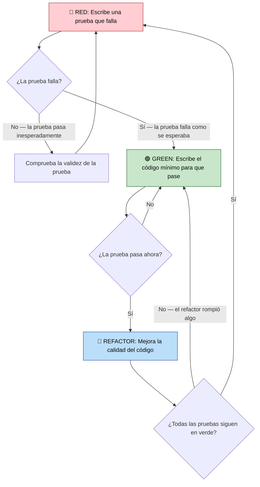
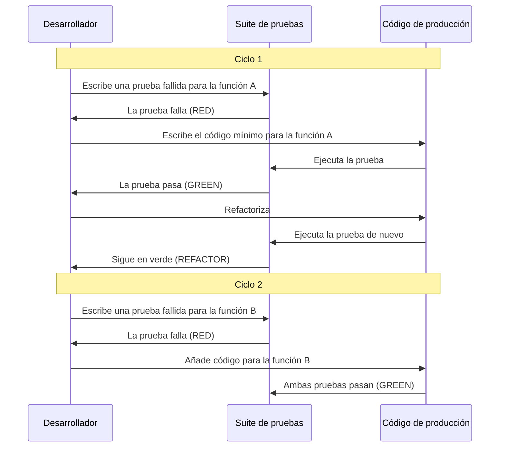
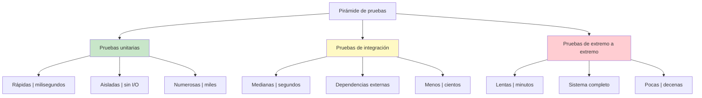

# Introducción al TDD

El Desarrollo Dirigido por Testes (Test-Driven Development, TDD) es un enfoque de desarrollo de software en el que escribes las pruebas **antes** de escribir el código de producción. Este flujo de trabajo invertido — primero las pruebas, después el código — cambia fundamentalmente cómo diseñas, implementas y verificas el software.

## El mantra del TDD: Red-Green-Refactor

El TDD sigue un ciclo cerrado y rápido con tres fases:

| Fase | Acción | Qué ocurre |
|------|--------|-------------|
| 🔴 **Red** | Escribe una prueba que falla | Primero piensa en el comportamiento deseado. La prueba falla porque todavía no existe código. |
| 🟢 **Green** | Escribe el código más simple para que pase | Haz que la prueba pase lo antes posible. Sin sobreingeniería. |
| 🔵 **Refactor** | Mejora el código | Elimina duplicación, renombra variables, extrae métodos. Las pruebas te protegen. |



> [!NOTE]
> Cada ciclo TDD debería durar **de 30 segundos a 5 minutos**. Si pasas horas en un solo ciclo, tus pruebas son demasiado grandes. Divide el problema en pasos más pequeños.

## ¿Por qué TDD? El iceberg de beneficios

El beneficio visible del TDD es **menos bugs**, pero los beneficios más profundos y valiosos están bajo la superficie:

| Capa | Beneficio | Por qué importa |
|-------|---------|---------------|
| **Superficie** | Menos defectos | Las pruebas detectan regresiones de inmediato |
| **Diseño** | Mejor arquitectura | La testabilidad obliga a un acoplamiento flojo |
| **Confianza** | Refactor sin miedo | Puedes reestructurar el código sin preocuparte |
| **Documentación** | Especificación viva | Las pruebas describen cómo se comporta el sistema |
| **Velocidad** | Ritmo sostenible | Menos depuración significa más trabajo en funcionalidades |

```python
# Traditional approach: code first, maybe test later
def divide(a, b):
    return a / b  # Bug: no zero-division check

# TDD approach: test first, code second
def test_divide_by_zero():
    """Test that division by zero raises an error."""
    import pytest
    with pytest.raises(ZeroDivisionError):
        divide(10, 0)

def divide(a, b):
    if b == 0:
        raise ZeroDivisionError("Cannot divide by zero")
    return a / b
```

> [!SUCCESS]
> El TDD no consiste en testar — consiste en el **diseño**. Escribir primero la prueba te obliga a pensar en la interfaz antes que en la implementación.

## Las tres leyes del TDD

Robert C. Martin (Uncle Bob) formalizó el TDD con tres leyes:

1. **Ley 1**: No puedes escribir código de producción hasta haber escrito una **prueba unitaria que falle**.
2. **Ley 2**: No puedes escribir más de una prueba unitaria de lo necesario para que falle — y **no compilar cuenta como fallar**.
3. **Ley 3**: No puedes escribir más código de producción de lo necesario para que pase la **prueba que está fallando en este momento**.



## Ejemplo práctico: TDD en acción

Construyamos una clase `ShoppingCart` usando TDD, paso a paso.

### Ciclo 1: Crear un carrito vacío

```python
# test_shopping_cart.py
from shopping_cart import ShoppingCart

def test_empty_cart():
    """A new cart should be empty."""
    cart = ShoppingCart()
    assert cart.total_items() == 0
```

Ejecuta: **Red** — `ShoppingCart` todavía no existe.

```python
# shopping_cart.py
class ShoppingCart:
    def total_items(self) -> int:
        return 0
```

Ejecuta: **Green** — la prueba pasa.

### Ciclo 2: Añadir artículos al carrito

```python
def test_add_item():
    """Adding an item increases the item count."""
    cart = ShoppingCart()
    cart.add_item("apple", 1.50)
    assert cart.total_items() == 1

def test_add_multiple_items():
    """Adding multiple items increases count accordingly."""
    cart = ShoppingCart()
    cart.add_item("apple", 1.50)
    cart.add_item("banana", 0.75)
    assert cart.total_items() == 2
```

Ejecuta: **Red** — `add_item` no existe.

```python
class ShoppingCart:
    def __init__(self):
        self._items = []

    def add_item(self, name: str, price: float) -> None:
        self._items.append({"name": name, "price": price})

    def total_items(self) -> int:
        return len(self._items)
```

Ejecuta: **Green** — todas las pruebas pasan.

### Ciclo 3: Calcular el precio total

```python
def test_total_price():
    """Total price should sum all item prices."""
    cart = ShoppingCart()
    cart.add_item("apple", 1.50)
    cart.add_item("banana", 0.75)
    assert cart.total_price() == pytest.approx(2.25)

def test_empty_cart_total():
    """Empty cart should have total of 0."""
    cart = ShoppingCart()
    assert cart.total_price() == 0.0
```

Ejecuta: **Red** — `total_price` no existe.

```python
class ShoppingCart:
    def __init__(self):
        self._items = []

    def add_item(self, name: str, price: float) -> None:
        self._items.append({"name": name, "price": price})

    def total_items(self) -> int:
        return len(self._items)

    def total_price(self) -> float:
        return sum(item["price"] for item in self._items)
```

Ejecuta: **Green** — todo pasa.

### Refactor: Mejorar el diseño

Ahora refactorizamos con confianza porque las pruebas nos protegen:

```python
from dataclasses import dataclass

@dataclass
class Item:
    name: str
    price: float

class ShoppingCart:
    def __init__(self):
        self._items: list[Item] = []

    def add_item(self, name: str, price: float) -> None:
        self._items.append(Item(name, price))

    def total_items(self) -> int:
        return len(self._items)

    def total_price(self) -> float:
        return sum(item.price for item in _items)
```

> [!TIP]
> Usa `pytest.approx()` para las comparaciones con coma flotante. Nunca uses `==` con números de coma flotante debido a los problemas de precisión.

## La mentalidad TDD: disciplina por encima de la inspiración

El TDD exige un cambio en cómo piensas sobre la programación:

| Mentalidad tradicional | Mentalidad TDD |
|---------------------|-------------|
| Escribir código y luego probar | Escribir la prueba y luego el código |
| La prueba es una fase aparte | La prueba forma parte del desarrollo |
| Diseño grande por adelantado | Diseño emergente a través de las pruebas |
| Miedo a refactorizar | Confianza para refactorizar libremente |
| Las pruebas demuestran que el código funciona | Las pruebas definen lo que el código debe hacer |
| "Escribiré pruebas más tarde" | "Escribiré la prueba ahora mismo" |

### Objeciones habituales y sus respuestas

| Objeción | Respuesta |
|-----------|----------|
| "Me hace perder velocidad" | Al principio sí. Después de 2-3 semanas avanzas más rápido porque depuras menos. |
| "No sé qué probar" | Prueba el comportamiento, no la implementación. Pregúntate: ¿qué debería hacer esta función? |
| "Mi código no es comprobable" | Ese es un síntoma de mal diseño. El TDD te lleva de forma natural hacia diseños comprobables. |
| "Escribir pruebas lleva demasiado tiempo" | Una buena prueba de TDD lleva de 30 a 60 segundos. Si lleva más, estás probando en el nivel equivocado. |
| "Mi jefe no me lo va a permitir" | No lo anuncies. Simplemente hazlo. Ellos notarán que hay menos bugs. |

## Tipos de pruebas en el ecosistema TDD



| Tipo de prueba | Velocidad | Alcance | Papel en el TDD |
|-----------|-------|-------|----------|
| **Unitaria** | Milisegundos | Una función o clase | Objetivo principal del TDD |
| **Integración** | Segundos | Fronteras de módulos | Verificar interacciones |
| **Extremo a extremo** | Minutos | Sistema completo | Validar flujos de trabajo |

> [!WARNING]
> No confundas el TDD con "escribir muchas pruebas". El TDD consiste en **escribir la prueba adecuada en el momento adecuado**. Un solo ciclo de TDD bien escrito vale por una docena de pruebas escritas a posteriori.

## El ritmo Red-Green-Refactor en la práctica

Sigamos una sesión completa de construcción de un `TemperatureConverter`:

```python
# --- 🔴 RED: Write failing test ---
def test_celsius_to_fahrenheit():
    converter = TemperatureConverter()
    result = converter.celsius_to_fahrenheit(100)
    assert result == 212.0

# Test fails: TemperatureConverter not defined

# --- 🟢 GREEN: Write minimal code ---
class TemperatureConverter:
    def celsius_to_fahrenheit(self, celsius):
        return celsius * 9 / 5 + 32

# Test passes

# --- 🔵 REFACTOR: Improve ---
# No refactoring needed yet. Move to next test.

# --- 🔴 RED: Write next test ---
def test_fahrenheit_to_celsius():
    converter = TemperatureConverter()
    result = converter.fahrenheit_to_celsius(212)
    assert result == 100.0

# Test fails: fahrenheit_to_celsius not defined

# --- 🟢 GREEN ---
class TemperatureConverter:
    def celsius_to_fahrenheit(self, celsius):
        return celsius * 9 / 5 + 32

    def fahrenheit_to_celsius(self, fahrenheit):
        return (fahrenheit - 32) * 5 / 9

# Both tests pass

# --- 🔴 RED: Test edge case ---
def test_absolute_zero():
    converter = TemperatureConverter()
    result = converter.celsius_to_fahrenheit(-273.15)
    assert result == -459.67

# --- 🟢 GREEN ---
# Already passes! Existing code handles negative values.

# --- 🔵 REFACTOR: Extract constant ---
ABSOLUTE_ZERO_C = -273.15
FREEZING_C = 0.0
BOILING_C = 100.0

class TemperatureConverter:
    def celsius_to_fahrenheit(self, celsius):
        return celsius * 9 / 5 + 32

    def fahrenheit_to_celsius(self, fahrenheit):
        return (fahrenheit - 32) * 5 / 9

    def is_above_absolute_zero(self, celsius):
        return celsius >= ABSOLUTE_ZERO_C
```

> [!SUCCESS]
> Cada ciclo TDD produjo un incremento claro y comprobable. Después de 3 ciclos tenemos un conversor robusto con 3 pruebas que pasan y código limpio.

## Convenciones para nombrar las pruebas

Los buenos nombres de prueba comunican la intención. Sigue estos patrones:

| Convención | Ejemplo |
|-----------|---------|
| `test_[feature]` | `test_add_item()` |
| `test_[scenario]_[expected]` | `test_empty_cart_returns_zero()` |
| `test_[method]_[condition]_[result]` | `test_divide_by_zero_raises_error()` |
| `test_given_[context]_when_[action]_then_[result]` | `test_given_negative_balance_when_withdraw_then_error()` |

```python
# Good test names — they tell a story
def test_authenticated_user_can_view_profile():
    pass

def test_unauthenticated_user_is_redirected_to_login():
    pass

def test_admin_user_sees_delete_button():
    pass

def test_normal_user_does_not_see_delete_button():
    pass
```

## Ejercicios de práctica

1. **TDD para invertir cadenas**: Escribe primero las pruebas de una función `reverse_string(s)`. Empieza con la cadena vacía, luego un solo carácter, luego varios caracteres y luego un palíndromo.

2. **TDD para verificar números primos**: Usa TDD para construir `is_prime(n)`. Empieza por el caso más simple (`n=2`) y después por los casos límite (`n=1`, `n=0`, números negativos).

3. **TDD para una implementación de FizzBuzz**: Aplica TDD al clásico FizzBuzz. Escribe pruebas para múltiplos de 3, múltiplos de 5, múltiplos de ambos y no múltiplos.

4. **Carrito de compras con descuento usando TDD**: Extiende la clase `ShoppingCart`. Escribe pruebas para un descuento del 10 % cuando el total supere los $100 y luego implementa para que pasen.

5. **Identifica el olor de prueba**: A partir de esta prueba, identifica qué está mal y corrígela:
   ```python
   def test_add():
       result = add(2, 3)
       result = add(5, 7)
       assert result == 12
   ```

6. **Refactor sin pruebas**: Esta función funciona pero está mal estructurada. Escribe primero las pruebas y luego refactoriza:
   ```python
   def process_data(items):
       r = []
       for i in items:
           if i > 0:
               r.append(i * 2)
           else:
               r.append(i * -1)
       return r
   ```

7. **TDD para una calculadora simple**: Usando TDD, construye una clase `Calculator` con los métodos `add`, `subtract`, `multiply` y `divide`. Prueba casos normales y casos límite (división por cero, números negativos).

8. **Reflexión sobre la mentalidad**: Describe cómo cambia tu forma de programar cuando escribes primero las pruebas. ¿Qué se siente diferente? ¿Qué es más difícil? ¿Qué es más fácil?

## Resumen

- **TDD = Red → Green → Refactor**: Un ciclo rápido y disciplinado
- **Primero las pruebas, después el código**: La prueba define lo que significa "terminado"
- **Tres leyes**: Escribe solo la prueba necesaria para que falle y solo el código necesario para que pase
- **Beneficios**: Mejor diseño, menos bugs, refactor sin miedo, documentación viva
- **Cambio de mentalidad**: Testear es diseñar, no verificar
- **Pirámide de pruebas**: Las pruebas unitarias son rápidas y numerosas; las pruebas E2E son lentas y pocas

> [!SUCCESS]
> El TDD es un superpoder. Transforma la programación de "¿esto funcionará?" a "sé que esto funciona". La disciplina de escribir primero las pruebas genera dividendos exponenciales a medida que crece tu proyecto.
