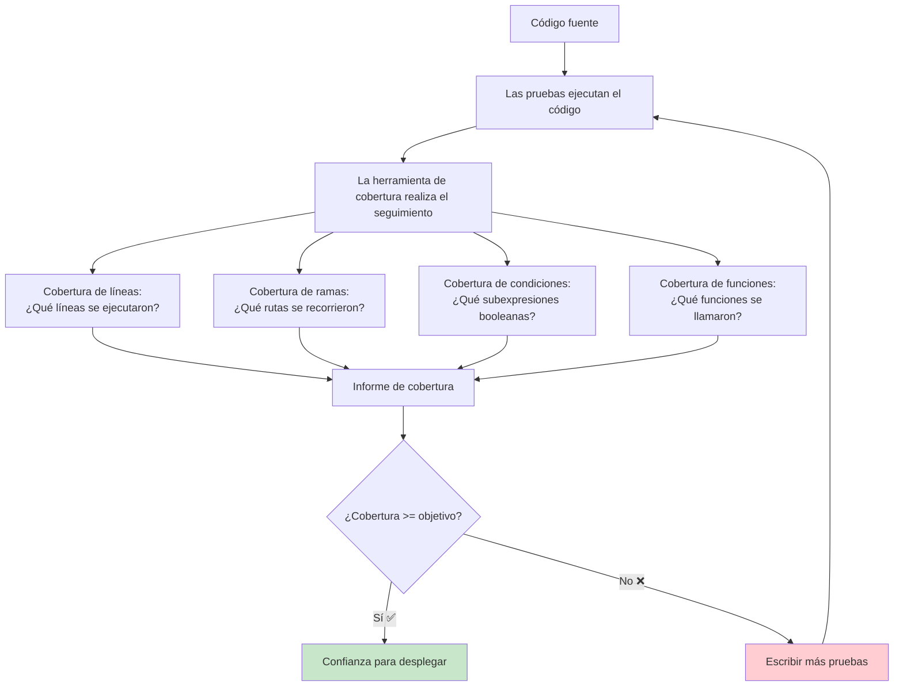
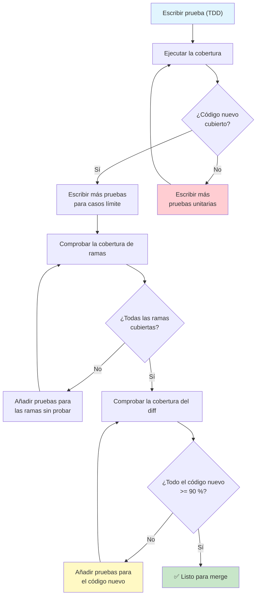

# Cobertura y calidad de las pruebas

La cobertura te dice qué código ejecutan tus pruebas. Es un **indicador negativo** útil, una cobertura baja significa que definitivamente no estás probando lo suficiente, pero una cobertura alta no garantiza buenas pruebas. Esta lección cubre cómo medir, interpretar y actuar sobre los datos de cobertura.

## ¿Qué es la cobertura de código?

La cobertura de código mide el porcentaje de tu base de código que se ejecuta durante las pruebas.



## Tipos de métricas de cobertura

| Métrica | Qué mide | Ejemplo |
|--------|-----------------|---------|
| **Cobertura de líneas** | Qué porcentaje de líneas se ejecutó | El 80 % de las líneas se ejecutó durante las pruebas |
| **Cobertura de ramas** | Qué porcentaje de ramas if/else se recorrió | 3 de 4 ramas cubiertas (75 %) |
| **Cobertura de condiciones** | Subexpresiones booleanas evaluadas | `A or B`: se probó A=True, A=False |
| **Cobertura de funciones** | Funciones que se llamaron | 45 de 50 funciones invocadas |
| **Cobertura de sentencias** | Sentencias individuales ejecutadas | 120 de 150 sentencias se ejecutaron |
| **Cobertura de rutas** | Todas las rutas posibles a través del código | 8 de 16 rutas posibles probadas |

```python
# Example showing different coverage types
def process_order(order: dict) -> str:
    """An order processing function to analyze coverage."""
    # Line 1 (always runs when called)
    if not order:                          # Branch 1: True / False
        return "empty_order"               # Line 2 (branch True)

    if order.get("amount", 0) > 100:       # Branch 2: True / False
        discount = order["amount"] * 0.1   # Line 4 (branch True)
        order["amount"] -= discount        # Line 5

    if order.get("loyalty_member"):        # Branch 3: True / False
        points = order["amount"] * 10      # Line 7 (branch True)
        order["loyalty_points"] = points   # Line 8

    if order.get("express_shipping"):      # Branch 4: True / False
        return "express"                   # Line 10 (branch True)

    return "standard"                      # Line 12
```

## Configurar la cobertura con pytest-cov

```bash
# Install coverage tools
pip install pytest-cov coverage

# Run tests with coverage
pytest --cov=src tests/

# Run with coverage report in terminal
pytest --cov=src --cov-report=term-missing tests/

# Generate HTML report (open htmlcov/index.html)
pytest --cov=src --cov-report=html tests/

# Generate XML report (for CI integration)
pytest --cov=src --cov-report=xml tests/

# Combine multiple coverage reports
pytest --cov=src --cov-report=term --cov-report=html:coverage_report tests/
```

### Configuración en pyproject.toml

```toml
[tool.coverage.run]
source = ["src"]
omit = ["*/tests/*", "*/migrations/*", "*/__init__.py"]
branch = true
parallel = true

[tool.coverage.report]
exclude_lines = [
    "pragma: no cover",
    "def __repr__",
    "if __name__ == .__main__.:",
    "raise NotImplementedError",
    "if False:",
    "def __str__",
]
fail_under = 80
show_missing = true
precision = 2

[tool.coverage.html]
directory = "coverage_html"
title = "My Project Coverage Report"
```

## Leer los informes de cobertura

```python
# src/calculator.py
def add(a, b):
    return a + b

def subtract(a, b):
    return a - b

def multiply(a, b):
    return a * b

def divide(a, b):
    if b == 0:
        raise ValueError("Cannot divide by zero")
    return a / b

def power(a, b):
    return a ** b

def modulus(a, b):
    if b == 0:
        raise ValueError("Cannot mod by zero")
    return a % b
```

```python
# tests/test_calculator.py
from src.calculator import add, subtract, multiply, divide

def test_add():
    assert add(2, 3) == 5

def test_subtract():
    assert subtract(5, 3) == 2

def test_multiply():
    assert multiply(4, 3) == 12

# Missing tests: divide, power, modulus!
```

```bash
# Run coverage
pytest --cov=src --cov-report=term-missing tests/

# Output:
# Name                 Stmts   Miss  Cover   Missing
# --------------------------------------------------
# src/calculator.py       15      6    60%   12-20
# --------------------------------------------------
# TOTAL                  15      6    60%
#
# Lines 12-20 are: divide exception, power(), modulus()
```

> [!WARNING]
> Un 60 % de cobertura con todas las pruebas en verde da una falsa sensación de seguridad. Las funciones no probadas podrían estar completamente rotas. La cobertura te dice lo que NO probaste.

## Cobertura de ramas: la pieza que falta

La cobertura de líneas puede ser engañosa. La cobertura de ramas revela las rutas sin probar:

```python
def validate_age(age: int) -> str:
    if age < 0:          # Branch 1
        return "invalid"
    elif age < 18:       # Branch 2
        return "minor"
    elif age < 65:       # Branch 3
        return "adult"
    else:                # Branch 4
        return "senior"
```

```python
# Test with 100% line coverage but only 50% branch coverage
def test_validate_age():
    assert validate_age(25) == "adult"
    # Lines covered: all 8 lines
    # Branches covered: only "adult" path (branch 3)
    # Missed: age < 0, age < 18, age >= 65
```

```bash
# Enable branch coverage
pytest --cov=src --cov-branch --cov-report=term-missing tests/

# Output:
# Name                 Stmts   Miss  Branch BrPart  Cover   Missing
# ----------------------------------------------------------------
# src/validator.py        8      0      4      3    75%   4,6,10
# ----------------------------------------------------------------
```

> [!TIP]
> Activa siempre la cobertura de ramas con `--cov-branch`. Solo la cobertura de líneas puede dar una falsa sensación de seguridad peligrosa.

## Objetivos de cobertura con significado

| Nivel de cobertura | Qué significa | Cuándo es suficiente |
|---------------|---------------|------------------|
| **< 40 %** | Lagunas críticas | Proyecto nuevo sin pruebas |
| **40-60 %** | Rutas principales probadas | Código heredado con cobertura parcial |
| **60-80 %** | La mayoría de las rutas cubiertas | Desarrollo activo, lanzamientos regulares |
| **80-90 %** | Bien probado | Servicios en producción, bibliotecas |
| **90-100 %** | Exhaustivamente probado | Sistemas críticos, financieros, médicos |

```python
# High coverage doesn't mean good tests
def is_valid_user(user: dict) -> bool:
    return (
        "name" in user
        and "email" in user
        and "@" in user.get("email", "")
        and len(user.get("name", "")) > 2
        and user.get("age", 0) >= 18
    )
```

```python
# "Tests" that achieve 100% coverage but test nothing useful
def test_is_valid_user():
    user = {"name": "Alice", "email": "a@b.com", "age": 25}
    result = is_valid_user(user)
    assert result is True
    # 100% line coverage! But:
    # - Not testing missing name
    # - Not testing invalid email
    # - Not testing underage
    # - Not testing short name
    # - Not testing empty dict
```

```python
# Meaningful coverage tests
def test_is_valid_user_happy_path():
    assert is_valid_user({"name": "Alice", "email": "a@b.com", "age": 25}) is True

def test_is_valid_user_missing_name():
    assert is_valid_user({"email": "a@b.com", "age": 25}) is False

def test_is_valid_user_invalid_email():
    assert is_valid_user({"name": "Alice", "email": "invalid", "age": 25}) is False

def test_is_valid_user_underage():
    assert is_valid_user({"name": "Alice", "email": "a@b.com", "age": 16}) is False

def test_is_valid_user_empty():
    assert is_valid_user({}) is False

def test_is_valid_user_short_name():
    assert is_valid_user({"name": "A", "email": "a@b.com", "age": 25}) is False
```

## Archivos de configuración de la cobertura

### .coveragerc

```ini
[run]
source = src
omit =
    */tests/*
    */migrations/*
    */.eggs/*
    **/__init__.py
    **/settings.py
    manage.py
branch = True
parallel = True

[report]
exclude_lines =
    pragma: no cover
    def __repr__
    def __str__
    if __name__ == "__main__":
    raise NotImplementedError
    raise AssertionError
    pass
ignore_errors = True
precision = 2
show_missing = True
fail_under = 85
skip_covered = True
skip_empty = True

[html]
directory = coverage_html
title = Coverage Report
extra_css = custom.css

[xml]
output = coverage.xml
package_depth = 3
```

### Cobertura en CI/CD

```yaml
# .github/workflows/tests.yml (partial)
name: Tests with Coverage

on: [push, pull_request]

jobs:
  test:
    runs-on: ubuntu-latest
    steps:
      - uses: actions/checkout@v4
      - uses: actions/setup-python@v5
        with:
          python-version: '3.12'

      - name: Install dependencies
        run: |
          pip install -r requirements.txt
          pip install pytest pytest-cov

      - name: Run tests with coverage
        run: |
          pytest --cov=src --cov-report=xml --cov-report=term-missing tests/

      - name: Upload coverage report
        uses: codecov/codecov-action@v4
        with:
          file: ./coverage.xml
          flags: unittests
          fail_ci_if_error: true
```

## Antipatrones de la cobertura

### 1. Perseguir el 100 % de cobertura

```python
# DON'T: Write tests just to hit coverage targets
def test_useless_getter():
    obj = MyClass()
    assert obj.get_name() is None  # Testing a getter that returns None

# DO: Test meaningful behavior
def test_get_name_after_setting():
    obj = MyClass()
    obj.set_name("Alice")
    assert obj.get_name() == "Alice"

def test_get_name_default():
    obj = MyClass()
    assert obj.get_name() == ""  # Meaningful default
```

### 2. Ignorar el código complejo

```python
# DON'T: Write tests for simple code, skip complex code
def test_simple_add():
    assert add(1, 2) == 3

# But no test for this complex logic:
def calculate_tax(income: float, deductions: list, filing_status: str) -> float:
    # Complex tax calculation with many branches
    pass  # Untested!
```

### 3. Cobertura de integración en lugar de cobertura unitaria

```python
# DON'T: Cover code through integration tests only
def test_full_api():
    response = client.post("/api/users", json={"name": "Alice"})
    assert response.status_code == 201
    # This covers models, serializers, views, middleware, DB...
    # But you don't know WHICH part is tested

# DO: Also write unit tests for each layer
def test_user_creation_service():
    service = UserService(mock_repo)
    user = service.create_user({"name": "Alice"})
    assert user.name == "Alice"
```

## Flujo de desarrollo guiado por la cobertura



## Usar las exclusiones de cobertura con criterio

```python
# Legitimate exclusions from coverage

# 1. Debug-only code
if DEBUG:  # pragma: no cover
    logger.debug(f"Processing order {order_id}: {order_data}")

# 2. Platform-specific code
if sys.platform == "win32":  # pragma: no cover
    WINDOWS_HANDLER = ...
else:
    UNIX_HANDLER = ...

# 3. Dead code (intentionally kept)
# pragma: no cover
def deprecated_function():
    """Kept for backwards compatibility."""
    pass

# 4. __repr__ / __str__ (often tested indirectly)
def __repr__(self):  # pragma: no cover
    return f"User({self.name!r})"
```

> [!NOTE]
> Usa `# pragma: no cover` con moderación. Cada exclusión debería llevar un comentario que explique POR QUÉ. El abuso de exclusiones vuelve inútil tu informe de cobertura.

## Integración de herramientas

```bash
# Using coverage.py directly (without pytest)
coverage run -m pytest tests/
coverage report -m
coverage html
coverage xml

# Run coverage with specific configuration
coverage run --rcfile=.coveragerc -m pytest tests/

# Combine parallel runs
coverage combine
coverage report

# View annotated source
coverage annotate -d coverage_annotated/

# Erase previous coverage data
coverage erase
```

### Cobertura del diff

La cobertura del diff mide la cobertura solo de las líneas modificadas en un pull request:

```bash
# Install diff-cover
pip install diff-cover

# Generate diff coverage report
diff-cover coverage.xml --compare-branch=main

# HTML output
diff-cover coverage.xml --compare-branch=main --html-report=diff_report.html

# Fail CI if diff coverage < 90%
diff-cover coverage.xml --compare-branch=main --fail-under=90
```

```bash
# Example diff-coverage output:
# ----------
# Diff Coverage
# Diff: origin/main...HEAD, created and modified lines: 45
# ----------
# src/calculator.py (90.0%): Missing line 42
# src/validator.py (100.0%)
# src/reports.py (66.7%): Missing lines 15, 23
# ----------
# Total:    Coverage: 85.7% (42 of 45 lines)
# FAILURE: Diff coverage (85.7%) is below threshold (90%)
```

## Ejercicios de práctica

1. **Instala y configura**: Instala pytest-cov y configura la cobertura para que haga seguimiento del directorio `src/` con la cobertura de ramas activada. Genera un informe HTML.

2. **La brecha entre líneas y ramas**: Escribe una función con if-else anidados (al menos 4 ramas). Escribe una prueba que alcance el 100 % de cobertura de líneas pero solo el 50 % de cobertura de ramas. Ejecuta `--cov-branch` para verificarlo.

3. **TDD guiado por la cobertura**: Elige una función con al menos 6 ramas. Desarróllala con TDD manteniendo la cobertura al 100 % tanto en líneas como en ramas. Muestra tu informe de cobertura.

4. **Mejora la cobertura**: Con el siguiente código, escribe pruebas para alcanzar el 100 % de cobertura de ramas:
   ```python
   def classify_number(n: int) -> str:
       if n <= 0:
           if n == 0:
               return "zero"
           return "negative"
       if n % 2 == 0:
           return "even" if n < 100 else "large even"
       return "odd" if n < 100 else "large odd"
   ```

5. **Define umbrales de cobertura**: Crea un `.coveragerc` que falle si la cobertura cae por debajo del 80 %. Crea una suite de pruebas que pase al principio y después añade código sin probar para provocar el fallo.

6. **Configura la cobertura del diff**: Crea un escenario en el que dos ramas tengan coberturas distintas. Ejecuta `diff-cover` para mostrar solo la cobertura de las líneas modificadas.

7. **Caza de antipatrones de cobertura**: Busca ejemplos, en una base de código real o de ejemplo, de antipatrones de cobertura: perseguir el 100 % con pruebas triviales, ignorar código complejo o abusar de `# pragma: no cover`.

8. **Configura la cobertura en CI**: Escribe un workflow de GitHub Actions que ejecute las pruebas con cobertura, las suba a Codecov y falle si la cobertura cae por debajo del 85 % o la cobertura del diff por debajo del 90 %.

## Resumen

- **La cobertura mide qué código se ejecuta durante las pruebas**, no qué código es correcto
- **La cobertura de líneas** es la métrica básica; **la cobertura de ramas** revela las rutas sin probar
- **100 % de cobertura ≠ 100 % de corrección**: puedes tener cobertura perfecta y seguir teniendo bugs
- **Objetivos de cobertura**: más del 80 % para el código de producción, más del 90 % para las rutas críticas
- **La cobertura del diff** asegura que el código nuevo esté probado, no solo los números totales
- **Las exclusiones** deberían ser raras y estar bien documentadas
- **Una cobertura alta es un efecto secundario** de una buena disciplina de pruebas, no el objetivo en sí mismo

> [!SUCCESS]
> La cobertura es una brújula, no un destino. Te señala el código sin probar, pero llegar al 100 % no significa que hayas terminado. Las pruebas con significado requieren criterio, no solo métricas.
