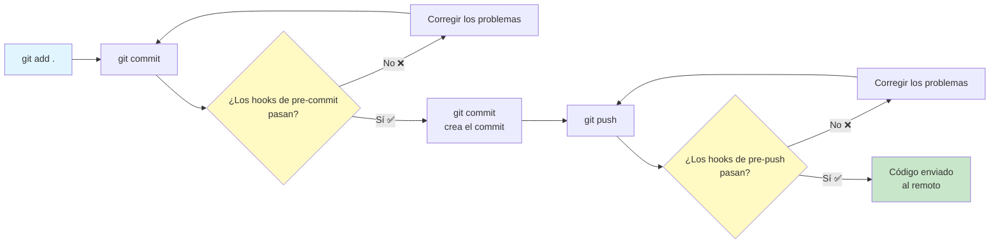
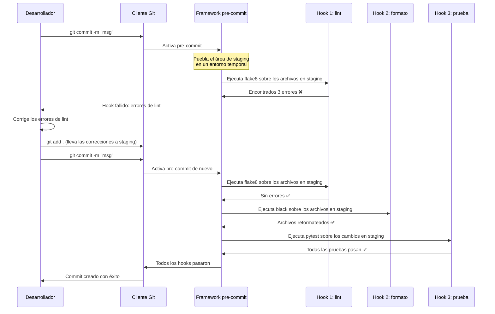

# Hooks de pre-commit

Los hooks de pre-commit son comprobaciones automatizadas que se ejecutan **antes** de que hagas commit del código. Detectan problemas de forma temprana — antes de que lleguen al repositorio —, lo que ahorra tiempo de revisión de código e impide que se mezcle código malo.

## ¿Qué son los hooks de Git?

Los hooks de Git son scripts que Git ejecuta en puntos concretos del flujo de trabajo:



| Tipo de hook | Cuándo se ejecuta | Usos habituales |
|-----------|-------------|-------------|
| `pre-commit` | Antes del editor del mensaje de commit | Lint, formato, pruebas, comprobación de secretos |
| `pre-push` | Antes de enviar al remoto | Ejecutar la suite de pruebas completa, análisis de seguridad |
| `commit-msg` | Después de escribir el mensaje de commit | Validar el formato del mensaje de commit |
| `prepare-commit-msg` | Antes del editor del mensaje de commit | Generar automáticamente mensajes de commit |
| `post-commit` | Después de crear el commit | Notificar a CI, actualizar dashboards |

## Presentación del framework pre-commit

El framework `pre-commit` hace que los hooks sean fáciles de instalar, configurar y compartir:

```bash
# Install the pre-commit framework
pip install pre-commit

# Verify installation
pre-commit --version

# Install hooks into your git repo
pre-commit install

# Run hooks on all files (useful for first setup)
pre-commit run --all-files

# Run a specific hook
pre-commit run flake8 --all-files

# Update hooks to latest versions
pre-commit autoupdate

# Uninstall hooks
pre-commit uninstall
```

### .pre-commit-config.yaml básico

```yaml
# .pre-commit-config.yaml
repos:
  - repo: https://github.com/pre-commit/pre-commit-hooks
    rev: v4.6.0
    hooks:
      - id: trailing-whitespace
      - id: end-of-file-fixer
      - id: check-yaml
      - id: check-added-large-files
        args: ['--maxkb=500']
      - id: check-json
      - id: check-toml
      - id: check-merge-conflict
      - id: detect-private-key
      - id: mixed-line-ending
        args: ['--fix=lf']

  - repo: https://github.com/psf/black
    rev: 24.4.2
    hooks:
      - id: black

  - repo: https://github.com/pycqa/isort
    rev: 5.13.2
    hooks:
      - id: isort
        args: ['--profile', 'black']

  - repo: https://github.com/pycqa/flake8
    rev: 7.1.0
    hooks:
      - id: flake8
        args: ['--max-line-length=88', '--extend-ignore=E203,W503']
```

## Cómo funciona pre-commit



> [!NOTE]
> pre-commit ejecuta los hooks **solo sobre los archivos en staging**. Así el ciclo de retroalimentación se mantiene rápido. Usa `pre-commit run --all-files` para comprobar el repositorio completo.

## Categorías habituales de hooks

### 1. Hooks de formato

```yaml
- repo: https://github.com/psf/black
  rev: 24.4.2
  hooks:
    - id: black
      language_version: python3.12
      args: ['--line-length=100']

- repo: https://github.com/pycqa/isort
  rev: 5.13.2
  hooks:
    - id: isort
      args: ['--profile', 'black']

- repo: https://github.com/pre-commit/mirrors-prettier
  rev: v4.0.0-alpha.8
  hooks:
    - id: prettier
      types_or: [javascript, typescript, css, json, yaml, markdown]
```

### 2. Hooks de linting

```yaml
- repo: https://github.com/astral-sh/ruff-pre-commit
  rev: v0.4.8
  hooks:
    - id: ruff
      args: [--fix, --exit-non-zero-on-fix]

- repo: https://github.com/pycqa/flake8
  rev: 7.1.0
  hooks:
    - id: flake8
      additional_dependencies:
        - flake8-docstrings
        - flake8-bugbear

- repo: https://github.com/pycqa/pylint
  rev: v3.2.2
  hooks:
    - id: pylint
      args: ['--max-line-length=100']
```

### 3. Hooks de seguridad

```yaml
- repo: https://github.com/Yelp/detect-secrets
  rev: v1.5.0
  hooks:
    - id: detect-secrets
      args: ['--baseline', '.secrets.baseline']

- repo: https://github.com/PyCQA/bandit
  rev: 1.7.9
  hooks:
    - id: bandit
      args: ['-x', 'tests/', '-ll']

- repo: https://github.com/pre-commit/pre-commit-hooks
  rev: v4.6.0
  hooks:
    - id: detect-private-key
```

### 4. Hooks de comprobación de tipos

```yaml
- repo: https://github.com/pre-commit/mirrors-mypy
  rev: v1.10.0
  hooks:
    - id: mypy
      args: ['--strict']
      additional_dependencies: [types-requests, types-PyYAML]

- repo: https://github.com/pre-commit/pyright
  rev: v1.1.366
  hooks:
    - id: pyright
```

### 5. Hooks de pruebas

```yaml
- repo: local
  hooks:
    - id: pytest
      name: pytest
      entry: pytest
      language: system
      types: [python]
      pass_filenames: false
      always_run: true
      args: ['-x', '--ff', '--cov=src', 'tests/']

    - id: pytest-cov-threshold
      name: Check coverage threshold
      entry: pytest
      language: system
      pass_filenames: false
      always_run: true
      args: ['--cov=src', '--cov-fail-under=85']
```

> [!WARNING]
> Ejecutar la suite de pruebas completa como hook de pre-commit puede ralentizar mucho los commits. Considera usar `pre-push` para la suite completa y dejar en `pre-commit` solo las pruebas unitarias rápidas.

## Configuración avanzada

### Hooks condicionales con files/exclude

```yaml
repos:
  - repo: https://github.com/psf/black
    rev: 24.4.2
    hooks:
      - id: black
        # Only run on Python files
        types: [python]
        # Exclude generated files
        exclude: |
          (?x)^(
            migrations/|
            .*_pb2\.py|
            build/
          )

  - repo: https://github.com/pre-commit/pre-commit-hooks
    rev: v4.6.0
    hooks:
      - id: check-added-large-files
        # Only check certain directories
        files: ^src/
        args: ['--maxkb=200']

  - repo: https://github.com/astral-sh/ruff-pre-commit
    rev: v0.4.8
    hooks:
      - id: ruff
        # Never run on test files
        exclude: ^tests/
        args: [--fix]
```

### Uso de los argumentos de los hooks

```yaml
repos:
  - repo: https://github.com/pycqa/flake8
    rev: 7.1.0
    hooks:
      - id: flake8
        args:
          - --max-line-length=100
          - --extend-ignore=E203,W503
          - --per-file-ignores=__init__.py:F401
        additional_dependencies:
          - flake8-docstrings==1.7.0
          - flake8-bugbear==24.4.26

  - repo: https://github.com/pycqa/pylint
    rev: v3.2.2
    hooks:
      - id: pylint
        args:
          - --disable=C0111
          - --max-line-length=100
          - --score=n
        files: ^src/

  - repo: https://github.com/psf/black
    rev: 24.4.2
    hooks:
      - id: black
        args: ['--line-length=100', '--target-version=py312']
```

### Hooks locales: ejecutar comandos del sistema

```yaml
repos:
  - repo: local
    hooks:
      - id: pytest
        name: Run unit tests
        entry: pytest
        language: system
        pass_filenames: false
        always_run: true
        args: ['-x', 'tests/unit/']

      - id: check-requirements
        name: Check requirements files
        entry: python
        language: system
        files: ^requirements.*\.txt$
        args: ['-c', 'scripts/check_requirements.py']

      - id: shellcheck
        name: Shell script lint
        entry: shellcheck
        language: system
        types: [shell]

      - id: make
        name: Run make check
        entry: make
        language: system
        pass_filenames: false
        always_run: true
        args: ['check']
```

## El ecosistema de hooks de pre-commit

| Categoría | Hook | Propósito |
|----------|------|---------|
| **Básico** | `trailing-whitespace` | Eliminar los espacios al final de la línea |
| **Básico** | `end-of-file-fixer` | Asegurar que los archivos terminen con salto de línea |
| **Básico** | `check-yaml` | Validar los archivos YAML |
| **Básico** | `check-json` | Validar los archivos JSON |
| **Básico** | `check-added-large-files` | Evitar commits de archivos grandes |
| **Lint** | `ruff` | Linter rápido de Python |
| **Lint** | `flake8` | Comprobador de cumplimiento de PEP 8 |
| **Lint** | `pylint` | Análisis profundo de Python |
| **Formato** | `black` | Formateador automático |
| **Formato** | `isort` | Ordenador de imports |
| **Formato** | `prettier` | Formateador multilenguaje |
| **Tipos** | `mypy` | Comprobación estática de tipos |
| **Tipos** | `pyright` | Comprobación de tipos rápida |
| **Seguridad** | `detect-secrets` | Encontrar secretos en el código |
| **Seguridad** | `bandit` | Escáner de vulnerabilidades de seguridad |
| **Seguridad** | `detect-private-key` | Encontrar claves privadas |
| **Pruebas** | `pytest` | Ejecutar la suite de pruebas |
| **Cobertura** | `pytest-cov` | Comprobar los umbrales de cobertura |
| **Doc** | `interrogate` | Comprobar la cobertura de docstrings |

## Crear hooks personalizados

Puedes escribir tus propios hooks para comprobaciones específicas del proyecto:

```python
# .pre-commit-hooks/check_migration_names.py
"""
Custom hook to validate migration file naming convention.
"""
import re
import sys
from pathlib import Path

MIGRATION_PATTERN = re.compile(r'^\d{4}_[a-z0-9_]+\.py$')

def main():
    errors = []
    for file in Path('migrations').glob('*.py'):
        if not MIGRATION_PATTERN.match(file.name):
            errors.append(f"Invalid migration name: {file.name}")

    if errors:
        for error in errors:
            print(error)
        sys.exit(1)
    sys.exit(0)

if __name__ == '__main__':
    main()
```

```yaml
# .pre-commit-config.yaml (custom hook)
repos:
  - repo: local
    hooks:
      - id: migration-naming
        name: Validate migration names
        entry: python
        language: system
        files: ^migrations/
        args: ['.pre-commit-hooks/check_migration_names.py']

      - id: commit-message-length
        name: Check commit message length
        entry: python
        language: system
        stages: [commit-msg]
        args: ['.pre-commit-hooks/check_commit_msg.py']
```

## Integración con CI

pre-commit también puede ejecutarse en pipelines de CI usando la etapa `ci`:

```yaml
# .github/workflows/pre-commit.yml
name: Pre-commit Checks

on:
  pull_request:
  push:
    branches: [main]

jobs:
  pre-commit:
    runs-on: ubuntu-latest
    steps:
      - uses: actions/checkout@v4
      - uses: actions/setup-python@v5
        with:
          python-version: '3.12'

      - name: Install pre-commit
        run: pip install pre-commit

      - name: Run all pre-commit hooks
        run: pre-commit run --all-files

      - name: Run only security hooks
        run: pre-commit run detect-secrets --all-files
```

### Pre-Commit CI (pre-commit.ci)

Activa la CI automática para tus hooks:

```yaml
# .pre-commit-config.yaml (with CI settings)
ci:
  autofix_commit_msg: |
    [pre-commit.ci] auto fixes from pre-commit hooks
  autofix_prs: true
  autoupdate_branch: main
  autoupdate_commit_msg: '[pre-commit.ci] autoupdate hooks'
  autoupdate_schedule: monthly
  submodules: false

repos:
  - repo: https://github.com/psf/black
    rev: 24.4.2
    hooks:
      - id: black

  - repo: https://github.com/astral-sh/ruff-pre-commit
    rev: v0.4.8
    hooks:
      - id: ruff
```

## Omitir hooks (temporalmente)

A veces necesitas saltarte los hooks:

```bash
# Skip all hooks (use sparingly!)
git commit -m "WIP: emergency fix" --no-verify

# Skip hooks via environment variable
SKIP=black,flake8 git commit -m "skip formatting"

# Skip using Git config
git -c core.hooksPath=/dev/null commit -m "bypass all"

# Skip specific hook with pre-commit
PRE_COMMIT_ALLOW_NO_CONFIG=1 git commit -m "emergency"
```

> [!WARNING]
> Saltarte los hooks les hace perder el sentido. Omítelos solo en emergencias legítimas y vuelve siempre a corregir los problemas.

## Solución de problemas de pre-commit

```bash
# Clear pre-commit cache
pre-commit clean

# Reinstall hooks
pre-commit install --overwrite

# Run hooks on specific files
pre-commit run --files src/main.py tests/test_main.py

# See what hooks would run (dry run)
pre-commit run --all-files --verbose

# Debug hook execution
pre-commit run --all-files --hook-stage manual

# Check version mismatches
pre-commit validate-config

# Force re-install of hooks
pre-commit install --install-hooks
```

### Problemas habituales

| Problema | Causa | Solución |
|-------|-------|----------|
| El hook falla por cambios no relacionados | El hook comprueba archivos sin preparar | Ejecuta `git stash` antes de hacer commit |
| `conda: command not found` | El entorno no está activado | Usa `language: system` |
| Los hooks son demasiado lentos | Suite de pruebas completa en pre-commit | Mueve los hooks lentos a pre-push |
| `ModuleNotFoundError` | Faltan dependencias del lenguaje | Añade `additional_dependencies` |
| Los hooks modifican los archivos | Formateadores automáticos | Vuelve a hacer staging después de que se ejecute el hook |
| No se encuentra `rev` | La etiqueta no existe | Comprueba en el repo la etiqueta correcta |

## Ejercicios de práctica

1. **Instala e inicializa**: Instala el framework pre-commit e inicialízalo en un repositorio Git. Ejecuta `pre-commit run --all-files` para comprobar el estado actual.

2. **Configuración básica**: Crea un `.pre-commit-config.yaml` con los hooks trailing-whitespace, end-of-file-fixer, check-yaml y black. Verifica que cada hook se activa correctamente.

3. **Configuración avanzada**: Añade a tu configuración de hooks flake8 con flake8-docstrings y ruff. Configúralos para que excluyan los archivos de prueba y los directorios de migraciones.

4. **Hook personalizado**: Escribe un hook personalizado que valide que todas las notas de trabajo incluyan un número de ticket de JIRA (por ejemplo, `PENDIENTE: PROJ-123: corregir esto`). Añádelo como hook local.

5. **Optimización de velocidad**: Perfila tus hooks. ¿Cuáles son lentos? Crea una configuración que ejecute los hooks rápidos (< 1 segundo) en pre-commit y los lentos en pre-push.

6. **Hooks de seguridad**: Añade `detect-secrets` y `bandit` a tus hooks. Crea un archivo `.secrets.baseline` para los secretos preexistentes.

7. **Integración con CI**: Crea un workflow de GitHub Actions que ejecute pre-commit en CI. Asegúrate de que falle la compilación si algún hook falla.

8. **Estandarización en el equipo**: Tu equipo tiene 5 repositorios. Crea una configuración de pre-commit compartida y reutilizable en todos ellos. Usa `default_language_version` y `default_stages` para mantener la coherencia.

## Resumen

- **Los hooks de pre-commit** detectan problemas antes de que lleguen al repositorio
- **El framework pre-commit** hace que los hooks sean fáciles de instalar, configurar y compartir
- **Los hooks se ejecutan solo sobre los archivos en staging** — retroalimentación rápida, comprobaciones incrementales
- **Habituales**: linting (ruff, flake8), formato (black, isort), seguridad (bandit, detect-secrets), comprobación de tipos (mypy)
- **Hooks locales**: ejecutan comandos del sistema, scripts personalizados o suites de pruebas
- **Integración con CI**: pre-commit funciona en local y en pipelines de CI
- **Omite con moderación**: salta los hooks solo en emergencias reales
- **Coherencia de equipo**: una configuración compartida garantiza que todos ejecuten las mismas comprobaciones

> [!SUCCESS]
> Los hooks de pre-commit automatizan la aplicación de la calidad. Transforman el "acuérdate de hacer lint" de una tarea manual en una garantía automática. Cada commit se convierte en un punto de control de calidad.
