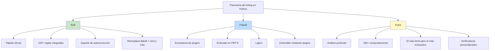
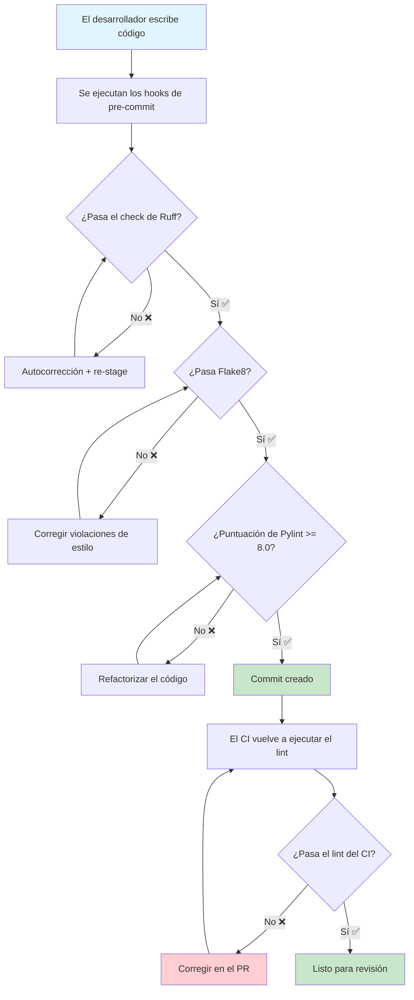

# Linting y calidad de código

Los linters son herramientas de análisis estático que detectan errores potenciales, violaciones de estilo y malos olores de código **sin ejecutar tu código**. Imponen consistencia, detectan bugs temprano y hacen que las revisiones de código se concentren en la lógica en lugar del formateo.

## ¿Por qué usar lint?

| Beneficio | Sin linter | Con linter |
|---------|---------------|-------------|
| **Consistencia** | Cada desarrollador tiene su propio estilo | El código sigue las reglas acordadas |
| **Prevención de bugs** | Un `==` en lugar de `is None` pasa desapercibido | El linter lo detecta automáticamente |
| **Revisión de código** | 30% de los comentarios sobre formateo | Las revisiones se centran en la arquitectura |
| **Incorporación** | Los nuevos desarrolladores aprenden las convenciones del código | El linter se las enseña |
| **CI/CD** | Los problemas de estilo bloquean los pipelines | El linter se ejecuta automáticamente |

## Los tres principales linters de Python



| Característica | Flake8 | Pylint | Ruff |
|---------|--------|--------|------|
| **Velocidad** | Rápido | Lento | Muy rápido (Rust) |
| **Instalación** | `pip install flake8` | `pip install pylint` | `pip install ruff` |
| **Reglas** | ~100 + plugins | ~200+ | ~800+ (muchos ecosistemas) |
| **Autocorrección** | No | No | Sí |
| **Configuración** | `.flake8` / `tox.ini` | `.pylintrc` | `pyproject.toml` / `ruff.toml` |
| **Integrado** | PEP 8 básico | Completo | Flake8 + isort + pycodestyle |
| **Lenguaje** | Python | Python | Rust (interfaz Pycross) |
| **Adopción** | Maduro, estable | Heredado, verboso | Moderno, en rápido crecimiento |

## Flake8: el estándar fiable

### Instalación y uso básico

```bash
# Install
pip install flake8

# Run on current directory
flake8

# Run on specific files
flake8 src/ tests/

# Show error codes
flake8 --statistics

# Exit with error count
flake8 --exit-zero

# Generate report
flake8 --output-file=flake8_report.txt
```

### Configuración

```ini
# .flake8
[flake8]
max-line-length = 100
extend-ignore = E203, W503
exclude =
    .git,
    __pycache__,
    migrations/,
    build/,
    dist/,
    .venv,
    venv/
max-complexity = 10
per-file-ignores =
    __init__.py: F401
    tests/*: S101
statistics = True
```

### Códigos de error de Flake8

| Código | Regla | Ejemplo |
|------|------|---------|
| **E1** | Indentación | `E111: 4 spaces per indent` |
| **E2** | Espacios en blanco | `E203: whitespace before ':'` |
| **E3** | Líneas en blanco | `E302: expected 2 blank lines after class` |
| **E4** | Imports | `E401: multiple imports on one line` |
| **E5** | Longitud de línea | `E501: line too long (100 > 79)` |
| **E7** | Sentencias | `E701: multiple statements on one line` |
| **W1** | Advertencia | `W191: indentation contains tabs` |
| **W2** | Advertencia | `W292: no newline at end of file` |
| **W5** | Advertencia | `W503: line break before binary operator` |
| **F4** | Import | `F401: module imported but unused` |
| **F6** | Definición | `F601: dictionary key duplicate` |
| **F8** | Nombre | `F821: undefined name 'foo'` |

### Plugins de Flake8

```bash
# Install plugins
pip install flake8-docstrings
pip install flake8-bugbear
pip install flake8-bandit
pip install flake8-builtins
pip install flake8-comprehensions
pip install flake8-import-order
pip install flake8-annotations
```

```ini
# .flake8 with plugins
[flake8]
max-line-length = 100
extend-ignore = E203, W503
extend-select = B, D, C4, ANN
per-file-ignores =
    __init__.py: F401
    tests/*: D100, D101, D102, ANN
```

```python
# Flake8 with plugins in action

def process_data(data):  # ANN001: missing type annotation for 'data'
    """Process the given data."""  # D200: docstring should fit on one line
    result = []
    for i, item in enumerate(data):
        # Using enumerate but never using 'i' - B007 caught by bugbear
        result.append(item * 2)
    return result


def validate_user(name, email, age):  # ANN001, ANN002
    """
    Validate user data.

    Checks name, email and age constraints.
    """
    if name is None or name == "":  # B101: use .strip() or compare to ""
        raise ValueError("Name required")
    return True
```

## Pylint: análisis profundo

### Instalación y uso básico

```bash
# Install
pip install pylint

# Run on a file
pylint src/main.py

# Run on a module
pylint src

# Generate a configuration file
pylint --generate-rcfile > .pylintrc

# Score only (no output)
pylint src --score=y

# Specify a configuration file
pylint --rcfile=.pylintrc src/
```

### Salida de Pylint

```
************* Module src.main
src/main.py:10:4: W0621: Redefining name 'process_data' from outer scope (redefined-outer-name)
src/main.py:15:8: E1101: Instance of 'list' has no 'do_something' member (no-member)
src/main.py:22:0: C0116: Missing function or method docstring (missing-function-docstring)
src/main.py:30:15: C0103: Variable name "x" doesn't conform to snake_case naming style (invalid-name)
src/main.py:45:0: R0914: Too many local variables (16/15) (too-many-locals)
```

### Categorías de mensajes de Pylint

| Categoría | Código | Significado | Cantidad |
|----------|------|---------|-------|
| **Convención** | `C0xxx` | Estilo/formateo | 50+ |
| **Refactor** | `R0xxx` | Mal olor de código | 20+ |
| **Advertencia** | `W0xxx` | Problemas potenciales | 80+ |
| **Error** | `E0xxx` | Bugs probables | 60+ |
| **Fatal** | `F0xxx` | Fallo crítico de Pylint | 5 |

### Configuración de .pylintrc

```ini
# .pylintrc
[MASTER]
ignore = .git,__pycache__,migrations,.venv
jobs = 4
load-plugins = pylint_django,pylint_flask

[MESSAGES CONTROL]
disable =
    C0111,  # missing-docstring (too strict)
    C0103,  # invalid-name
    R0903,  # too-few-public-methods
    W0511,  # fixme (allow TODO comments)

[FORMAT]
max-line-length = 100
expected-line-ending-format = LF

[DESIGN]
max-args = 7
max-attributes = 10
max-locals = 20
max-returns = 6
max-branches = 15
max-statements = 50
max-parents = 7
min-public-methods = 1
max-public-methods = 30

[SIMILARITIES]
min-similarity-lines = 10
ignore-comments = yes
ignore-docstrings = yes
ignore-imports = yes

[BASIC]
good-names = i, j, k, ex, Run, _, id, pk
bad-names = foo, bar, baz
```

> [!NOTE]
> Puntuación de Pylint: 10.0 es perfecto. La mayoría de los proyectos apuntan a 8.0-9.0. Usa `--fail-under=8.0` en el CI para forzar una puntuación mínima.

## Ruff: la potencia moderna

Ruff es un linter basado en Rust que es **10-100x más rápido** que los linters tradicionales de Python.

### Instalación y uso básico

```bash
# Install
pip install ruff

# Run on current directory
ruff check .

# Auto-fix issues
ruff check --fix .

# Show which rules apply
ruff check --show-settings

# Generate a configuration file
ruff check --generate-docs > RULES.md
```

### Configuración de Ruff

```toml
# pyproject.toml
[tool.ruff]
target-version = "py312"
line-length = 100

[tool.ruff.lint]
select = ["E", "F", "I", "N", "W", "D", "B", "SIM", "UP", "S"]
ignore = ["E203", "W503", "D100", "D104"]

[tool.ruff.lint.per-file-ignores]
"__init__.py" = ["F401"]
"tests/**" = ["D", "S101"]

[tool.ruff.format]
quote-style = "double"
indent-style = "space"
line-ending = "lf"

[tool.ruff.lint.pydocstyle]
convention = "google"
```

```bash
# Ruff specific checks
ruff check --select ALL  # Enable all rules
ruff check --select E,W,F  # Flake8 rules
ruff check --select I  # Import sorting
ruff check --select N  # Naming conventions
ruff check --select D  # Docstring conventions
ruff check --select B  # Bugbear rules
ruff check --select SIM # Simplify expressions
ruff check --select UP # Pyupgrade (modernize)
ruff check --select S  # Security (bandit rules)
```

### Salida de Ruff

```bash
$ ruff check src/
src/main.py:1:1: F401 [*] `os` imported but unused
src/main.py:5:5: E225 missing whitespace around operator
src/main.py:8:1: E302 expected 2 blank lines after class, found 1
src/main.py:12:9: B006 Do not use mutable data structures for argument defaults
src/main.py:15:1: D100 Missing docstring in public module
src/main.py:20:12: SIM105 Use `contextlib.suppress` instead of `try-except-pass`
Found 6 errors.
[*] 2 fixable with the `--fix` option.
```

### Antes y después de Ruff

```python
# BEFORE: Messy code
import os,sys
from collections import *

class data_processor:
    def __init__(self,data=[]):  # B006: mutable default
        self.data = data
    def process(self,item):
        if item in ['a','b','c']:pass
        else:
            try:
                result=do_something(item)
            except:  # E722: bare except
                pass
        return None
```

```python
# AFTER: Ruff fixes applied
import sys
from collections import defaultdict

class DataProcessor:
    def __init__(self, data=None):
        if data is None:
            data = []
        self.data = data

    def process(self, item):
        if item in {'a', 'b', 'c'}:
            return None
        result = do_something(item)
        return result
```

## Integración de linters en pre-commit

```yaml
# .pre-commit-config.yaml
repos:
  # Ruff (fast, comprehensive)
  - repo: https://github.com/astral-sh/ruff-pre-commit
    rev: v0.4.8
    hooks:
      - id: ruff
        args: [--fix, --exit-non-zero-on-fix]

  # Flake8 (complementary checks)
  - repo: https://github.com/pycqa/flake8
    rev: 7.1.0
    hooks:
      - id: flake8
        additional_dependencies:
          - flake8-docstrings
          - flake8-bugbear

  # Pylint (deep analysis)
  - repo: https://github.com/pycqa/pylint
    rev: v3.2.2
    hooks:
      - id: pylint
        args: [--fail-under=8.0]
```

## Integración en CI

```yaml
# .github/workflows/lint.yml
name: Linting

on:
  pull_request:
  push:
    branches: [main]

jobs:
  lint:
    runs-on: ubuntu-latest
    strategy:
      matrix:
        linter: [ruff, flake8, pylint]

    steps:
      - uses: actions/checkout@v4
      - uses: actions/setup-python@v5
        with:
          python-version: '3.12'

      - name: Install dependencies
        run: |
          pip install -r requirements.txt
          pip install ruff flake8 flake8-docstrings flake8-bugbear pylint

      - name: Run ${{ matrix.linter }}
        run: make lint-{{ matrix.linter }}

      - name: Generate report
        if: always()
        run: |
          ruff check . --output-format=github > ruff_report.txt 2>&1 || true
```

```makefile
# Makefile
.PHONY: lint lint-ruff lint-flake8 lint-pylint

lint: lint-ruff lint-flake8 lint-pylint

lint-ruff:
	ruff check src/ tests/
	ruff format --check src/ tests/

lint-flake8:
	flake8 src/ tests/ --statistics

lint-pylint:
	pylint src/ --fail-under=8.0

lint-fix:
	ruff check --fix src/ tests/
	ruff format src/ tests/
```



## Comparación de configuraciones de linting

| Ajuste | Flake8 | Pylint | Ruff |
|---------|--------|--------|------|
| Archivo de configuración | `.flake8` / `tox.ini` | `.pylintrc` | `pyproject.toml` / `ruff.toml` |
| Longitud de línea | `max-line-length=100` | `max-line-length=100` | `line-length=100` |
| Reglas ignoradas | `extend-ignore=E203` | `disable=C0111` | `ignore=["E203"]` |
| Excluir archivos | `exclude=.git,venv` | `ignore=.git,venv` | `exclude=["venv"]` |
| Configuración por archivo | `per-file-ignores` | bloques `--disable=` | `per-file-ignores` |
| Umbral de falha | Código de salida 0-3 | `--fail-under=8.0` | Código de salida 0-1 |

## Supresión de avisos del linter

```python
# Flake8 suppression
def bad_function():  # noqa: E501
    long_line = "x" * 200  # noqa: E501

# Pylint suppression
class MyClass:  # pylint: disable=too-few-public-methods
    def my_method(self):
        pass

# Ruff suppression
result = 1 + 1  # noqa: SIM114 (if applicable)

# File-level suppression
# flake8: noqa: E501, W503
# ruff: noqa: E501
```

> [!WARNING]
> Suprime los avisos con moderación. Cada supresión debe ir acompañada de un comentario que explique POR QUÉ. Demasiadas supresiones anulan el propósito de tener un linter.

## Ejercicios prácticos

1. **Instala y configura Flake8**: Instala flake8 y crea una configuración `.flake8` que establezca la longitud de línea en 100, ignore E203 y W503, y excluya los directorios `migrations/` y `.venv/`.

2. **Corrige las violaciones de Flake8**: Dado este código, corrige todas las violaciones de flake8:
   ```python
   import os,sys

   class calculator:
       def add(self,a,b):
           return a+b
       def subtract(self,a,b):
           return a-b
   ```

3. **Migración a Ruff**: Toma un proyecto que usa flake8 + isort + pycodestyle y crea una única configuración de ruff que reemplace a las tres. Verifica que se apliquen las mismas reglas.

4. **Mejora de la puntuación en Pylint**: Configura pylint con un umbral de puntuación. Escribe código que puntúe por debajo de 5.0 y luego refactoriza hasta que puntúe por encima de 9.0. Documenta los cambios realizados.

5. **Conjunto de reglas personalizado**: Crea una configuración de linting para un proyecto de equipo. Incluye reglas para docstrings (convención Google), anotaciones de tipo, manejo de errores y convenciones de nombres.

6. **Duelo de linters**: Crea un archivo de prueba con 10 malas prácticas intencionadas. Ejecuta flake8, pylint y ruff sobre él. Compara la salida de cada uno. ¿Cuál detecta más problemas? ¿Cuál es el más rápido?

7. **Pipeline de CI**: Crea un workflow de GitHub Actions que ejecute ruff, flake8 y pylint en cada PR. El pipeline debe fallar si cualquier linter encuentra violaciones.

8. **Linting en pre-commit**: Añade ruff y flake8 como hooks de pre-commit. Configura ruff para que corrija automáticamente los problemas y flake8 para que solo informe de errores (no de advertencias). Verifica que los hooks funcionen tanto con archivos en stage como sin stage.

## Resumen

- **Flake8**: Rápido, basado en plugins, enfocado en PEP 8. Bueno para comprobaciones rápidas de estilo.
- **Pylint**: Análisis profundo, 200+ reglas, sistema de puntuación. El mejor para revisiones de código integrales.
- **Ruff**: Extremadamente rápido (Rust), reemplaza múltiples herramientas, soporta autocorrección. El estándar moderno.
- **Integración**: Los tres funcionan con hooks de pre-commit y pipelines de CI.
- **Configuración**: Cada herramienta tiene su propio formato de archivo de configuración — mantenlos bajo control de versiones.
- **Supresión**: Usa `# noqa` con moderación y con comentarios explicativos.
- **Estrategia**: Empieza con Ruff (retroalimentación rápida), añade Flake8 (ecosistema de plugins) y usa Pylint para análisis profundos periódicos.

> [!SUCCESS]
> El linting convierte la calidad de código de una negociación humana en una garantía automatizada. Con la configuración de linter adecuada, tu código se mantiene consistente, tus revisiones se mantienen enfocadas y tus bugs se mantienen al mínimo.
