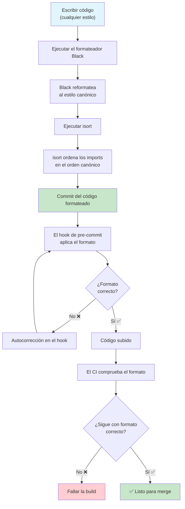
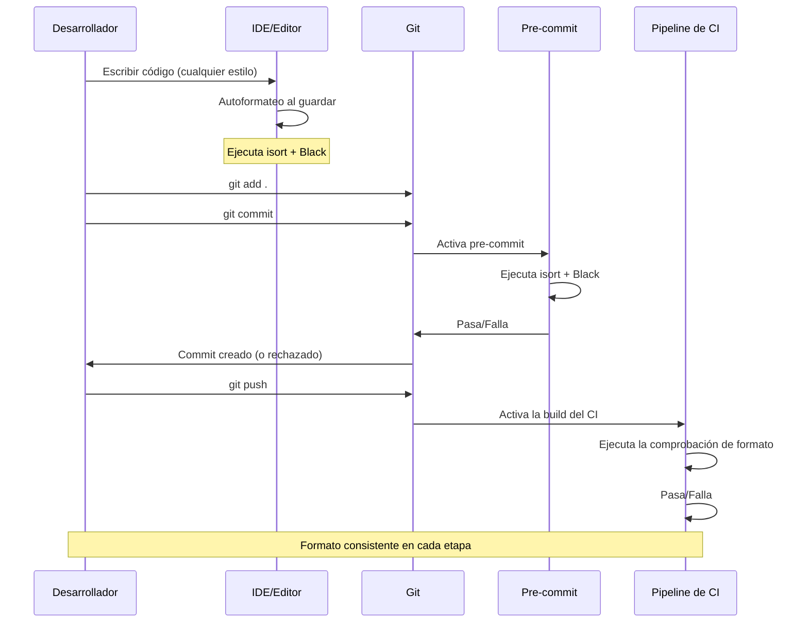

# Formateo de código

El formateo de código es el aspecto más debatido y menos importante de la programación — y exactamente por eso debe estar **automatizado**. Formateadores como Black e isort eliminan por completo las discusiones de formateo al imponer un estilo consistente y legible por máquina.

## ¿Por qué automatizar el formateo?

| Problema | Formateo manual | Formateo automatizado |
|---------|------------------|---------------------|
| **Bike-shedding** | Horas de debate sobre «¿Pestañas o espacios?» | El formateador decide |
| **Inconsistencia** | Cada archivo se ve distinto | Todos los archivos siguen las mismas reglas |
| **Contaminación de los diffs** | Cambios reales mezclados con formateo | Solo cambios significativos en los diffs |
| **Revisión de código** | 30% de los comentarios sobre formateo | 100% sobre la lógica |
| **Incorporación** | «Nuestra guía de estilo es…» | «Ejecuta `make format`» |



## Black: el formateador sin concesiones

Black es «el formateador de código Python sin concesiones». Tiene muy pocas opciones de configuración por diseño — produce una salida consistente sin importar quién lo ejecute.

### Instalación

```bash
# Install Black
pip install black

# Check version
black --version

# Format a file or directory
black src/main.py
black src/ tests/

# Check if files need formatting (without changing)
black --check src/ tests/

# See what would change (diff mode)
black --diff src/main.py

# Format with specific line length
black --line-length=100 src/

# Fast mode (skip AST validation)
black --fast src/
```

### Configuración de Black

```toml
# pyproject.toml
[tool.black]
line-length = 100
target-version = ["py312"]
include = '\.pyi?$'
extend-exclude = '''
/(
    \.eggs
  | \.git
  | \.hg
  | \\.mypy_cache
  | \\.tox
  | \\.venv
  | _build
  | buck-out
  | build
  | dist
  | migrations
)/
'''

# setup.cfg (alternative)
[black]
line_length = 100
target_version = py312
include = \.pyi?$
extend-exclude = \.eggs|\.git|\.hg|\.mypy_cache|\.tox|\.venv|_build|buck-out|build|dist
```

### Antes y después de Black

```python
# BEFORE: Inconsistent formatting
def calculate_total(items,discount=0):
    total=sum(item['price']*item.get('qty',1) for item in items)
    if discount>0:
        total=total-(total*discount)
    return round(total,2)

def process_data(
    data,transform=None,
    validate=True):
    result=[]
    for d in data:
        if validate and not is_valid(d):continue
        v = transform(d) if transform else d
        result.append(v)
    return result
```

```python
# AFTER: Black formatted
def calculate_total(items, discount=0):
    total = sum(item["price"] * item.get("qty", 1) for item in items)
    if discount > 0:
        total = total - (total * discount)
    return round(total, 2)


def process_data(data, transform=None, validate=True):
    result = []
    for d in data:
        if validate and not is_valid(d):
            continue
        v = transform(d) if transform else d
        result.append(v)
    return result
```

### Transformaciones de Black

| Patrón | Antes de Black | Después de Black |
|---------|-------------|-------------|
| Espacios | `x=1+2` | `x = 1 + 2` |
| Comillas | `x = 'hello'` | `x = "hello"` |
| Paréntesis | `result = (1 + 2) * 3` | `result = (1 + 2) * 3` |
| Saltos de línea (largos) | `x = some_func(arg1, arg2, ...)` (más de 88 caracteres) | Formato multilínea |
| Comas finales | `func(a, b, c)` | `func(a, b, c)` (añade comas en varias líneas) |
| Líneas en blanco | Espaciado inconsistente | Exactamente 2 antes de funciones/clases |
| Coma final mágica | `func(a,b,)` | La preserva y la usa para el formato vertical |

### La coma final mágica

```python
# Black uses trailing commas to decide formatting style

# Without trailing comma → Black puts everything on one line
result = calculate_complex_thing(arg1, arg2, arg3)

# With trailing comma → Black expands vertically
result = calculate_complex_thing(
    arg1,
    arg2,
    arg3,
)

# Use trailing comma to control formatting
items = [
    "apple",
    "banana",
    "orange",
    "grape",  # ← trailing comma forces vertical layout
]
```

## isort: organización de imports

isort ordena y agrupa los imports según una convención estándar.

### Instalación

```bash
# Install isort
pip install isort

# Sort imports for a file
isort src/main.py

# Check if imports need sorting
isort --check-only src/

# Show diff of changes
isort --diff src/main.py

# Sort entire project
isort src/ tests/

# Generate a configuration file
isort --print-settings > .isort.cfg
```

### Configuración de isort

```toml
# pyproject.toml
[tool.isort]
profile = "black"
line_length = 100
multi_line_output = 3
include_trailing_comma = true
force_grid_wrap = 0
use_parentheses = true
ensure_newline_before_comments = true
sections = ["FUTURE", "STDLIB", "THIRDPARTY", "FIRSTPARTY", "LOCALFOLDER"]
known_first_party = ["src"]
known_third_party = ["django", "pytest", "requests", "numpy"]
skip = ["migrations", ".venv"]
```

### Secciones de imports de isort

isort organiza los imports en secciones separadas por líneas en blanco:

```python
# Standard library
import os
import sys
from datetime import datetime
from pathlib import Path

# Third-party libraries (blank line)
import pytest
import requests
from django.db import models
from numpy import array

# First-party / project modules (blank line)
from src.models import User
from src.services import PaymentService

# Local folder (blank line)
from .utils import helpers
from ..config import settings
```

### Antes y después de isort

```python
# BEFORE: Messy imports
from django.db import models
import sys, os
from ..config import settings
import requests
from datetime import datetime
import pytest
from src.models import User
from pathlib import Path
from .utils import helpers
import numpy
```

```python
# AFTER: isort sorted
import os
import sys
from datetime import datetime
from pathlib import Path

import numpy
import pytest
import requests
from django.db import models

from src.models import User

from .utils import helpers
from ..config import settings
```

## Integración de Black + isort

### Configuración de pre-commit

```yaml
# .pre-commit-config.yaml
repos:
  - repo: https://github.com/psf/black
    rev: 24.4.2
    hooks:
      - id: black
        args: [--line-length=100]
        language_version: python3.12

  - repo: https://github.com/pycqa/isort
    rev: 5.13.2
    hooks:
      - id: isort
        args: [--profile, black, --line-length=100]
```

### ¡El orden importa!

Ejecuta isort **antes** de Black — o configura isort con `profile = "black"`:

```bash
# Correct order: isort first, then black
isort src/ && black src/

# Or use the black profile in isort
# isort will respect Black's formatting
isort --profile black src/
```

```yaml
# Makefile
.PHONY: format

format:
	isort --profile black src/ tests/
	black --line-length 100 src/ tests/

format-check:
	isort --check-only --profile black src/ tests/
	black --check --line-length 100 src/ tests/
```

## Patrones avanzados de formateo

### Normalización de cadenas con Black

```python
# Black normalizes string quotes (double quotes preferred)
message = 'Hello, World!'  # → message = "Hello, World!"

# But preserves triple-quoted strings
docstring = """This is a docstring."""  # Stays as-is

# Escaped quotes are handled
text = "She said, \"Hello\""  # → text = 'She said, "Hello"'
```

### Estrategias de longitud de línea

```python
# Strategy 1: Let Black break long lines
def process_data(data, transform=None, validate=True, cache_results=False):
    # Black handles this automatically based on line length setting
    pass

# Strategy 2: Use trailing comma for vertical formatting
important_result = some_function(
    argument_one,
    argument_two,
    argument_three,
    argument_four,
)

# Strategy 3: Parenthesize for explicit line breaks
result = (
    first_operand
    + second_operand
    - third_operand
    * fourth_operand
)
```

### Formateo de funcionalidades de Python 3.12+

```python
# Type parameter syntax (Python 3.12)
def first[T](items: list[T]) -> T:
    return items[0]

# Match statement formatting
def process_status(status: int) -> str:
    match status:
        case 200:
            return "OK"
        case 404:
            return "Not Found"
        case 500:
            return "Server Error"
        case _:
            return "Unknown"

# Exception groups
try:
    do_something()
except* ValueError as eg:
    for e in eg.exceptions:
        handle_value_error(e)
```

## Formateo en el CI

```yaml
# .github/workflows/format.yml
name: Formatting Check

on: [pull_request]

jobs:
  format:
    runs-on: ubuntu-latest
    steps:
      - uses: actions/checkout@v4
      - uses: actions/setup-python@v5
        with:
          python-version: '3.12'

      - name: Install formatters
        run: |
          pip install black isort

      - name: Check formatting with isort
        run: |
          isort --check-only --diff --profile black src/ tests/

      - name: Check formatting with Black
        run: |
          black --check --diff --line-length 100 src/ tests/

      - name: Show formatting errors
        if: failure()
        run: |
          echo "❌ Formatting issues found. Run:"
          echo "  isort --profile black src/ tests/"
          echo "  black --line-length 100 src/ tests/"
```

## Formateadores alternativos

| Formateador | Estilo | Configuración | Velocidad |
|-----------|-------|---------------|-------|
| **Black** | Sin concesiones | Muy pocas opciones | Rápido |
| **autopep8** | Compatible con PEP 8 | Muchas opciones | Moderada |
| **yapf** | Con plugins | Opciones extensas | Moderada |
| **ruff format** | Compatible con Black | Pocas opciones | Muy rápido |

```bash
# autopep8
pip install autopep8
autopep8 --in-place --aggressive --aggressive src/

# yapf
pip install yapf
yapf --in-place --recursive src/

# ruff format
pip install ruff
ruff format src/
```

### Ruff format como sustituto de Black

El formateador de Ruff es un sustituto directo de Black:

```bash
# Ruff format (Black-compatible, much faster)
ruff format src/ tests/

# Check only
ruff format --check src/ tests/

# Show diff
ruff format --diff src/ tests/

# In pyproject.toml
[tool.ruff.format]
quote-style = "double"
indent-style = "space"
line-ending = "lf"
docstring-code-format = true
```

```toml
# pyproject.toml — ruff as the sole formatter
[tool.ruff]
line-length = 100
target-version = "py312"

[tool.ruff.format]
quote-style = "double"
indent-style = "space"
line-ending = "lf"
docstring-code-format = true
docstring-code-line-length = "dynamic"

[tool.ruff.lint]
select = ["I"]
# isort rules enabled for import sorting via ruff
```

```yaml
# Pre-commit with ruff for both lint and format
repos:
  - repo: https://github.com/astral-sh/ruff-pre-commit
    rev: v0.4.8
    hooks:
      - id: ruff
        args: [--fix, --exit-non-zero-on-fix]
      - id: ruff-format
```

> [!TIP]
> Si vas a empezar un proyecto nuevo, usa **ruff** tanto para el linting COMO para el formateo. Es más rápido que Black + isort juntos y totalmente compatible. En proyectos existentes, Black + isort es la ruta de migración más segura.

## Flujo de trabajo de formateo



## Ejercicios prácticos

1. **Instala y ejecuta Black**: Instala Black y formatea un archivo Python desordenado. Usa `--diff` para ver qué cambió. Usa `--check` para verificar el formateo sin modificar archivos.

2. **Configura Black**: Configura el pyproject.toml con la configuración de Black. Establece la longitud de línea en 100, apunta a Python 3.12 y excluye las migraciones y los entornos virtuales.

3. **Perfiles de isort**: Crea una configuración de isort con `profile = "black"`. Crea un archivo con los imports deliberadamente desordenados y verifica que isort los organice correctamente.

4. **La coma final mágica**: Escribe una función con 8 parámetros. Formateala con Black sin comas finales, añade después una coma final y vuelve a formatear. Observa la diferencia en el formato.

5. **Formateo en pre-commit**: Añade Black e isort como hooks de pre-commit. Configúralos para que el formateo se aplique automáticamente en cada commit. Prueba escribiendo código sin formatear y haciendo commit.

6. **Puerta de formateo en el CI**: Crea un workflow de GitHub Actions que compruebe el formateo en cada PR. La build debe fallar si algún archivo no está correctamente formateado. Incluye instrucciones en el mensaje de error sobre cómo corregirlo.

7. **Ruff como formateador**: Migra un proyecto de Black + isort a usar ruff tanto para el linting COMO para el formateo. Compara el tamaño de la configuración y la velocidad de ejecución.

8. **Convención de formateo del equipo**: Tu equipo de 10 desarrolladores no se pone de acuerdo sobre el formateo. Escribe una propuesta que incluya: (a) por qué el formateo automatizado es mejor que el manual, (b) qué herramienta usar y por qué, (c) la configuración exacta, (d) cómo integrarla en el flujo de trabajo.

## Resumen

- **Black** es el formateador sin concesiones — configuración mínima, salida consistente
- **isort** organiza los imports en secciones estándar (stdlib, third-party, first-party)
- **Ejecuta siempre isort antes de Black** — o configura isort con `profile = "black"`
- **La coma final mágica** controla el formato vertical frente al horizontal en Black
- **Los hooks de pre-commit** automatizan el formateo antes de que el código se haga commit
- **Las comprobaciones del CI** garantizan que el formateo nunca se olvide
- **Ruff format** es un sustituto más rápido y directo de Black
- **La consistencia gana a la perfección** — cualquier formato automatizado es mejor que los debates sobre formateo manual

> [!SUCCESS]
> El formateo automatizado elimina categorías enteras de comentarios de revisión de código. Con Black e isort, tu equipo dedica cero tiempo a debates de formateo y el 100% de la energía de revisión a lo que importa: la lógica, la arquitectura y la corrección.
