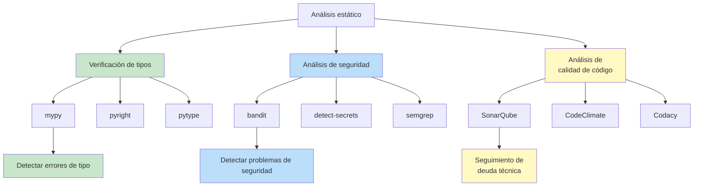
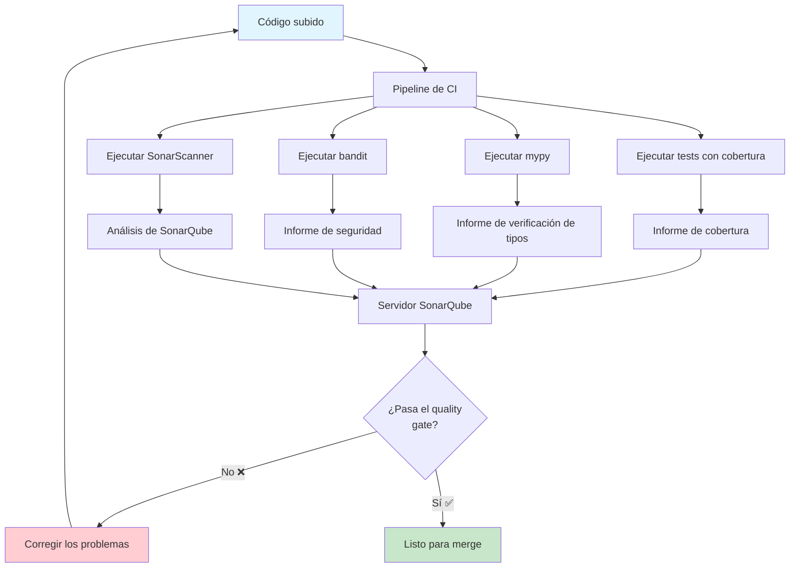

# Análisis estático y escaneo de código

El análisis estático examina tu código **sin ejecutarlo** para encontrar bugs, vulnerabilidades de seguridad, errores de tipo y problemas de calidad del código. A diferencia de los linters (que imponen estilo), los analizadores estáticos encuentran **bugs potenciales reales** en tu lógica.

## Tipos de análisis estático



| Herramienta | Propósito | Detecta | Velocidad |
|------|---------|-------|-------|
| **mypy** | Verificación de tipos | Incompatibilidades de tipo, seguridad con None, returns ausentes | Moderada |
| **bandit** | Escaneo de seguridad | Inyección SQL, contraseñas hardcodeadas, eval inseguro | Rápida |
| **SonarQube** | Calidad integral | Bugs, vulnerabilidades, malos olores de código, duplicación | Lenta |

## Verificación de tipos con mypy

mypy es el verificador de tipos estáticos estándar de Python. Verifica que tus anotaciones de tipo sean coherentes con la forma en que el código usa realmente los valores.

### Instalación

```bash
# Install mypy
pip install mypy

# Install type stubs for libraries
pip install types-requests types-PyYAML types-python-dateutil

# Run mypy on a file
mypy src/main.py

# Run mypy on a module
mypy src

# Run mypy with strict mode
mypy --strict src/

# Generate a configuration file
mypy --generate-config
```

### Configuración básica de mypy

```toml
# pyproject.toml
[tool.mypy]
python_version = "3.12"
strict = true
ignore_missing_imports = true
disallow_untyped_defs = true
disallow_any_unimported = false
no_implicit_optional = true
warn_redundant_casts = true
warn_unused_ignores = true
warn_return_any = true
warn_unreachable = true

exclude = [
    "migrations/",
    "build/",
    ".venv/",
    "tests/",
]

[[tool.mypy.overrides]]
module = "tests.*"
disallow_untyped_defs = false
ignore_missing_imports = true
```

### mypy en acción

```python
# BEFORE: No type annotations (mypy cannot help)
def process_user(user_data):
    name = user_data["name"]
    age = user_data["age"]
    return f"{name} is {age} years old"


def calculate_discount(price, percentage):
    return price * percentage
```

```python
# AFTER: With type annotations (mypy catches errors)
from typing import Protocol, Any


class UserData(Protocol):
    name: str
    age: int


def process_user(user_data: UserData) -> str:
    name: str = user_data.name
    age: int = user_data.age
    return f"{name} is {age} years old"


def calculate_discount(price: float, percentage: float) -> float:
    return price * percentage
```

### Errores comunes de mypy

```python
from typing import Optional, Union, Any, Callable


# Error 1: None safety
def get_user_name(user_id: int) -> Optional[str]:
    if user_id == 1:
        return "Alice"
    return None


def process_user(user_id: int) -> str:
    name = get_user_name(user_id)
    # ERROR: Argument 1 to "len" has incompatible type "Optional[str]"; expected "str"
    return f"User: {name.upper()}"  # mypy error!
    # Fix: name = get_user_name(user_id) or "Unknown"
    #       name.upper()


# Error 2: Type mismatch
def add(a: int, b: int) -> int:
    return a + b


result = add(1, "2")  # mypy error: Argument 2 to "add" has incompatible type "str"; expected "int"


# Error 3: Missing return
def validate_age(age: int) -> bool:
    if age < 0:
        return False
    # ERROR: Missing return statement
    # Fix: return age >= 0


# Error 4: Incompatible return type
def get_item(items: list[int], index: int) -> int:
    if index < len(items):
        return items[index]
    return None  # mypy error: Incompatible return value type "None"; expected "int"
    # Fix: return -1 or use Optional[int]


# Error 5: Any type leak
def process(data: Any) -> str:
    return data  # mypy warns about returning Any unless silenced
```

### Estrategia de tipado gradual

```python
# Stage 1: Function signatures only (most value)
def create_user(name: str, email: str) -> User:
    ...

# Stage 2: Add return types everywhere
def find_user(user_id: int) -> Optional[User]:
    ...

# Stage 3: Full annotations (internal variables too)
def calculate_total(items: list[Item]) -> float:
    total: float = 0.0
    for item in items:
        total += item.price * item.quantity
    return total
```

### Stubs de tipos para bibliotecas externas

```bash
# Types for popular libraries
pip install types-requests
pip install types-PyYAML
pip install types-python-dateutil
pip install types-beautifulsoup4
pip install types-redis
pip install types-pytz
```

```python
# With types-requests installed, mypy checks this:
import requests


def fetch_data(url: str) -> dict:
    response = requests.get(url)
    response.raise_for_status()
    return response.json()  # Correctly typed as dict
```

### Opciones del modo estricto de mypy

| Flag | Qué hace |
|------|-------------|
| `--strict` | Habilita todos los flags estrictos siguientes |
| `--disallow-untyped-defs` | Todas las funciones deben tener anotaciones de tipo |
| `--disallow-incomplete-defs` | No se permiten anotaciones parciales (p. ej., `def f(x)` sin tipar `x`) |
| `--disallow-untyped-calls` | No se pueden llamar funciones sin anotaciones de tipo |
| `--no-implicit-optional` | `Optional[T]` debe ser explícito |
| `--warn-redundant-casts` | Advertencia sobre llamadas `cast()` innecesarias |
| `--warn-unused-ignores` | Advertencia sobre comentarios `# type: ignore` sin usar |
| `--warn-return-any` | Advertencia cuando una función devuelve un `Any` inferido |
| `--warn-unreachable` | Advertencia sobre código inalcanzable |

## Escaneo de seguridad con bandit

Bandit encuentra problemas de seguridad comunes en el código Python.

### Instalación

```bash
# Install bandit
pip install bandit

# Run bandit on a file
bandit -r src/

# Run with specific severity/confidence
bandit -r src/ -ll  # Only medium+ severity
bandit -r src/ -iii # Only medium+ confidence

# Generate HTML report
bandit -r src/ -f html -o bandit_report.html

# Generate JSON report
bandit -r src/ -f json -o bandit_report.json

# Use a baseline (skip known issues)
bandit -r src/ -b .bandit_baseline.json
```

### Configuración de Bandit

```ini
# .bandit
[bandit]
exclude: tests,.venv,migrations
tests: B101,B102,B301,B302,B303,B304,B305,B306,B307,B308,B309,B310,B311,B312,B313,B314,B315,B316,B317,B318,B319,B320,B321,B322,B323,B324,B325,B326,B327,B328,B329,B330,B331,B332,B333,B334,B335,B336,B337,B338,B339,B340,B341,B342,B343,B344,B345,B346,B347,B348,B349,B350,B351,B352,B353,B354,B355,B356,B357,B358,B359,B360,B361,B362,B363,B364,B365,B366,B367,B368,B369,B370,B371,B372,B373,B374,B375,B376,B377,B378,B379,B380,B381,B382,B383,B384,B385,B386,B387,B388,B389,B390,B391,B392,B393,B394,B395,B396,B397,B398,B399,B400,B401,B402,B403,B404,B405,B406,B407,B408,B409,B410,B411,B412,B413,B414,B415,B416,B417,B418,B419,B420,B421,B422,B423,B424,B425,B426,B427,B428,B429,B430,B431,B432,B433,B434,B435,B436,B437,B438,B439,B440,B441,B442,B443,B444,B445,B446,B447,B448,B449,B450,B451,B452,B453,B454,B455,B456,B457,B458,B459,B460,B461,B462,B463,B464,B465,B466,B467,B468,B469,B470,B471,B472,B473,B474,B475,B476,B477,B478,B479,B480,B481,B482,B483,B484,B485,B486,B487,B488,B489,B490,B491,B492,B493,B494,B495,B496,B497,B498,B499,B500
skips: B101,B311
```

### Problemas de seguridad que detecta Bandit

```python
import hashlib
import subprocess
import os

# B102: exec() usage (dangerous)
exec("print('hello')")  # BANDIT: B102

# B201: subprocess with shell=True
subprocess.call("ls -la", shell=True)  # BANDIT: B201

# B303: MD5 used for password
hashlib.md5(b"password")  # BANDIT: B303

# B105: Hardcoded password
password = "super_secret_123"  # BANDIT: B105

# B106: Hardcoded API key
API_KEY = "sk-abc123def456"  # BANDIT: B106

# B108: Temp file in insecure location
file_path = "/tmp/data.txt"  # BANDIT: B108

# B110: Bare except (catches all exceptions)
try:
    do_something()
except:  # BANDIT: B110
    pass

# B112: Try/except/pass
try:
    do_something()
except ValueError:
    pass  # BANDIT: B112

# B301: Pickle (dangerous deserialization)
import pickle
data = pickle.loads(unsafe_data)  # BANDIT: B301

# B320: SQL injection risk
cursor.execute("SELECT * FROM users WHERE id = " + user_input)  # BANDIT: B320
```

### Escribir código seguro (a prueba de Bandit)

```python
import secrets
import hashlib
import subprocess
from typing import Optional


# ✅ Safe: Use environment variables for secrets
DATABASE_PASSWORD = os.environ.get("DATABASE_PASSWORD")
if not DATABASE_PASSWORD:
    raise ValueError("DATABASE_PASSWORD not set")


# ✅ Safe: Use parameterized queries
def get_user(user_id: int) -> Optional[dict]:
    cursor.execute("SELECT * FROM users WHERE id = ?", (user_id,))
    return cursor.fetchone()


# ✅ Safe: Use subprocess without shell
def list_directory(path: str) -> list[str]:
    result = subprocess.run(
        ["ls", "-la", path],
        capture_output=True,
        text=True,
        check=True,
    )
    return result.stdout.splitlines()


# ✅ Safe: Use secrets module for security-sensitive randomness
def generate_reset_token() -> str:
    return secrets.token_hex(32)


# ✅ Safe: Use hashlib securely
def hash_password(password: str) -> str:
    salt = secrets.token_hex(16)
    return hashlib.pbkdf2_hmac("sha256", password.encode(), salt.encode(), 100000).hex()


# ✅ Safe: Use context managers for files
def read_config(path: str) -> str:
    with open(path) as f:
        return f.read()
```

### Integración de Bandit en CI

```yaml
# .github/workflows/security.yml
name: Security Scan

on: [pull_request, push]

jobs:
  security:
    runs-on: ubuntu-latest
    steps:
      - uses: actions/checkout@v4
      - uses: actions/setup-python@v5
        with:
          python-version: '3.12'

      - name: Install bandit
        run: pip install bandit

      - name: Run bandit security scan
        run: |
          bandit -r src/ -ll -f json -o bandit_report.json || true

      - name: Upload report
        uses: actions/upload-artifact@v4
        with:
          name: bandit-report
          path: bandit_report.json

      - name: Fail on high severity issues
        run: |
          HIGH_ISSUES=$(python -c "
          import json
          with open('bandit_report.json') as f:
              data = json.load(f)
          high = [r for r in data.get('results', []) 
                  if r.get('issue_severity') == 'HIGH']
          print(f'High severity issues: {len(high)}')
          for r in high:
              print(f'  - {r[\"test_id\"]}: {r[\"issue_text\"]} at {r[\"filename\"]}:{r[\"line_number\"]}')
          exit(1 if high else 0)
          ")
```

## SonarQube: análisis integral de calidad

SonarQube ofrece un panel para seguir la calidad del código a lo largo del tiempo, incluyendo bugs, vulnerabilidades, malos olores de código y deuda técnica.

### Ejecutar SonarQube localmente

```bash
# Run SonarQube with Docker
docker run -d --name sonarqube \
  -p 9000:9000 \
  sonarqube:community

# Install SonarScanner
pip install sonar-scanner

# Run analysis
sonar-scanner \
  -Dsonar.projectKey=my_project \
  -Dsonar.sources=src \
  -Dsonar.tests=tests \
  -Dsonar.python.coverage.reportPaths=coverage.xml \
  -Dsonar.host.url=http://localhost:9000 \
  -Dsonar.login=your_token
```

### sonar-project.properties

```properties
# sonar-project.properties
sonar.projectKey=my_python_project
sonar.projectName=My Python Project
sonar.projectVersion=1.0
sonar.sources=src
sonar.tests=tests
sonar.sourceEncoding=UTF-8
sonar.language=py
sonar.python.version=3.12

# Coverage
sonar.python.coverage.reportPaths=coverage.xml
sonar.python.xunit.reportPath=test-report.xml

# Exclusions
sonar.exclusions=**/migrations/**,**/__init__.py
sonar.test.exclusions=**/migrations/**

# Quality gates
sonar.qualitygate.wait=true
sonar.qualitygate.timeout=300

# Duplication
sonar.cpd.exclusions=**/migrations/**
```

### Métricas de calidad de SonarQube

| Métrica | Qué mide | Objetivo |
|--------|-----------------|--------|
| **Bugs** | Errores en tiempo de ejecución y comportamiento incorrecto | 0 |
| **Vulnerabilidades** | Debilidades de seguridad | 0 |
| **Malos olores de código** | Problemas de mantenibilidad | Baja |
| **Deuda técnica** | Tiempo para corregir todos los problemas | < 5% |
| **Duplicaciones** | Bloques de código repetidos | < 3% |
| **Cobertura** | Porcentaje de cobertura de pruebas | >= 80% |
| **Calificación de seguridad** | A-E según vulnerabilidades | A |
| **Calificación de fiabilidad** | A-E según bugs | A |
| **Calificación de mantenibilidad** | A-E según malos olores de código | A |



## Flujo de trabajo de CI integral

```yaml
# .github/workflows/static-analysis.yml
name: Static Analysis

on:
  pull_request:
  push:
    branches: [main]

jobs:
  type-check:
    runs-on: ubuntu-latest
    steps:
      - uses: actions/checkout@v4
      - uses: actions/setup-python@v5
        with:
          python-version: '3.12'

      - name: Install dependencies
        run: |
          pip install -r requirements.txt
          pip install mypy types-requests types-PyYAML

      - name: Run mypy
        run: mypy src/ --strict

  security:
    runs-on: ubuntu-latest
    steps:
      - uses: actions/checkout@v4
      - uses: actions/setup-python@v5
        with:
          python-version: '3.12'

      - name: Install bandit
        run: pip install bandit

      - name: Run bandit
        run: bandit -r src/ -ll

  sonarqube:
    runs-on: ubuntu-latest
    steps:
      - uses: actions/checkout@v4
        with:
          fetch-depth: 0

      - uses: actions/setup-python@v5
        with:
          python-version: '3.12'

      - name: Install dependencies
        run: |
          pip install -r requirements.txt
          pip install pytest pytest-cov

      - name: Run tests with coverage
        run: |
          pytest --cov=src --cov-report=xml --junitxml=test-report.xml

      - name: SonarQube Scan
        uses: SonarSource/sonarqube-scan-action@v4
        env:
          SONAR_TOKEN: ${{ secrets.SONAR_TOKEN }}
        with:
          args: >
            -Dsonar.python.coverage.reportPaths=coverage.xml
            -Dsonar.python.xunit.reportPath=test-report.xml
```

## Ejercicios prácticos

1. **Configuración de mypy**: Instala mypy y configúralo con el modo `--strict`. Añade anotaciones de tipo a un archivo Python hasta que mypy no informe de errores. Empieza con un archivo sin anotaciones de tipo.

2. **Corrige los errores de mypy**: Dado este código, corrige todos los errores de mypy:
   ```python
   def get_user(id):
       if id == 1:
           return {"name": "Alice", "age": 30}
       return None

   def process_user(user):
       return user["name"].upper()
   ```

3. **Auditoría de seguridad con Bandit**: Crea un archivo Python con 5 vulnerabilidades de seguridad comunes (contraseñas hardcodeadas, inyección SQL, uso de eval, inyección de shell, pickle). Ejecuta bandit y verifica que las detecta todas.

4. **Corrige los problemas de seguridad**: Dados los hallazgos de bandit del ejercicio 3, corrige todas las vulnerabilidades siguiendo las mejores prácticas. Verifica que bandit no informe de problemas tras las correcciones.

5. **Configuración de SonarQube**: Ejecuta SonarQube localmente con Docker. Configura un proyecto y ejecuta SonarScanner sobre un proyecto de Python. Analiza los resultados del quality gate.

6. **Tipado gradual**: Toma un módulo Python de más de 200 líneas sin anotaciones de tipo. Añade anotaciones de tipo gradualmente: primero las firmas de las funciones, luego los tipos de retorno y después las variables internas. Observa cómo mypy detecta problemas en cada etapa.

7. **Integración en CI**: Crea un workflow de GitHub Actions que ejecute mypy (modo estricto) y bandit en cada PR. El pipeline debe fallar si existe algún error de tipo o si bandit encuentra problemas de alta severidad.

8. **Configuración del quality gate**: Configura los quality gates de SonarQube para que exijan: 0 bugs, 0 vulnerabilidades, al menos 80% de cobertura y menos de 5% de código duplicado. Después crea un PR que viole una de las condiciones y verifica que falla.

## Resumen

- **mypy** detecta errores de tipo en tiempo de compilación — cuanto antes la anotación, más ayuda
- **El modo estricto** (`--strict`) es el más valioso — fuerza anotaciones completas
- **bandit** encuentra problemas de seguridad: secretos hardcodeados, riesgos de inyección, APIs inseguras
- **SonarQube** ofrece un seguimiento integral de la calidad: bugs, vulnerabilidades, deuda técnica
- **La integración en CI** convierte el análisis estático en una parte obligatoria del proceso de desarrollo
- **Corrige los problemas en el origen** — no suprimas los avisos sin entenderlos
- **El análisis estático complementa las pruebas** — los tests verifican el comportamiento, el análisis estático verifica la estructura del código

> [!SUCCESS]
> Las herramientas de análisis estático son tus revisores de código automatizados. mypy comprueba tus tipos, bandit comprueba tu seguridad y SonarQube sigue tu calidad a lo largo del tiempo. Juntos, detectan lo que los tests no ven.
