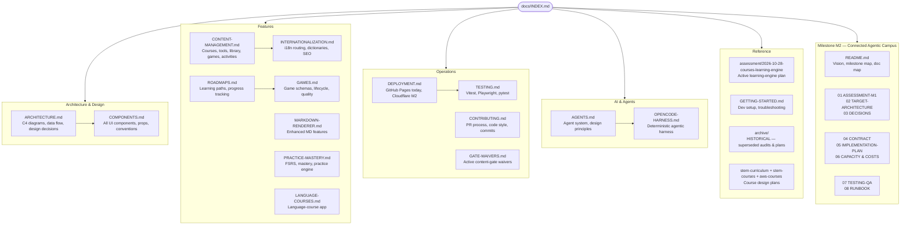

# Nuniversity Platform — Documentation Index

> **Nuniversity** is an open, multilingual educational platform built with **Next.js 15** and deployed as a static site (GitHub Pages during M1; Cloudflare Pages primary from M2).
> Mission: *Empower learners worldwide through accessible, interactive, and high-quality education.*

---

## Documentation Map



---

## Quick Start

```bash
# 1. Install dependencies
npm install

# 2. Run in development mode
npm run dev

# 3. Open in browser
open http://localhost:3000  # (or :3001 if 3000 is in use)
```

---

## Platform Overview

Nuniversity is composed of the following main features, all accessible via a locale-prefixed URL (e.g. `/en/`, `/pt/`, `/es/`):

| Feature | URL Pattern | Description |
|---|---|---|
| **Home** | `/{lang}` | Landing page with hero and features |
| **Courses** | `/{lang}/courses` | 49 Markdown-driven learning paths |
| **Tools** | `/{lang}/tools` | 10 interactive productivity/study tools |
| **Games** | `/{lang}/games` | 7 games across 6 categories |
| **Languages** | `/{lang}/languages` | 5 vocabulary activities (matching & flashcards) |
| **Quizzes** | `/{lang}/quizzes` | Certification quizzes & timed mock exams |
| **Library** | `/{lang}/library` | 118 curated external learning resources |
| **Roadmaps** | `/{lang}/roadmaps` | Structured learning paths with progress |
| **About** | `/{lang}/about` | Mission, vision, team |
| **Contact** | `/{lang}/contact` | Contact form (Formspree) |

---

## Supported Languages

| Code | Language | Flag |
|---|---|---|
| `en` | English | 🇺🇸 |
| `pt` | Português | 🇧🇷 |
| `es` | Español | 🇪🇸 |

---

## Documentation by Category

### Architecture & Design

Understand how the system is built.

| Document | Lines | What You'll Learn |
|---|---|---|
| [ARCHITECTURE.md](./architecture/ARCHITECTURE.md) | 450 | System diagrams, folder structure, data flow, theme system, key design decisions |
| [COMPONENTS.md](./architecture/COMPONENTS.md) | 1,150 | Curated component reference — props, usage patterns, server vs client conventions |

### Features

How each feature works and how to extend it.

| Document | Lines | What You'll Learn |
|---|---|---|
| [CONTENT-MANAGEMENT.md](./features/CONTENT-MANAGEMENT.md) | 580 | Adding courses, tools, library resources, games, language activities — file formats, frontmatter reference |
| [INTERNATIONALIZATION.md](./features/INTERNATIONALIZATION.md) | 485 | i18n routing, dictionary loading, locale fallback, adding new languages |
| [ROADMAPS.md](./features/ROADMAPS.md) | 621 | Roadmap architecture, step types, progress tracking, data model |
| [GAMES.md](./features/GAMES.md) | 278 | Game system, lifecycle, content quality standards (vocabulary content moved to Languages — see CONTENT-MANAGEMENT.md) |
| [MARKDOWN-RENDERER.md](./features/MARKDOWN-RENDERER.md) | 216 | Enhanced Markdown: code blocks, alert boxes, Mermaid diagrams, tables |
| [PRACTICE-MASTERY.md](./features/PRACTICE-MASTERY.md) | 120 | Practice keys, Beta-posterior mastery, FSRS scheduling, review cards |
| [LANGUAGE-COURSES.md](./features/LANGUAGE-COURSES.md) | 150 | Language-course routes, exercise types, vocab SRS |

### Operations

How to deploy, test, and contribute.

| Document | Lines | What You'll Learn |
|---|---|---|
| [DEPLOYMENT.md](./operations/DEPLOYMENT.md) | 420 | GitHub Pages today; M2 Cloudflare Pages dual deploy, CI/CD pipeline, static export constraints |
| [TESTING.md](./operations/TESTING.md) | 320 | Test plan & suites (1,704 vitest / 795 pytest), artifact + e2e layers, Vitest setup |
| [CONTRIBUTING.md](./operations/CONTRIBUTING.md) | 500 | Branching, commit conventions, PR process, code style |
| [GATE-WAIVERS.md](./operations/GATE-WAIVERS.md) | 110 | Active content-gate waiver manifest (lesson-level gates), enforced by CI |

### AI & Agents

AI-powered content generation and development workflows.

| Document | Lines | What You'll Learn |
|---|---|---|
| [AGENTS.md](./ai/AGENTS.md) | 397 | Course Writer & Game Builder agents, usage templates, LLM config |
| [OPENCODE-HARNESS.md](./ai/OPENCODE-HARNESS.md) | 1954 | Deterministic agentic harness: hooks, skills, memory, agents |

### Reference

Assessment, setup, and course-plan tracking.

| Document | Lines | What You'll Learn |
|---|---|---|
| [assessment/2026-10-28-courses-learning-engine/](./assessment/2026-10-28-courses-learning-engine/IMPLEMENTATION-PLAN.md) | 3 files | **Active** — learning-engine plan: phases 0–3 implemented (FSRS, mastery, practice, review); phases 4–6 pending. `DECISIONS.md` is authoritative over the plan |
| [archive/](./archive/README.md) | 27 files | **HISTORICAL — superseded.** 2026-10-26 full audit, 2026 app review + executed phase plans, `PLAN-MODERNIZATION.md` (its Clerk/Neon/PostHog choices are superseded by M2 DR-01/02/09), legacy September audit |
| [GETTING-STARTED.md](./getting-started/GETTING-STARTED.md) | 284 | Dev setup via FNM, environment, scripts, troubleshooting |
| [STEM-ROADMAP.md](./stem-curriculum/STEM-ROADMAP.md) | 350 | STEM curriculum roadmap and course sequencing |
| [stem-courses/](./stem-courses/) | 23 files | Course design documents (22 planned; nonprofit course shipped) |
| [aws-courses/](./aws-courses/) | 5 files | AWS/Databricks course and quiz-bank designs |

> **Security documents** with open findings are kept outside the committed tree in the gitignored
> `docs/_private/` folder until the queued items are fixed and the register is sanitized.

### Milestone Planning

Where the platform is going next, and why.

| Document | What You'll Learn |
|---|---|
| [milestone-m2/README.md](./milestone-m2/README.md) | M2 "Connected Agentic Campus" — vision, milestone map (M1→M2→M3), invariants, doc set map, supersession of PLAN-MODERNIZATION backend choices |
| [milestone-m2/01-ASSESSMENT-M1.md](./milestone-m2/01-ASSESSMENT-M1.md) | Deep assessment of the current MVP: inventories, debt register, limitations L1–L7 |
| [milestone-m2/02-TARGET-ARCHITECTURE.md](./milestone-m2/02-TARGET-ARCHITECTURE.md) | Target architecture: two content planes, service selection (verified free tiers), personalization engine, RAG knowledge base, migration strategy |
| [milestone-m2/03-DECISIONS.md](./milestone-m2/03-DECISIONS.md) | Decision records DR-01…DR-10 (ADR format): Supabase Auth, D1+R2, LlmRouter, dual deploy, degradation ladder |
| [milestone-m2/04-CONTRACT.md](./milestone-m2/04-CONTRACT.md) | Technical contract: learner state v3 + merge rules, D1 schema, R2 pack/shard formats, API surface, interfaces, secrets |
| [milestone-m2/05-IMPLEMENTATION-PLAN.md](./milestone-m2/05-IMPLEMENTATION-PLAN.md) | Phased plan P0–P7: tasks with file paths, acceptance criteria, DoD, effort, dependency list |
| [milestone-m2/06-CAPACITY-AND-COSTS.md](./milestone-m2/06-CAPACITY-AND-COSTS.md) | Verified free-tier ledger (dated), capacity math, burn alarms, degradation ladder |
| [milestone-m2/07-TESTING-QA.md](./milestone-m2/07-TESTING-QA.md) | M2 test strategy: sync property fuzz, contract tests, e2e journeys, AI eval pipeline, CI gates |
| [milestone-m2/08-RUNBOOK.md](./milestone-m2/08-RUNBOOK.md) | Operations: deploys, migrations, cron jobs, backups, incident playbook, rollback, weekly checklist |

---

## Tech Stack

| Layer | Technology |
|---|---|
| Framework | Next.js 15 (App Router, React 19, static export) |
| Language | TypeScript 5 |
| Styling | Tailwind CSS v3 (3-layer token system; DaisyUI removed in the 2026-10 redesign) |
| Coming in M2 | Cloudflare Pages/Workers (Hono) + D1 + R2, Supabase Auth (IdP), budgeted AI LLM router |
| Markdown | react-markdown + remark-gfm + rehype-raw |
| Diagrams | Mermaid.js |
| Code Highlight | react-syntax-highlighter |
| Animations | Framer Motion |
| Forms | React Hook Form + Formspree |
| Testing | Vitest + @testing-library/react |
| Deployment | GitHub Pages (static export) |
| Analytics (M2) | Cloudflare Web Analytics + D1 product events |
| AI Agents | OpenCode + @opencode-ai/plugin |

---

## Platform Statistics

| Metric | Count |
|---|---|
| Courses | 49 |
| Lessons (markdown) | 1,299 (436 en · 456 pt · 406 es) |
| Languages | 3 (EN, PT, ES) |
| Interactive Tools | 10 |
| Games | 7 |
| Language Activities | 5 pairs + 1 language course |
| Quiz banks | 4 (AWS AIF/CLF/DEA, Snowflake C03) |
| Library Resources | 118 (en 10 · pt 50 · es 58) |
| Roadmaps | 2 |
| Documentation Files | 86 |

---

## Copyright

© 2026 Nuniversity. All Rights Reserved.
