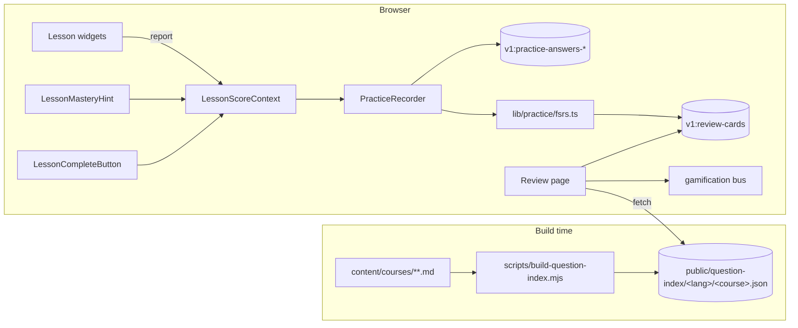

# Courses Learning Engine — Implementation Plan (Phases 0–3)

- **Date:** 2026-10-28
- **Status:** Approved plan, ready for implementation
- **Scope of this document:** Phases 0–3 in full, step-by-step detail. Phases 4–6 are summarized at the end (separate plans will follow).
- **Source inputs:**
  - `docs/assessment/2026-10-26-full-audit/` (31 findings; PERF-01 verified already fixed — see P0-S0)
  - Learning-science research synthesis (Dunlosky et al. 2013 six strategies; Bloom 2-sigma mastery learning; Mayer multimedia principles; CAST UDL 3.0; FSRS scheduler; Self-Determination Theory)
  - Prior planning conversation (2026-10-28): full program approved; soft mastery gates at 70%; JavaScript-only code runner in a later phase.

---

## 0. Execution protocol for small models — READ THIS FIRST

You (the executing agent) must follow these rules for every step in this document.

1. **Work steps strictly in order.** Do not start a step before every step it depends on (see the step index, §4) is verified.
2. **One step = one unit of work.** Create or modify only the files a step names. Never reformat, rename, or "improve" code outside the step's target.
3. **Read before writing.** Each step lists a `CONTEXT` line: files to open and read before editing. If the real file differs from what a step quotes, adapt to the real file and keep the step's *intent*, never invent new APIs.
4. **Verify every step.** Run the step's `VERIFY` commands. A step is done only when its verification passes.
5. **Two-strike rule.** If a step's verification fails twice for the same reason, stop that step, write the blocker to `.scratch/learning-engine/PROGRESS.md` (one line: step ID, error, hypothesis), and move to the next step marked `INDEPENDENT`. Report blocked steps at the end.
6. **Track progress.** Create `.scratch/learning-engine/PROGRESS.md` before P0-S1 and append one line per finished step: `- [x] P0-S1 <one-line result>`.
7. **No drive-by refactors.** No dependency upgrades (except the one `npm install` in P0-S1), no config changes, no content (`content/courses/**`) changes anywhere in Phases 0–3.
8. **Commits.** Do not commit unless the operator explicitly asks. At the end of each phase, print a summary of changed files and the gate results so the operator can commit.
9. **Match surrounding style.** The repo uses TypeScript strict mode, single quotes in TS/TSX, 2-space indent, existing helpers from `@/lib/storage/safe-storage`. Follow the file you are editing.
10. **Never trust "it should work".** Every claim of completion must be backed by a command you actually ran.

**Global gates (run at the end of every phase):**

```bash
npm run test      # vitest, all green
npm run lint      # next lint, no new errors
npm run build     # full static build, must succeed
```

Python (only when a step touches the skill):

```bash
python -m pytest .opencode/skills/course-writer/tests -q
```

---

## 1. Context: what exists and what we are building

### 1.1 Current platform (verified 2026-10-28)

- Next.js 14 App Router, `output: 'export'` static site on GitHub Pages (user site → `basePath` is always `''` in production). Locales: `en`, `pt`, `es` (see `lib/i18n/config.ts`).
- 49 courses, ~1,299 lessons under `content/courses/<slug>/<locale>/<NN-lesson>.md`; metadata in `content/courses/<slug>/course.json`.
- Lesson viewer: `app/[lang]/courses/[courseSlug]/[lessonSlug]/page.tsx`. Interactive widgets (`question`, `matching`, `fillblank`, `dragdrop` fences) are parsed by `components/markdown/MarkdownRenderer.tsx` and scored in-memory by `components/lessons/LessonScoreContext.tsx` (`LessonScoreProvider` → `register`/`report`).
- **Key gap:** widget answers are never persisted. Score state resets on navigation. There is no spaced review, no interleaving, no mastery model.
- Progress that *does* persist (via `lib/progress/storage.ts`, all `localStorage` through `lib/storage/safe-storage.ts`): lesson completion, last-visited pointer, quiz/exam attempts, XP/badges/streak (`lib/gamification/`).
- `package.json` `prebuild` runs `node scripts/publish-media.mjs && node scripts/generate-search-index.mjs` — we will add our build script there.

### 1.2 What we build (Phases 0–3)

A **client-side learning engine** that turns the ~5,783 existing `question` fences into a learner model:

- **P0:** error boundary + storage schema for practice answers + FSRS scheduler wrapper.
- **P1:** persist every in-lesson widget answer (per-skill EWMA mastery); extend the course-writer validators for new frontmatter.
- **P2:** mastery UX — a live mastery bar and a soft "review recommended" gate on lesson completion.
- **P3:** a build-time question index, a **Daily Review** page (FSRS-scheduled, cross-course, interleaved), a per-course **Mixed Practice** page, a due-cards dashboard card, and XP for review sessions.

Everything stays static and local: no backend, no new runtime dependencies except `ts-fsrs` (pure TypeScript, no WASM).

### 1.3 Locked decisions (do not revisit during implementation)

| Decision | Value |
|---|---|
| Mastery gate | **Soft**: completion always allowed; below 70% show "review recommended" |
| Mastery model | Per-record EWMA of correctness, alpha 0.3, initialized with first outcome |
| Spaced repetition | **FSRS** via `ts-fsrs@4.5.0` (pinned: v5+/v7 changed the API to `DefaultScheduler`), `request_retention` 0.9, fuzz enabled; rating `Rating.Good` on correct, `Rating.Again` on incorrect |
| Practice key scheme | **`<courseSlug>::<authoredId>`** when an authored id exists, else `<courseSlug>::<hashKey(lessonSlug::label)>`. Course prefix is mandatory: authored ids are unique per course, not globally |
| Review session size | Max 20 due cards per session, mixed practice 10 per session |
| Review XP | 10 XP per completed session of ≥5 cards, at most once per local calendar day (`dayKey()`) |
| Scope of persisted answers | Non-exam lessons only (exam-mode lessons already persist attempts via the Quizzes storage) |
| Question index | MCQ/true-false `question` fences only; per locale; en fallback mirrors runtime fallback; ids course-prefixed |
| Local storage keys | New: `v1:practice-answers-<courseSlug>`, `v1:review-cards`, `v1:review-xp-day`. Existing keys unchanged (no migration needed — additive schema) |
| Code runner | Deferred to Phase 4, **JavaScript-only**, sandboxed iframe (see `IMPLEMENTATION-PLAN-PHASES-4-6.md`) |

### 1.4 Storage schemas (final — implement exactly)

```ts
// One record per answered widget, stored per course.
interface PracticeAnswerStore {
  version: 2
  updatedAt: string                  // ISO 8601
  answers: Record<string, PracticeAnswerRecord>   // keyed by stable practice key
}

interface PracticeAnswerRecord {
  key: string            // authored question id when available, else hashed label
  lessonSlug: string
  label: string          // question text (display)
  skill: string | null   // lesson-level skill tag, v1: first/only skill of the lesson
  attempts: number
  correct: number
  ewma: number           // 0..1 mastery estimate for this record
  lastCorrect: boolean
  lastAnsweredAt: string // ISO 8601
}

// Global FSRS card state, one per practice key, across all courses.
interface ReviewCardState {
  key: string
  courseSlug: string
  lessonSlug: string
  due: string            // ISO 8601
  stability: number
  difficulty: number
  elapsed_days: number
  scheduled_days: number
  reps: number
  lapses: number
  state: number          // ts-fsrs Card.State as number
  lastReview: string | null
}
```

Build-time question index (generated, not hand-written), one file per course per locale at
`public/question-index/<lang>/<courseSlug>.json`:

```json
{
  "course": "sql-beginner",
  "lang": "en",
  "generatedAt": "2026-10-28T00:00:00.000Z",
  "count": 42,
  "questions": [
    {
      "id": "sql-beginner::sql-01-q1",
      "lesson": "01-what-is-sql-rdbms",
      "type": "multiple-choice",
      "question": "…",
      "options": ["…", "…"],
      "correct": 2,
      "explanation": "…"
    }
  ]
}
```

### 1.5 Architecture (data flow)



---

## 2. Step index

| Step | Phase | Summary | Files | Depends on |
|---|---|---|---|---|
| P0-S0 | 0 | Confirm PERF-01 already fixed | (read-only) | — |
| P0-S1 | 0 | Install `ts-fsrs` | `package.json` (via npm) | — |
| P0-S2 | 0 | Lesson error boundary | `components/lessons/LessonErrorBoundary.tsx`, lesson `page.tsx` | — |
| P0-S3 | 0 | Practice types + answer store | `lib/practice/types.ts`, `lib/practice/record.ts` | — |
| P0-S4 | 0 | FSRS wrapper + card store | `lib/practice/fsrs.ts`, `lib/practice/cards.ts` | P0-S1, P0-S3 |
| P0-S5 | 0 | Practice unit tests | `tests/lib/practice-record.test.ts`, `tests/lib/practice-fsrs.test.ts` | P0-S3, P0-S4 |
| P1-S1 | 1 | Add stable `key` to widget results | `LessonScoreContext.tsx`, `QuestionBlock.tsx` | P0-S3 |
| P1-S2 | 1 | PracticeRecorder component | `components/lessons/PracticeRecorder.tsx` | P0-S3, P0-S4, P1-S1 |
| P1-S3 | 1 | Wire recorder into lesson page | `app/[lang]/courses/[courseSlug]/[lessonSlug]/page.tsx` | P1-S2 |
| P1-S4 | 1 | `skills`/`objectives` frontmatter types | `lib/courses/get-course-content.ts` | — |
| P1-S5 | 1 | course-writer validator update | `.opencode/skills/course-writer/scripts/validate_lesson.py`, `references/practice-metadata.md` | — |
| P2-S1 | 2 | LessonMasteryHint component | `components/lessons/LessonMasteryHint.tsx` | P1-S1 |
| P2-S2 | 2 | Soft gate in complete button | `components/lessons/LessonProgress.tsx` | P2-S1 |
| P2-S3 | 2 | Page wiring (provider wraps CTA) | lesson `page.tsx` | P1-S3, P2-S1, P2-S2 |
| P3-S1 | 3 | Question-fence parser module | `scripts/lib/question-fences.mjs` | — |
| P3-S2 | 3 | Question-index build script | `scripts/build-question-index.mjs`, `package.json` | P3-S1 |
| P3-S3 | 3 | Review card due helpers | `lib/practice/cards.ts` (extend) | P0-S4 |
| P3-S4 | 3 | Review XP event | `lib/gamification/types.ts`, `lib/gamification/profile.ts` | — |
| P3-S5 | 3 | ReviewClient component | `components/review/ReviewClient.tsx` | P3-S2, P3-S3, P3-S4 |
| P3-S6 | 3 | Review page + mixed practice page | `app/[lang]/review/page.tsx`, `app/[lang]/courses/[courseSlug]/practice/page.tsx` | P3-S5 |
| P3-S7 | 3 | ReviewDueCard on courses page | `components/review/ReviewDueCard.tsx`, `app/[lang]/courses/courses-client.tsx` | P3-S3 |
| P3-S8 | 3 | Dictionary strings | `dictionaries/en.json`, `dictionaries/pt.json`, `dictionaries/es.json` | — |
| P3-S9 | 3 | Feature doc | `docs/features/PRACTICE-MASTERY.md` | — |

---

## 3. Phase 0 — Foundations

### P0-S0 — Confirm PERF-01 (Prism bundle) is already fixed

`CONTEXT:` `components/markdown/FixWrapper.tsx`

The 2026-10-26 audit lists PERF-01 as open, but the file already uses `PrismLight` with 20 explicitly registered grammars. Do not implement anything. Just confirm and record:

VERIFY:
```bash
grep -n "PrismLight" components/markdown/FixWrapper.tsx | head -1
# expected: import { PrismLight as SyntaxHighlighter } from 'react-syntax-highlighter'
```
Append to `.scratch/learning-engine/PROGRESS.md`: `- [x] P0-S0 PERF-01 already fixed (PrismLight, 20 grammars)`.

### P0-S1 — Install ts-fsrs (pinned)

```bash
npm install --save-exact ts-fsrs@4.5.0
```

**Why pinned:** `ts-fsrs` v5+/v7 replaced `fsrs()`/`createEmptyCard()`/`repeat()` with an async `DefaultScheduler` and renamed card fields (`dueAt`). Pinning 4.5.0 keeps the API used in P0-S4 stable. Do not upgrade during this program.

VERIFY:
```bash
node -e "
const { fsrs, createEmptyCard, generatorParameters, Rating } = require('ts-fsrs');
const f = fsrs(generatorParameters({ enable_fuzz: false }));
const card = createEmptyCard(new Date('2026-01-01T00:00:00Z'));
const good = f.repeat(card, new Date('2026-01-02T00:00:00Z'))[Rating.Good].card;
if (!(good.due.getTime() > new Date('2026-01-02T00:00:00Z').getTime())) throw new Error('not scheduled');
console.log('ok', Rating.Again, Rating.Good, good.due.toISOString());
"
# expected: "ok 1 3 2026-01-0?T..." — the card is scheduled into the future
```

If this prints an error about a different API shape, the installed version is wrong — reinstall the pinned version, do not adapt the code around it. If npm cannot resolve 4.5.0 in this environment, use the newest 4.x (`npm view ts-fsrs versions --json`), record the exact version in `PROGRESS.md`, and confirm the same snippet works.

Fallback (Plan B) if no 4.x can be installed: implement an in-house SM-2-lite scheduler inside `lib/practice/fsrs.ts` only. Plan B spec: `newCard` sets `due = now`; `review(card, correct, now)`: correct → `interval = max(1, ceil(previousInterval * 2.3))` (first review 2d, second 6d), incorrect → `interval = 1`, `lapses += 1`; `due = now + interval days`; clamp to 180 days. Record `State` 0..3 for compatibility. Do not change any other file.

### P0-S2 — Lesson error boundary (audit ARCH-04)

`CONTEXT:` `app/[lang]/courses/[courseSlug]/[lessonSlug]/page.tsx`

**Create** `components/lessons/LessonErrorBoundary.tsx` with exactly:

```tsx
'use client'

import { Component, type ReactNode } from 'react'
import { AlertTriangle, RotateCcw } from 'lucide-react'

interface LessonErrorBoundaryProps {
  children: ReactNode
}

interface LessonErrorBoundaryState {
  error: Error | null
}

/**
 * Guards the rendered lesson body. A single malformed fence must degrade to
 * a friendly retry card instead of blanking the whole page (audit ARCH-04).
 * Chrome only: marked data-audio-skip so the read-aloud feature ignores it.
 */
export default class LessonErrorBoundary extends Component<LessonErrorBoundaryProps, LessonErrorBoundaryState> {
  state: LessonErrorBoundaryState = { error: null }

  static getDerivedStateFromError(error: Error): LessonErrorBoundaryState {
    return { error }
  }

  private reset = () => {
    this.setState({ error: null })
  }

  render() {
    if (this.state.error) {
      return (
        <div role="alert" data-audio-skip className="my-8 rounded-xl border border-red-300 dark:border-red-800 bg-red-50 dark:bg-red-950/30 p-6 text-center">
          <AlertTriangle className="mx-auto h-8 w-8 text-red-600 dark:text-red-400" />
          <p className="mt-3 font-medium text-red-800 dark:text-red-200">
            This part of the lesson failed to render.
          </p>
          <p className="mt-1 text-sm text-red-700/80 dark:text-red-300/80 break-words">
            {this.state.error.message}
          </p>
          <button
            type="button"
            onClick={this.reset}
            className="mt-4 inline-flex items-center gap-2 rounded-lg border border-red-300 dark:border-red-800 px-4 py-2 text-sm font-medium text-red-800 dark:text-red-200 hover:bg-red-100 dark:hover:bg-red-900/40"
          >
            <RotateCcw className="h-4 w-4" />
            Try again
          </button>
        </div>
      )
    }
    return this.props.children
  }
}
```

**Edit** `app/[lang]/courses/[courseSlug]/[lessonSlug]/page.tsx`:
1. Add to the imports: `import LessonErrorBoundary from '@/components/lessons/LessonErrorBoundary'`
2. Inside the lesson content card, wrap the `<div className="prose-measure">` children: place `<LessonErrorBoundary>` immediately inside `<div className="prose-measure">` and `</LessonErrorBoundary>` immediately before its closing `</div>`, so **both** the exam branch and the normal branch are covered. Do not change anything else in the file in this step.

VERIFY:
```bash
npm run build && npx tsc --noEmit
```

### P0-S3 — Practice types + answer store

**Create** `lib/practice/types.ts` with exactly the schema block from §1.4 as TypeScript:

```ts
/**
 * Learner-model storage schema v2. All data stays in localStorage; nothing
 * identifies the user. Keys are additive — no existing v1 key changes.
 */

export interface PracticeAnswerRecord {
  key: string
  lessonSlug: string
  label: string
  skill: string | null
  attempts: number
  correct: number
  /** 0..1 correctness estimate for this record. */
  ewma: number
  lastCorrect: boolean
  lastAnsweredAt: string
}

export interface PracticeAnswerStore {
  version: 2
  updatedAt: string
  answers: Record<string, PracticeAnswerRecord>
}

export interface ReviewCardState {
  key: string
  courseSlug: string
  lessonSlug: string
  due: string
  stability: number
  difficulty: number
  elapsed_days: number
  scheduled_days: number
  reps: number
  lapses: number
  state: number
  lastReview: string | null
}

export type ReviewCardMap = Record<string, ReviewCardState>
```

**Create** `lib/practice/record.ts` with exactly:

```ts
import { isSafeKey, readJson, writeJson } from '@/lib/storage/safe-storage'
import type { PracticeAnswerRecord, PracticeAnswerStore } from './types'

export const PRACTICE_PREFIX = 'v1:practice-answers-'

/** EWMA smoothing factor: weight of the newest outcome. */
export const EWMA_ALPHA = 0.3

export function practiceKey(courseSlug: string): string {
  return `${PRACTICE_PREFIX}${courseSlug}`
}

/**
 * Deterministic short key (djb2, base36). Used when a widget has no authored
 * id, so the same question maps to the same record across sessions.
 */
export function hashKey(input: string): string {
  let h = 5381
  for (let i = 0; i < input.length; i++) {
    h = ((h << 5) + h + input.charCodeAt(i)) | 0
  }
  return `h-${(h >>> 0).toString(36)}`
}

/**
 * Globally unique practice key. Authored ids are unique per course only, so the
 * course slug prefix prevents collisions across the 49 courses.
 */
export function stablePracticeKey(courseSlug: string, authoredId: string | undefined, lessonSlug: string, label: string): string {
  const base = authoredId && authoredId.trim() !== '' ? authoredId.trim() : hashKey(`${lessonSlug}::${label}`)
  return `${courseSlug}::${base}`
}

function emptyStore(): PracticeAnswerStore {
  return { version: 2, updatedAt: new Date().toISOString(), answers: Object.create(null) }
}

function finite(value: unknown, fallback: number): number {
  return typeof value === 'number' && Number.isFinite(value) ? value : fallback
}

function sanitizeRecord(raw: unknown): PracticeAnswerRecord | null {
  if (typeof raw !== 'object' || raw === null) return null
  const value = raw as Record<string, unknown>
  if (typeof value.key !== 'string' || typeof value.lessonSlug !== 'string') return null
  return {
    key: value.key,
    lessonSlug: value.lessonSlug,
    label: typeof value.label === 'string' ? value.label : '',
    skill: typeof value.skill === 'string' ? value.skill : null,
    attempts: Math.max(1, Math.floor(finite(value.attempts, 1))),
    correct: Math.max(0, Math.floor(finite(value.correct, 0))),
    ewma: Math.min(1, Math.max(0, finite(value.ewma, 0))),
    lastCorrect: value.lastCorrect === true,
    lastAnsweredAt: typeof value.lastAnsweredAt === 'string' ? value.lastAnsweredAt : new Date().toISOString(),
  }
}

function sanitizeStore(raw: unknown): PracticeAnswerStore | null {
  if (typeof raw !== 'object' || raw === null) return null
  const value = raw as Record<string, unknown>
  if (value.version !== 2 || typeof value.answers !== 'object' || value.answers === null) return null
  const answers: Record<string, PracticeAnswerRecord> = Object.create(null)
  for (const [k, v] of Object.entries(value.answers as Record<string, unknown>)) {
    if (!isSafeKey(k)) continue
    const record = sanitizeRecord(v)
    if (record) answers[k] = record
  }
  return {
    version: 2,
    updatedAt: typeof value.updatedAt === 'string' ? value.updatedAt : new Date().toISOString(),
    answers,
  }
}

export function getPracticeStore(courseSlug: string): PracticeAnswerStore {
  return readJson<PracticeAnswerStore>(practiceKey(courseSlug), sanitizeStore) ?? emptyStore()
}

function saveStore(store: PracticeAnswerStore, courseSlug: string): void {
  store.updatedAt = new Date().toISOString()
  writeJson(practiceKey(courseSlug), store)
}
```

Continue `lib/practice/record.ts` with exactly:

```ts
export interface RecordAnswerInput {
  key: string
  label: string
  skill?: string | null
  correct: boolean
}

/**
 * Records one answer event and updates the EWMA mastery estimate.
 * First observation initializes ewma with the outcome; later observations
 * blend: ewma = ewma*(1-alpha) + outcome*alpha.
 */
export function recordPracticeAnswer(
  courseSlug: string,
  lessonSlug: string,
  input: RecordAnswerInput
): PracticeAnswerRecord {
  const store = getPracticeStore(courseSlug)
  const existing = store.answers[input.key]
  const outcome = input.correct ? 1 : 0

  let record: PracticeAnswerRecord
  if (existing) {
    const attempts = existing.attempts + 1
    const correct = existing.correct + (input.correct ? 1 : 0)
    const ewma = existing.ewma * (1 - EWMA_ALPHA) + outcome * EWMA_ALPHA
    record = { ...existing, attempts, correct, ewma, lastCorrect: input.correct, lastAnsweredAt: new Date().toISOString() }
  } else {
    record = {
      key: input.key,
      lessonSlug,
      label: input.label,
      skill: input.skill ?? null,
      attempts: 1,
      correct: input.correct ? 1 : 0,
      ewma: outcome,
      lastCorrect: input.correct,
      lastAnsweredAt: new Date().toISOString(),
    }
  }

  store.answers[input.key] = record
  saveStore(store, courseSlug)
  return record
}

/** Mean EWMA across a lesson's answered records, or null when none exist. */
export function lessonMastery(store: PracticeAnswerStore, lessonSlug: string): number | null {
  const records = Object.values(store.answers).filter((r) => r.lessonSlug === lessonSlug)
  if (records.length === 0) return null
  return records.reduce((sum, r) => sum + r.ewma, 0) / records.length
}

/** Slugs of courses that have at least one recorded practice answer. */
export function listCoursesWithPractice(): string[] {
  if (typeof window === 'undefined') return []
  const slugs: string[] = []
  try {
    for (let i = 0; i < window.localStorage.length; i++) {
      const k = window.localStorage.key(i)
      if (k && k.startsWith(PRACTICE_PREFIX)) {
        slugs.push(k.slice(PRACTICE_PREFIX.length))
      }
    }
  } catch {
    return []
  }
  return slugs
}
```

VERIFY:
```bash
npx tsc --noEmit
```

### P0-S4 — FSRS wrapper + review-card store

`CONTEXT:` the README of the installed `ts-fsrs` version (`node_modules/ts-fsrs/README.md`) — confirm the exported names `fsrs`, `createEmptyCard`, `generatorParameters`, `Grade`, `State`, and the `Card` fields used below. If names differ, adapt **only this file and `cards.ts`**; nothing else may import `ts-fsrs` (single-import rule).

**Create** `lib/practice/fsrs.ts`:

```ts
/**
 * The ONLY module in the codebase allowed to import ts-fsrs (pinned 4.5.0).
 * Mapping: correct answer -> Rating.Good, incorrect -> Rating.Again.
 */
import {
  createEmptyCard,
  fsrs,
  generatorParameters,
  Rating,
  type Card,
  type RecordLogItem,
  type State,
} from 'ts-fsrs'
import type { ReviewCardState } from './types'

const scheduler = fsrs(generatorParameters({ request_retention: 0.9, enable_fuzz: true }))

export function toRating(correct: boolean): Rating {
  return correct ? Rating.Good : Rating.Again
}

export function newCard(key: string, courseSlug: string, lessonSlug: string, now: Date = new Date()): ReviewCardState {
  return serializeCard(createEmptyCard(now), key, courseSlug, lessonSlug)
}

export function reviewCard(
  state: ReviewCardState,
  correct: boolean,
  now: Date = new Date()
): { next: ReviewCardState; log: RecordLogItem } {
  const card = deserializeCard(state)
  const result = scheduler.repeat(card, now)[toRating(correct)]
  return { next: serializeCard(result.card, state.key, state.courseSlug, state.lessonSlug), log: result }
}

export function isDue(state: ReviewCardState, now: Date = new Date()): boolean {
  return new Date(state.due).getTime() <= now.getTime()
}

function serializeCard(card: Card, key: string, courseSlug: string, lessonSlug: string): ReviewCardState {
  return {
    key,
    courseSlug,
    lessonSlug,
    due: new Date(card.due).toISOString(),
    stability: card.stability,
    difficulty: card.difficulty,
    elapsed_days: card.elapsed_days,
    scheduled_days: card.scheduled_days,
    reps: card.reps,
    lapses: card.lapses,
    state: card.state as number,
    lastReview: card.last_review ? new Date(card.last_review).toISOString() : null,
  }
}

function deserializeCard(state: ReviewCardState): Card {
  return {
    due: new Date(state.due),
    stability: state.stability,
    difficulty: state.difficulty,
    elapsed_days: state.elapsed_days,
    scheduled_days: state.scheduled_days,
    reps: state.reps,
    lapses: state.lapses,
    state: state.state as State,
    last_review: state.lastReview ? new Date(state.lastReview) : null,
  } as unknown as Card
}
```

Version note: on `ts-fsrs@4.5.0`, `Rating` is a numeric enum (`Again=1, Hard=2, Good=3, Easy=4`) and `scheduler.repeat(card, now)` returns a `RecordLog` keyed by those values. **Never use string keys (`'Good'`)** — that silently returns `undefined` and crashes on `.card`. If the installed 4.x exposes `Grades` instead of `Rating`, alias it in the import (`Rating as Grades`) rather than changing any other file.

**Create** `lib/practice/cards.ts`:

```ts
import { readJson, writeJson } from '@/lib/storage/safe-storage'
import type { ReviewCardMap, ReviewCardState } from './types'
import { isDue } from './fsrs'

const REVIEW_CARDS_KEY = 'v1:review-cards'
/** Defensive cap so a long-lived profile cannot exceed localStorage limits. */
const MAX_CARDS = 5000

function sanitize(raw: unknown): ReviewCardMap | null {
  if (typeof raw !== 'object' || raw === null) return null
  const value = raw as Record<string, unknown>
  const map: ReviewCardMap = Object.create(null)
  for (const [k, v] of Object.entries(value)) {
    if (typeof v !== 'object' || v === null) continue
    const card = v as Record<string, unknown>
    if (typeof card.key !== 'string' || typeof card.due !== 'string') continue
    map[k] = v as unknown as ReviewCardState
  }
  return map
}

export function getReviewCards(): ReviewCardMap {
  return readJson<ReviewCardMap>(REVIEW_CARDS_KEY, sanitize) ?? Object.create(null)
}

export function saveReviewCard(state: ReviewCardState): void {
  const map = getReviewCards()
  map[state.key] = state
  writeJson(REVIEW_CARDS_KEY, map)
}

export function getDueCards(now: Date = new Date()): ReviewCardState[] {
  return Object.values(getReviewCards()).filter((c) => isDue(c, now))
}
```

VERIFY:
```bash
npx tsc --noEmit
```

### P0-S5 — Unit tests for the engine core

`CONTEXT:` `tests/progress/` and `tests/gamification/` for style; `vitest.config.ts` (jsdom, `@` alias).

**Create** `tests/practice/record.test.ts`:

```ts
import { beforeEach, describe, expect, it } from 'vitest'
import {
  EWMA_ALPHA,
  getPracticeStore,
  hashKey,
  lessonMastery,
  recordPracticeAnswer,
  stablePracticeKey,
} from '@/lib/practice/record'

beforeEach(() => {
  window.localStorage.clear()
})

describe('hashKey', () => {
  it('is deterministic and prefixed', () => {
    expect(hashKey('a')).toBe(hashKey('a'))
    expect(hashKey('a')).toMatch(/^h-/)
    expect(hashKey('a')).not.toBe(hashKey('b'))
  })
})

describe('stablePracticeKey', () => {
  it('prefixes the course slug and prefers the authored id', () => {
    expect(stablePracticeKey('sql-beginner', 'sql-01-q1', '01-lesson', 'question text')).toBe('sql-beginner::sql-01-q1')
    expect(stablePracticeKey('sql-beginner', undefined, '01-lesson', 'question text')).toMatch(/^sql-beginner::h-/)
  })
})

describe('recordPracticeAnswer + lessonMastery', () => {
  it('initializes ewma with the first outcome and records the course-scoped key', () => {
    const key = stablePracticeKey('course-a', 'q1', '01-lesson', 'q')
    const rec = recordPracticeAnswer('course-a', '01-lesson', { key, label: 'q', skill: null, correct: true })
    expect(rec.attempts).toBe(1)
    expect(rec.ewma).toBe(1)
    expect(getPracticeStore('course-a').answers[key]).toBeDefined()
  })

  it('blends later outcomes with EWMA_ALPHA', () => {
    const key = stablePracticeKey('course-b', 'q1', '01-lesson', 'q')
    recordPracticeAnswer('course-b', '01-lesson', { key, label: 'q', skill: null, correct: true })
    const rec = recordPracticeAnswer('course-b', '01-lesson', { key, label: 'q', skill: null, correct: false })
    expect(rec.attempts).toBe(2)
    expect(rec.ewma).toBeCloseTo(1 * (1 - EWMA_ALPHA) + 0 * EWMA_ALPHA, 10)
  })

  it('lessonMastery averages ewma over the lesson records only', () => {
    recordPracticeAnswer('course-c', '01-a', { key: stablePracticeKey('course-c', 'q1', '01-a', 'q1'), label: 'q1', skill: null, correct: true })
    recordPracticeAnswer('course-c', '01-a', { key: stablePracticeKey('course-c', 'q2', '01-a', 'q2'), label: 'q2', skill: null, correct: false })
    recordPracticeAnswer('course-c', '02-b', { key: stablePracticeKey('course-c', 'q3', '02-b', 'q3'), label: 'q3', skill: null, correct: true })
    const store = getPracticeStore('course-c')
    expect(lessonMastery(store, '01-a')).toBeCloseTo(0.5, 10)
    expect(lessonMastery(store, '02-b')).toBeCloseTo(1, 10)
    expect(lessonMastery(store, '03-missing')).toBeNull()
  })

  it('discards corrupt stored records instead of crashing', () => {
    window.localStorage.setItem('v1:practice-answers-course-d', JSON.stringify({
      version: 2,
      updatedAt: 'x',
      answers: { bad: { attempts: 'NaN' }, good: { key: 'k', lessonSlug: 'l', attempts: '3', ewma: 9 } },
    }))
    const store = getPracticeStore('course-d')
    expect(store.answers.bad).toBeUndefined()
    expect(store.answers.good.attempts).toBe(3)
    expect(store.answers.good.ewma).toBe(1)
  })
})
```

**Create** `tests/practice/fsrs.test.ts`:

```ts
import { beforeEach, describe, expect, it } from 'vitest'
import { isDue, newCard, reviewCard } from '@/lib/practice/fsrs'
import { getReviewCards, saveReviewCard } from '@/lib/practice/cards'

beforeEach(() => {
  window.localStorage.clear()
})

describe('fsrs wrapper', () => {
  it('a new card is due immediately and schedules later after Good', () => {
    const now = new Date('2026-01-01T09:00:00Z')
    const card = newCard('course::q1', 'course', '01-lesson', now)
    expect(isDue(card, now)).toBe(true)
    const { next } = reviewCard(card, true, now)
    expect(new Date(next.due).getTime()).toBeGreaterThan(now.getTime())
    expect(next.reps).toBe(1)
  })

  it('Again schedules sooner than Good', () => {
    const now = new Date('2026-01-01T09:00:00Z')
    const card = newCard('course::q2', 'course', '01-lesson', now)
    const good = reviewCard(card, true, now).next
    const again = reviewCard(card, false, now).next
    expect(new Date(again.due).getTime()).toBeLessThanOrEqual(new Date(good.due).getTime())
  })
})

describe('card store', () => {
  it('persists and returns saved cards', () => {
    const card = newCard('store-k', 'course', '01-lesson', new Date('2026-01-01T09:00:00Z'))
    saveReviewCard(card)
    expect(getReviewCards()['store-k'].key).toBe('store-k')
  })
})
```

VERIFY:
```bash
npm run test
# expected: all test files pass, including the two new ones
```

---

## 4. Phase 1 — Persisting practice answers

### P1-S1 — Stable keys on widget results

`CONTEXT:` `components/lessons/LessonScoreContext.tsx`, `components/markdown/QuestionBlock.tsx`

1. In `LessonScoreContext.tsx`, extend the `LessonWidgetResult` interface with one optional field:

```ts
export interface LessonWidgetResult {
  id: string
  label: string
  total: number
  correct: number
  missed: string[]
  answered: boolean
  /** Authored, stable identifier (e.g. the question fence's `id`). Optional. */
  key?: string
}
```

Do not touch `sameResult` — the key is stable per widget instance, so comparing it is unnecessary.

2. In `QuestionBlock.tsx`, both `report({...})` calls gain one property: `key: data.id,` added after `label: data.question,`. Touch nothing else.

The other widget types (`MatchingQuestion`, `FillBlankQuestion`, `DragOrderQuestion`, `BucketDropQuestion`) are untouched in this phase; the recorder falls back to a hashed label for them.

VERIFY:
```bash
npx tsc --noEmit && npm run test
```

### P1-S2 — PracticeRecorder component

**Create** `components/lessons/PracticeRecorder.tsx` with exactly:

```tsx
'use client'

import { useEffect, useRef } from 'react'
import { useLessonScore } from './LessonScoreContext'
import { recordPracticeAnswer, stablePracticeKey } from '@/lib/practice/record'
import { newCard, reviewCard } from '@/lib/practice/fsrs'
import { getReviewCards, saveReviewCard } from '@/lib/practice/cards'

interface PracticeRecorderProps {
  courseSlug: string
  lessonSlug: string
  /** Lesson-level skill tags from frontmatter (v1: usually 0 or 1). */
  skills?: string[]
}

/**
 * Headless bridge between lesson widgets and the persisted learner model.
 * Renders nothing. On every new widget result it (a) updates the per-course
 * practice answer store and (b) schedules the FSRS review card for that
 * question. Exam-mode lessons do not mount this component.
 */
export default function PracticeRecorder({ courseSlug, lessonSlug, skills = [] }: PracticeRecorderProps) {
  const { results } = useLessonScore()
  const seenRef = useRef<Record<string, string>>({})

  useEffect(() => {
    for (const result of Object.values(results)) {
      if (!result.answered) continue
      const signature = `${result.correct}|${result.missed.length}`
      if (seenRef.current[result.id] === signature) continue
      seenRef.current[result.id] = signature

      const stableKey = stablePracticeKey(courseSlug, result.key, lessonSlug, result.label)
      const skill = skills.length === 1 ? skills[0] : null
      const correct = result.correct > 0

      recordPracticeAnswer(courseSlug, lessonSlug, { key: stableKey, label: result.label, skill, correct })

      const now = new Date()
      const cards = getReviewCards()
      const existing = cards[stableKey]
      const { next } = existing
        ? reviewCard(existing, correct, now)
        : reviewCard(newCard(stableKey, courseSlug, lessonSlug, now), correct, now)
      saveReviewCard(next)
    }
  }, [results, courseSlug, lessonSlug, skills])

  return null
}
```

VERIFY:
```bash
npx tsc --noEmit
```

### P1-S3 — Wire the recorder into the lesson page

`CONTEXT:` `app/[lang]/courses/[courseSlug]/[lessonSlug]/page.tsx`

1. Import: `import PracticeRecorder from '@/components/lessons/PracticeRecorder'`
2. Inside the **non-exam** branch of the content area, add the recorder right after `<LessonScoreSummary dict={dict} />` (still inside the `LessonScoreProvider`):

```tsx
<LessonScoreProvider key={`${courseSlug}/${lessonSlug}`}>
  <MarkdownRenderer ... />
  <LessonScoreSummary dict={dict} />
  <PracticeRecorder courseSlug={courseSlug} lessonSlug={lessonSlug} />
</LessonScoreProvider>
```

Do not pass `skills` yet (P1-S4 adds the frontmatter type; P2-S3 passes it through).

VERIFY (manual, using the dev server):
```bash
npm run dev
# 1. Open http://localhost:3000/en/courses/sql-beginner/  → start any lesson.
# 2. Answer one practice question (correct or not).
# 3. Reload the page, then run in the browser console:
#    JSON.parse(localStorage.getItem('v1:practice-answers-sql-beginner'))
#    JSON.parse(localStorage.getItem('v1:review-cards'))
# expected: both keys exist; the store has one record; review-cards has one card.
# 4. Answer the same question again → attempts increments to 2.
```
Then stop the dev server and run `npm run test && npm run build`.

### P1-S4 — `skills` / `objectives` frontmatter types

`CONTEXT:` `lib/courses/get-course-content.ts`

In the `CourseMetadata` interface add two optional fields (after `examMinutes`):

```ts
  /** Skill tags used by the practice mastery model. Optional; old lessons omit it. */
  skills?: string[]
  /** Learning objectives shown in future UI. Optional. */
  objectives?: string[]
```

No other change. gray-matter passes arrays through; the fields flow automatically wherever `lesson.metadata` is used.

VERIFY:
```bash
npx tsc --noEmit
```

### P1-S5 — course-writer validator update

`CONTEXT:` `.opencode/skills/course-writer/scripts/validate_lesson.py`, `references/lesson-template.md`

1. In `validate_lesson.py`, add a check function next to `validate_frontmatter`. The file's convention is `(errors: list[str], warnings: list[str])`, not tuples:

```python
def check_learning_metadata(data: dict) -> tuple[list[str], list[str]]:
    """skills/objectives are optional; when present they must be lists of strings."""
    errors: list[str] = []
    warnings: list[str] = []
    for field in ("skills", "objectives"):
        if field not in data:
            warnings.append(f"frontmatter: optional '{field}' list missing (recommended)")
            continue
        value = data[field]
        if not isinstance(value, list) or not all(isinstance(x, str) for x in value):
            errors.append(f"frontmatter: '{field}' must be a list of strings")
        elif not value:
            errors.append(f"frontmatter: '{field}' must not be empty when present")
    return errors, warnings
```

Then, inside `validate_frontmatter`, immediately before `return errors, warnings`, add:

```python
    meta_errors, meta_warnings = check_learning_metadata(data)
    errors.extend(meta_errors)
    warnings.extend(meta_warnings)
```

Missing `skills` produces a **warning** (exit code 1, tolerated) — old lessons must keep passing. Wrong *type* produces an **error** (exit 2).

2. **Create** `.opencode/skills/course-writer/references/practice-metadata.md` documenting the two frontmatter fields, the EWMA model, and the rule "one lesson SHOULD carry 1–3 `skills` tags; the recorder uses the tag only when exactly one is present".

3. Fixture check (do not commit fixtures):

```bash
mkdir -p .scratch/learning-engine/fixtures
printf -- '---\ntitle: T\ndescription: D\norder: 1\nduration: 5 minutes\ndifficulty: beginner\nskills:\n  - sql-basics\n---\n\n# T\n\nBody.\n' > .scratch/learning-engine/fixtures/valid.md
printf -- '---\ntitle: T\ndescription: D\norder: 1\nduration: 5 minutes\ndifficulty: beginner\nskills: sql-basics\n---\n\n# T\n\nBody.\n' > .scratch/learning-engine/fixtures/invalid.md
OPENCODE_FILE_PATH=.scratch/learning-engine/fixtures/valid.md python .opencode/skills/course-writer/scripts/validate_lesson.py; echo "exit=$?"
OPENCODE_FILE_PATH=.scratch/learning-engine/fixtures/invalid.md python .opencode/skills/course-writer/scripts/validate_lesson.py; echo "exit=$?"
# expected: valid.md -> no skills-related error (exit 0 or 1 for unrelated warnings)
#           invalid.md -> error mentioning 'skills' (exit 2)
```

VERIFY:
```bash
python -m pytest .opencode/skills/course-writer/tests -q
# expected: all existing tests still pass
```

---

## 5. Phase 2 — Mastery UX (soft gates)

### P2-S1 — LessonMasteryHint component

**Create** `components/lessons/LessonMasteryHint.tsx` with exactly:

```tsx
'use client'

import { useMemo } from 'react'
import { useLessonScore } from './LessonScoreContext'

interface LessonMasteryHintProps {
  dict?: any
  threshold?: number
}

/**
 * Live practice-mastery bar for the current lesson. Renders nothing until at
 * least one widget is registered. Soft signal only — never blocks anything.
 */
export default function LessonMasteryHint({ dict, threshold = 0.7 }: LessonMasteryHintProps) {
  const { registered, results } = useLessonScore()
  const t = dict?.lesson?.mastery

  const model = useMemo(() => {
    const widgets = Object.values(registered)
    const expected = widgets.reduce((sum, w) => sum + w.total, 0)
    const answered = Object.values(results).filter((r) => r.answered)
    const correct = answered.reduce((sum, r) => sum + r.correct, 0)
    const total = answered.reduce((sum, r) => sum + r.total, 0)
    const unanswered = widgets.filter((w) => results[w.id]?.answered !== true).length
    return { expected, correct, total, unanswered, percent: total > 0 ? correct / total : 0 }
  }, [registered, results])

  if (model.expected === 0) return null

  const pct = Math.round(model.percent * 100)
  const state = model.unanswered > 0 ? 'pending' : model.percent >= threshold ? 'strong' : 'review'
  const label =
    state === 'pending'
      ? t?.pending || 'Answer the practice questions to measure your mastery'
      : state === 'strong'
        ? t?.strong || 'Great mastery of this lesson'
        : t?.review || 'Review recommended before moving on'

  return (
    <div
      data-testid="lesson-mastery-hint"
      data-audio-skip
      className="mt-6 rounded-xl border bg-muted/30 p-4"
      aria-live="polite"
    >
      <div className="flex items-center justify-between text-sm mb-2">
        <span className="font-medium text-foreground">{t?.title || 'Practice mastery'}</span>
        <span className="tabular-nums text-muted-foreground">{pct}%</span>
      </div>
      <div className="h-2 w-full rounded-full bg-gray-200 dark:bg-gray-700 overflow-hidden">
        <div
          className={`h-full rounded-full transition-all duration-300 ${
            state === 'strong' ? 'bg-green-600' : state === 'review' ? 'bg-yellow-500' : 'bg-gray-400'
          }`}
          style={{ width: `${pct}%` }}
        />
      </div>
      <p className={`mt-2 text-xs ${state === 'review' ? 'text-yellow-700 dark:text-yellow-400' : 'text-muted-foreground'}`}>
        {label}
      </p>
    </div>
  )
}
```

VERIFY:
```bash
npx tsc --noEmit
```

### P2-S2 — Soft gate in LessonCompleteButton

`CONTEXT:` `components/lessons/LessonProgress.tsx` (the `LessonCompleteButton` function)

Add a soft-gate hint inside `LessonCompleteButton`:

1. Import: `import { useLessonScore } from '@/components/lessons/LessonScoreContext'` and `import { AlertTriangle } from 'lucide-react'` (lucide already used in this repo).
2. Inside the component, read the score context (it has a safe no-op fallback, so this is safe even if the button is ever rendered outside a provider):

```tsx
const { registered, results } = useLessonScore()
const score = (() => {
  const widgets = Object.values(registered)
  const answered = widgets.filter((w) => results[w.id]?.answered === true)
  if (widgets.length === 0 || answered.length < widgets.length) return null
  const correct = answered.reduce((s, w) => s + (results[w.id]?.correct ?? 0), 0)
  const total = answered.reduce((s, w) => s + (results[w.id]?.total ?? 0), 0)
  return total > 0 ? correct / total : null
})()
```

3. Below the existing "Completed" badge, render the review-recommended chip when the learner completes a lesson under threshold:

```tsx
{completed && score !== null && score < 0.7 && (
  <span className="inline-flex items-center gap-1 rounded-full bg-yellow-100 px-2.5 py-1 text-xs font-medium text-yellow-800 dark:bg-yellow-900 dark:text-yellow-200">
    <AlertTriangle className="h-3 w-3" />
    {dict?.lesson?.mastery?.review || 'Review recommended'}
  </span>
)}
```

Behavior is unchanged otherwise: completion is never blocked (locked decision, §1.3).

VERIFY:
```bash
npx tsc --noEmit && npm run test
```

### P2-S3 — Page wiring: provider wraps content + CTA, passes skills

`CONTEXT:` `app/[lang]/courses/[courseSlug]/[lessonSlug]/page.tsx`

Restructure the return JSX so ONE `LessonScoreProvider` wraps the content card, the mastery hint, the recorder, and the completion button. Replace the current `{/* Lesson Content */}` block, the exam ternary, and the `{/* Completion CTA */}` block with exactly this structure (keep all surrounding sections untouched):

```tsx
<LessonScoreProvider key={`${courseSlug}/${lessonSlug}`}>
  {/* Lesson Content */}
  <div
    className="bg-card rounded-2xl border border-border p-6 sm:p-8 mb-8 shadow-sm overflow-x-clip"
    data-lesson-content
  >
    <div className="prose-measure">
      <LessonErrorBoundary>
        {lesson.metadata.exam && lessonQuestions.length > 0 ? (
          <LessonExam
            lang={lang}
            lessonId={`${courseSlug}/${lessonSlug}`}
            questions={lessonQuestions}
            examMinutes={lesson.metadata.examMinutes ?? 90}
            dict={dict}
          >
            <MarkdownRenderer
              content={lesson.content}
              lang={lang}
              dict={dict}
              pageTitle={lesson.metadata.title}
            />
          </LessonExam>
        ) : (
          <>
            <MarkdownRenderer
              content={lesson.content}
              lang={lang}
              dict={dict}
              pageTitle={lesson.metadata.title}
            />
            <LessonScoreSummary dict={dict} />
          </>
        )}
      </LessonErrorBoundary>
    </div>
  </div>

  {/* Completion CTA */}
  <div className="mb-8">
    {!lesson.metadata.exam && (
      <LessonMasteryHint dict={dict} />
    )}
    <div className="mt-4">
      <LessonCompleteButton
        courseSlug={courseSlug}
        lessonSlug={lessonSlug}
        lessonSlugs={allLessons.map(lesson => lesson.slug)}
        dict={dict}
      />
    </div>
  </div>

  {!lesson.metadata.exam && (
    <PracticeRecorder courseSlug={courseSlug} lessonSlug={lessonSlug} skills={lesson.metadata.skills ?? []} />
  )}
</LessonScoreProvider>
```

Notes for the executor:
- `LessonErrorBoundary` from P0-S2 moves inside this structure (no duplicate wrapper may remain elsewhere in the file — remove the P0-S2 temporary wrapper if it now sits twice).
- Exam-mode lessons: no mastery hint, no recorder (their attempts persist via the Quizzes storage — locked decision §1.3).
- The feedback section (`<LessonFeedback/>`), progress bar, navigation, and everything after stay exactly where they are, **outside** the provider.

VERIFY (manual + build):
```bash
npm run dev
# 1. Open a non-exam lesson, answer questions: mastery bar updates live.
# 2. Complete the lesson with <70%: the yellow "Review recommended" chip appears next to the Completed badge.
# 3. Open an exam lesson (e.g. an aws-* course exam lesson): no mastery bar; exam still works end-to-end.
```
```bash
npm run test && npm run lint && npm run build
```

---

## 6. Phase 3 — Daily Review & Mixed Practice

### P3-S1 — Question-fence parser module

**Create** `scripts/lib/question-fences.mjs`:

```js
/**
 * Extracts `question` fenced blocks from lesson markdown.
 * Shared by the build-time index script and its tests.
 * Invalid fences are skipped here; the course-writer validator reports them.
 */
export function extractQuestionFences(markdown) {
  const results = []
  const re = /```question\r?\n([\s\S]*?)\r?\n```/g
  let match
  let index = 0
  while ((match = re.exec(markdown)) !== null) {
    index += 1
    try {
      const data = JSON.parse(match[1])
      if (
        data &&
        typeof data.question === 'string' &&
        Array.isArray(data.options) &&
        Number.isInteger(data.correct)
      ) {
        results.push({ index, data })
      }
    } catch {
      // skip unparseable fence
    }
  }
  return results
}
```

**Create** `scripts/lib/question-fences.d.mts` (TypeScript checks every `**/*.ts`, and this gives the `.mjs` module accurate types):

```ts
export interface ExtractedQuestion {
  index: number
  data: {
    id?: string
    type?: string
    question: string
    options: string[]
    correct: number
    explanation?: string
  }
}

export function extractQuestionFences(markdown: string): ExtractedQuestion[]
```

**Create** `tests/practice/question-fences.test.ts`:

```ts
import { describe, expect, it } from 'vitest'
import { extractQuestionFences } from '../../scripts/lib/question-fences.mjs'

const fence = (json: string) => '```question\n' + json + '\n```'

describe('extractQuestionFences', () => {
  it('extracts valid question fences and skips invalid ones', () => {
    const md = [
      'intro',
      fence(JSON.stringify({ id: 'a-01-q1', type: 'multiple-choice', question: 'Q1?', options: ['x', 'y'], correct: 1 })),
      '```question\n{not json',
      '```',
      fence(JSON.stringify({ question: 'Q2?', options: ['a'], correct: 0 })),
    ].join('\n')
    const found = extractQuestionFences(md)
    expect(found).toHaveLength(2)
    expect(found[0].data.id).toBe('a-01-q1')
    expect(found[1].index).toBe(2)
  })
})
```

VERIFY:
```bash
npm run test
```

### P3-S2 — Question-index build script

**Create** `scripts/build-question-index.mjs`:

```js
#!/usr/bin/env node
/**
 * Generates public/question-index/<lang>/<courseSlug>.json from lesson
 * markdown question fences. Mirrors the runtime locale fallback: when a
 * locale file is missing, the English content is indexed under that locale.
 * Idempotent; safe to re-run. Part of `npm run prebuild`.
 */
import fs from 'fs'
import path from 'path'
import matter from 'gray-matter'
import { extractQuestionFences } from './lib/question-fences.mjs'

const ROOT = process.cwd()
const COURSES_DIR = path.join(ROOT, 'content', 'courses')
const OUT_DIR = path.join(ROOT, 'public', 'question-index')
const LOCALES = ['en', 'pt', 'es']

function listCourses() {
  return fs.readdirSync(COURSES_DIR, { withFileTypes: true })
    .filter((d) => d.isDirectory())
    .map((d) => d.name)
}

function readLesson(slug, locale) {
  const filePath = path.join(COURSES_DIR, slug, locale)
  if (!fs.existsSync(filePath)) return []
  return fs.readdirSync(filePath)
    .filter((f) => f.endsWith('.md'))
    .map((file) => {
      const { content } = matter(fs.readFileSync(path.join(filePath, file), 'utf8'))
      return { lessonSlug: file.replace(/\.md$/, ''), content }
    })
}

function readLessonWithFallback(slug, locale) {
  const own = readLesson(slug, locale)
  if (own.length > 0) return own
  return locale === 'en' ? [] : readLesson(slug, 'en')
}

let total = 0
for (const locale of LOCALES) {
  const localeDir = path.join(OUT_DIR, locale)
  fs.mkdirSync(localeDir, { recursive: true })
  for (const slug of listCourses()) {
    const questions = []
    const usedIds = new Set()
    for (const { lessonSlug, content } of readLessonWithFallback(slug, locale)) {
      for (const { index, data } of extractQuestionFences(content)) {
        const base = typeof data.id === 'string' && data.id.trim() !== '' ? data.id.trim() : `${lessonSlug}-${index}`
        // Course-prefixed: authored ids are unique per course, not globally.
        let id = `${slug}::${base}`
        while (usedIds.has(id)) id = `${id}#`
        usedIds.add(id)
        questions.push({
          id,
          lesson: lessonSlug,
          type: data.type === 'true-false' ? 'true-false' : 'multiple-choice',
          question: data.question,
          options: data.options.map(String),
          correct: data.correct,
          ...(typeof data.explanation === 'string' ? { explanation: data.explanation } : {}),
        })
      }
    }
    const payload = {
      course: slug,
      lang: locale,
      generatedAt: new Date().toISOString(),
      count: questions.length,
      questions,
    }
    fs.writeFileSync(path.join(localeDir, `${slug}.json`), JSON.stringify(payload))
    total += questions.length
  }
  console.log(`[question-index] ${locale}: ok`)
}
console.log(`[question-index] total questions: ${total}`)
```

**Edit** `package.json` — extend the existing `prebuild` script:

```json
"prebuild": "node scripts/publish-media.mjs && node scripts/generate-search-index.mjs && node scripts/build-question-index.mjs",
```

**Edit** `.gitignore` — next to the other generated prebuild output, add:

```gitignore
public/question-index/
```

VERIFY:
```bash
node scripts/build-question-index.mjs
ls public/question-index/en/ | head -3
node -e "const j=require('./public/question-index/en/sql-beginner.json'); console.log(j.course, j.count, j.questions[0].id)"
# expected: course slug, count > 0, an id like "sql-beginner::sql-01-q1"
```
Then `npm run build` (prebuild runs automatically) and confirm no errors.

### P3-S3 — Due-card helpers (extend cards.ts)

Append to `lib/practice/cards.ts`:

```ts
/** Cards due for review, newest-due first, capped. */
export function pickDueSession(limit = 20, now: Date = new Date()): ReviewCardState[] {
  return getDueCards(now)
    .sort((a, b) => new Date(a.due).getTime() - new Date(b.due).getTime())
    .slice(0, limit)
}
```

VERIFY: `npx tsc --noEmit`

### P3-S4 — Review XP event

`CONTEXT:` `lib/gamification/types.ts`, `lib/gamification/profile.ts`

1. In `lib/gamification/types.ts`:
   - Extend the `GamificationEvent` union: `| { type: 'review-complete'; reviewed: number }`
   - Add to `XP_GAINS`: `'review-complete': 10,`
2. **Do not modify `lib/gamification/profile.ts`.** Verified: `applyEvent` reads `XP_GAINS[event.type]`, `touchStreak` runs for every event (so a review session also maintains the daily streak), and `evaluateBadges` ignores unknown event types. Adding the union member and the XP entry is sufficient; no new badge.
3. The `reviewed` count is informational; XP is flat 10 per session (session ≥5 cards, gated once per local day by the caller).

VERIFY:
```bash
npx tsc --noEmit && npm run test
```

### P3-S5 — ReviewClient component

`CONTEXT:` `components/quizzes/QuizPlayer.tsx` (visual conventions only — do not import it).

**Create** `components/review/ReviewClient.tsx`:

```tsx
'use client'

import { useCallback, useEffect, useMemo, useState } from 'react'
import { CheckCircle2, Layers, RefreshCw, XCircle } from 'lucide-react'
import type { Locale } from '@/lib/i18n/config'
import { recordAndEmit } from '@/lib/gamification/bus'
import { dayKey } from '@/lib/gamification/profile'
import { listCoursesWithPractice } from '@/lib/practice/record'
import { getReviewCards, saveReviewCard } from '@/lib/practice/cards'
import { newCard, reviewCard } from '@/lib/practice/fsrs'

interface IndexQuestion {
  id: string
  lesson: string
  course: string
  type: 'multiple-choice' | 'true-false'
  question: string
  options: string[]
  correct: number
  explanation?: string
}

interface QuestionIndex {
  course: string
  lang: string
  questions: IndexQuestion[]
}

export interface ReviewClientProps {
  lang: Locale
  dict?: any
  /** When set: mixed-practice mode for one course (ignores due dates). */
  courseSlug?: string
}

type Phase = 'loading' | 'empty' | 'session' | 'done'

const REVIEW_XP_DAY_KEY = 'v1:review-xp-day'
const DUE_SESSION_LIMIT = 20
const MIXED_SESSION_LIMIT = 10
const MIN_CARDS_FOR_XP = 5

function shuffle<T>(items: T[]): T[] {
  const copy = [...items]
  for (let i = copy.length - 1; i > 0; i--) {
    const j = Math.floor(Math.random() * (i + 1))
    ;[copy[i], copy[j]] = [copy[j], copy[i]]
  }
  return copy
}

/** Round-robin interleave across courses, then shuffle within the result. */
function interleave(groups: IndexQuestion[][]): IndexQuestion[] {
  const out: IndexQuestion[] = []
  let added = true
  for (let i = 0; added; i++) {
    added = false
    for (const group of groups) {
      if (i < group.length) {
        out.push(group[i])
        added = true
      }
    }
  }
  return out
}

/**
 * Daily review (FSRS-due, cross-course, interleaved) and per-course mixed
 * practice. All state is client-side; content comes from the static
 * question index generated at build time.
 */
export default function ReviewClient({ lang, dict, courseSlug }: ReviewClientProps) {
  const t = dict?.review
  const [phase, setPhase] = useState<Phase>('loading')
  const [session, setSession] = useState<IndexQuestion[]>([])
  const [index, setIndex] = useState(0)
  const [selected, setSelected] = useState<number | null>(null)
  const [revealed, setRevealed] = useState(false)

  const load = useCallback(async () => {
    setPhase('loading')
    const slugs = courseSlug ? [courseSlug] : listCoursesWithPractice()
    const dueCards = getReviewCards()
    const now = new Date()

    const groups: IndexQuestion[][] = []
    for (const slug of slugs) {
      try {
        const res = await fetch(`/question-index/${lang}/${slug}.json`)
        if (!res.ok) continue
        const payload = (await res.json()) as QuestionIndex
        const questions: IndexQuestion[] = payload.questions.map((q) => ({ ...q, course: payload.course }))
        let pool: IndexQuestion[]
        if (courseSlug) {
          pool = questions
        } else {
          pool = questions.filter((q) => {
            const card = dueCards[q.id]
            return card && new Date(card.due).getTime() <= now.getTime()
          })
        }
        if (pool.length > 0) groups.push(pool)
      } catch {
        // offline or missing index: skip this course
      }
    }

    const mixed = interleave(groups.map(shuffle))
    const sessionCards = courseSlug
      ? shuffle(mixed).slice(0, MIXED_SESSION_LIMIT)
      : mixed.slice(0, DUE_SESSION_LIMIT)
    setSession(sessionCards)
    setIndex(0)
    setSelected(null)
    setRevealed(false)
    setPhase(sessionCards.length === 0 ? 'empty' : 'session')
  }, [courseSlug, lang])

  useEffect(() => {
    load()
  }, [load])

  const current = session[index]

  const answer = (optionIndex: number) => {
    if (revealed || !current) return
    setSelected(optionIndex)
    setRevealed(true)

    // Persist the FSRS scheduling for this card immediately.
    const correct = optionIndex === current.correct
    const cards = getReviewCards()
    const existing = cards[current.id]
    const card = existing
      ? reviewCard(existing, correct).next
      : reviewCard(newCard(current.id, current.course ?? courseSlug ?? '', current.lesson)).next
    saveReviewCard(card)
  }

  const next = () => {
    if (index + 1 < session.length) {
      setIndex(index + 1)
      setSelected(null)
      setRevealed(false)
      return
    }
    // Session complete: award XP at most once per local day, sessions >= MIN_CARDS.
    if (session.length >= MIN_CARDS_FOR_XP) {
      const today = dayKey(new Date())
      let lastDay: string | null = null
      try {
        lastDay = window.localStorage.getItem(REVIEW_XP_DAY_KEY)
      } catch {
        lastDay = null
      }
      if (lastDay !== today) {
        try {
          window.localStorage.setItem(REVIEW_XP_DAY_KEY, today)
        } catch {
          /* storage full: XP simply not gated */
        }
        recordAndEmit({ type: 'review-complete', reviewed: session.length })
      }
    }
    setPhase('done')
  }

  const emptyText = useMemo(
    () => (courseSlug ? t?.mixed_empty || 'No practice questions found for this course.' : t?.empty || 'Nothing due for review right now. Finish a lesson to start building your review deck.'),
    [courseSlug, t]
  )

  if (phase === 'loading') {
    return (
      <div className="p-8 text-center text-muted-foreground" data-audio-skip>
        <RefreshCw className="mx-auto h-6 w-6 animate-spin" />
      </div>
    )
  }

  if (phase === 'empty') {
    return (
      <div className="p-8 text-center text-muted-foreground" data-audio-skip data-testid="review-empty">
        {emptyText}
      </div>
    )
  }

  if (phase === 'done') {
    return (
      <div className="p-8 text-center" data-audio-skip data-testid="review-done">
        <CheckCircle2 className="mx-auto h-10 w-10 text-green-600" />
        <p className="mt-3 font-medium">{t?.done || 'Session complete.'}</p>
        <button
          type="button"
          onClick={load}
          className="mt-4 inline-flex items-center gap-2 rounded-lg border px-4 py-2 text-sm font-medium hover:bg-accent"
        >
          <RefreshCw className="h-4 w-4" />
          {t?.again || 'Practice again'}
        </button>
      </div>
    )
  }

  const correct = revealed && selected === current.correct
  return (
    <div className="rounded-xl border bg-card shadow-sm" data-testid="review-session" data-audio-skip>
      <div className="flex items-center justify-between border-b px-4 py-3">
        <span className="inline-flex items-center gap-2 text-sm font-semibold">
          <Layers className="h-4 w-4 text-primary" />
          {courseSlug ? t?.mixed_title || 'Mixed practice' : t?.title || 'Daily review'}
        </span>
        <span className="text-xs tabular-nums text-muted-foreground">
          {index + 1} / {session.length}
        </span>
      </div>
      <div className="p-4 sm:p-6">
        <p className="mb-4 font-medium leading-relaxed">{current.question}</p>
        <div className="space-y-2">
          {current.options.map((option, i) => {
            let variant = 'border-border hover:border-primary/50 hover:bg-accent/50 cursor-pointer'
            if (revealed) {
              if (i === current.correct) variant = 'border-green-500 bg-green-50 dark:bg-green-950/30 cursor-default'
              else if (i === selected) variant = 'border-red-500 bg-red-50 dark:bg-red-950/30 cursor-default'
              else variant = 'border-border opacity-60 cursor-default'
            } else if (selected === i) {
              variant = 'border-primary bg-primary/5 cursor-pointer'
            }
            return (
              <button
                key={i}
                type="button"
                onClick={() => answer(i)}
                className={`w-full rounded-lg border p-3 text-left text-sm sm:text-base transition-colors ${variant}`}
              >
                {String.fromCharCode(65 + i)}. {option}
              </button>
            )
          })}
        </div>
        <div aria-live="polite">
          {revealed && (
            <div className={`mt-4 rounded-lg border p-4 ${correct ? 'border-green-200 bg-green-50 dark:border-green-900 dark:bg-green-950/30' : 'border-red-200 bg-red-50 dark:border-red-900 dark:bg-red-950/30'}`}>
              <p className={`flex items-center gap-2 text-sm font-semibold ${correct ? 'text-green-800 dark:text-green-200' : 'text-red-800 dark:text-red-200'}`}>
                {correct ? <CheckCircle2 className="h-4 w-4" /> : <XCircle className="h-4 w-4" />}
                {correct ? t?.correct || 'Correct' : t?.incorrect || 'Incorrect'}
              </p>
              {current.explanation && (
                <p className="mt-1 text-sm text-foreground/80">{current.explanation}</p>
              )}
              <button
                type="button"
                onClick={next}
                className="mt-3 rounded-lg bg-primary px-4 py-2 text-sm font-medium text-primary-foreground hover:bg-primary/90"
              >
                {index + 1 < session.length ? t?.next || 'Next' : t?.finish || 'Finish'}
              </button>
            </div>
          )}
        </div>
      </div>
    </div>
  )
}
```

VERIFY:
```bash
npx tsc --noEmit && npm run test
```

### P3-S6 — Review page + per-course mixed-practice page

**Create** `app/[lang]/review/page.tsx`:

```tsx
import { type Locale, i18n } from '@/lib/i18n/config'
import { getDictionary } from '@/lib/i18n/get-dictionary'
import ReviewClient from '@/components/review/ReviewClient'
import { pageMetadata } from '@/lib/seo/metadata'
import type { Metadata } from 'next'

export const dynamic = 'force-static'
export const revalidate = false

export async function generateStaticParams() {
  return i18n.locales.map((lang) => ({ lang }))
}

export async function generateMetadata({ params }: { params: { lang: Locale } }): Promise<Metadata> {
  return pageMetadata({
    lang: params.lang,
    path: 'review',
    title: 'Daily review',
    description: 'Spaced repetition across all your courses.',
    type: 'article',
  })
}

export default async function ReviewPage({ params }: { params: { lang: Locale } }) {
  const dict = await getDictionary(params.lang)
  return (
    <div className="container-custom py-12">
      <h1 className="text-3xl font-bold mb-2">{dict.review?.heading || 'Daily review'}</h1>
      <p className="text-muted-foreground mb-8">{dict.review?.subtitle || 'Spaced repetition across all your courses.'}</p>
      <div className="max-w-3xl">
        <ReviewClient lang={params.lang} dict={dict} />
      </div>
    </div>
  )
}
```

**Create** `app/[lang]/courses/[courseSlug]/practice/page.tsx`:

```tsx
import { getAllCourses } from '@/lib/courses/get-course-content'
import { type Locale, i18n } from '@/lib/i18n/config'
import { getDictionary } from '@/lib/i18n/get-dictionary'
import ReviewClient from '@/components/review/ReviewClient'

export const dynamic = 'force-static'

export async function generateStaticParams() {
  const params: { lang: Locale; courseSlug: string }[] = []
  for (const lang of i18n.locales) {
    for (const course of await getAllCourses(lang)) {
      params.push({ lang, courseSlug: course.slug })
    }
  }
  return params
}

export default async function PracticePage({ params }: { params: { lang: Locale; courseSlug: string } }) {
  const dict = await getDictionary(params.lang)
  return (
    <div className="container-custom py-12">
      <h1 className="text-3xl font-bold mb-8">{dict.review?.mixed_heading || 'Mixed practice'}</h1>
      <div className="max-w-3xl">
        <ReviewClient lang={params.lang} dict={dict} courseSlug={params.courseSlug} />
      </div>
    </div>
  )
}
```

Then add a "Mixed practice" entry link on the course landing page. **Exact placement:** in `app/[lang]/courses/[courseSlug]/page.tsx`, inside the `<div className="mb-10">` header block, immediately **after** the `<ResumeCta ... />` element and before the closing `</div>`:

```tsx
<Link
  href={`/${lang}/courses/${course.slug}/practice/`}
  className="mt-4 inline-flex items-center gap-2 rounded-lg border border-border bg-card px-4 py-2 text-sm font-medium hover:bg-accent transition-colors"
>
  <Target className="h-4 w-4" />
  {dict.review?.mixed_cta || 'Mixed practice'}
</Link>
```

`Target` is already imported in that file, and `course.slug` is already in scope — no new imports.

VERIFY:
```bash
npm run build
# then, after deploying or `npx serve out`:
# 1. /en/review/ loads; empty state shows when nothing is due.
# 2. Complete a lesson practice question, then set its card's `due` in the
#    browser console to a past date and reload /en/review/ → the card is served.
# 3. /en/courses/sql-beginner/practice/ serves 10 mixed questions.
```

### P3-S7 — ReviewDueCard on the courses page

**Create** `components/review/ReviewDueCard.tsx`:

```tsx
'use client'

import { useEffect, useState } from 'react'
import Link from 'next/link'
import { CalendarClock } from 'lucide-react'
import type { Locale } from '@/lib/i18n/config'
import { getDueCards } from '@/lib/practice/cards'

/** Courses-page card: how many review cards are due today. Renders nothing when zero. */
export default function ReviewDueCard({ lang }: { lang: Locale }) {
  const [due, setDue] = useState<number | null>(null)

  useEffect(() => {
    setDue(getDueCards().length)
  }, [])

  if (due === null || due === 0) return null

  return (
    <Link
      href={`/${lang}/review/`}
      data-testid="review-due-card"
      className="mb-6 flex items-center gap-3 rounded-xl border border-primary/30 bg-primary/5 px-4 py-3 text-sm font-medium text-foreground hover:bg-primary/10 transition-colors"
    >
      <CalendarClock className="h-4 w-4 text-primary" />
      {due} {due === 1 ? 'card' : 'cards'} due for review
    </Link>
  )
}
```

**Edit** `app/[lang]/courses/courses-client.tsx`: import `ReviewDueCard` and render `<ReviewDueCard lang={lang} />` as the first child inside the outermost returned container, above the search input. Read the file first; the component receives `lang` already (verify the prop name — the file was read during planning and renders locale-aware links; if the prop is named differently, pass what exists).

VERIFY:
```bash
npm run build && npm run test
```

### P3-S8 — Dictionary strings

`CONTEXT:` `dictionaries/en.json`, `dictionaries/pt.json`, `dictionaries/es.json`

Add a top-level `"review"` key to each (merge if one already exists):

en.json:
```json
"review": {
  "heading": "Daily review",
  "subtitle": "Spaced repetition across all your courses.",
  "title": "Daily review",
  "mixed_title": "Mixed practice",
  "mixed_heading": "Mixed practice",
  "mixed_cta": "Mixed practice",
  "empty": "Nothing due for review right now. Finish a lesson to start building your review deck.",
  "mixed_empty": "No practice questions found for this course.",
  "correct": "Correct",
  "incorrect": "Incorrect",
  "next": "Next",
  "finish": "Finish",
  "done": "Session complete.",
  "again": "Practice again"
}
```

pt.json:
```json
"review": {
  "heading": "Revisão diária",
  "subtitle": "Repetição espaçada em todos os seus cursos.",
  "title": "Revisão diária",
  "mixed_title": "Prática mista",
  "mixed_heading": "Prática mista",
  "mixed_cta": "Prática mista",
  "empty": "Nada para revisar agora. Conclua uma lição para começar a construir seu baralho de revisão.",
  "mixed_empty": "Nenhuma questão de prática encontrada neste curso.",
  "correct": "Correto",
  "incorrect": "Incorreto",
  "next": "Próxima",
  "finish": "Concluir",
  "done": "Sessão concluída.",
  "again": "Praticar novamente"
}
```

es.json:
```json
"review": {
  "heading": "Repaso diario",
  "subtitle": "Repetición espaciada en todos tus cursos.",
  "title": "Repaso diario",
  "mixed_title": "Práctica mixta",
  "mixed_heading": "Práctica mixta",
  "mixed_cta": "Práctica mixta",
  "empty": "Nada para repasar por ahora. Termina una lección para empezar a construir tu mazo de repaso.",
  "mixed_empty": "No se encontraron preguntas de práctica en este curso.",
  "correct": "Correcto",
  "incorrect": "Incorrecto",
  "next": "Siguiente",
  "finish": "Terminar",
  "done": "Sesión completada.",
  "again": "Practicar de nuevo"
}
```

Also add `"mastery": { "title": "Practice mastery", "pending": "Answer the practice questions to measure your mastery", "strong": "Great mastery of this lesson", "review": "Review recommended before moving on" }` inside the `"lesson"` key of each dictionary (same merge rule; pt: "Domínio da prática" / "Responda as questões de prática para medir seu domínio" / "Ótimo domínio desta lição" / "Recomendado revisar antes de avançar"; es: "Dominio de la práctica" / "Responde las preguntas de práctica para medir tu dominio" / "Gran dominio de esta lección" / "Se recomienda repasar antes de avanzar").

VERIFY:
```bash
node -e "['en','pt','es'].forEach(l=>{const d=require('./dictionaries/'+l+'.json'); if(!d.review) throw new Error(l);}); console.log('ok')"
npm run build
```

### P3-S9 — Feature doc

**Create** `docs/features/PRACTICE-MASTERY.md` (~40 lines, house style): what the learner model is, storage keys, EWMA formula, FSRS mapping (Good/Again), soft-gate behavior, question-index generation, and "how to reset your local data" (remove the three localStorage keys).

VERIFY: final gates

```bash
npm run test && npm run lint && npm run build
```

---

## 7. Phases 4–6 (later scope — direction only, not in this plan)

- **Phase 4 — Multimodal:** `codeexercise` fence with a **JavaScript-only** sandboxed runner (Web Worker + test-case assertions, no CDN); `EssentialsView` condensed lesson mode; glossary tooltips; media pipeline (content/media per course).
- **Phase 5 — Skill v2:** Mayer/UDL authoring checklists in the course-writer skill; single question-bank source of truth shared by lessons and the Quizzes app; backfill scripts deriving review cards/skills from existing lessons.
- **Phase 6 — Rollout:** per-course waves (AWS cert → roadmap courses → remainder), `resources` fence linking the Library into lessons, roadmap mastery requirements, CI additions to `.github/workflows/nextjs.yml`.

## 8. Risks & rollback

| Risk | Mitigation |
|---|---|
| `ts-fsrs` API drift | Single import file (`lib/practice/fsrs.ts`); Plan B in-house SM-2-lite (P0-S1 note); version pinned by lockfile |
| localStorage quota | 5,000-card cap; answers store is per-course and small; corruption-safe via `readJson` validators |
| Question-index size | MCQ-only, per-course files, loaded on demand only by review pages |
| Derived (non-authored) ids change when lessons are edited | FSRS state for those keys is orphaned — acceptable; the skill mandates stable authored ids for new content |
| Static export regressions | Every phase ends with `npm run build`; all new pages are `force-static` |

Rollback: every change is additive. Reverting the phase's commits restores prior behavior; no existing storage key is modified or invalidated.

## 9. Definition of Done (Phases 0–3)

- [ ] All steps P0-S0 … P3-S9 verified and logged in `.scratch/learning-engine/PROGRESS.md`
- [ ] `npm run test`, `npm run lint`, `npm run build` all green
- [ ] Manual checks in P1-S3, P2-S3, P3-S6 performed on at least one non-exam course and one exam course
- [ ] `python -m pytest .opencode/skills/course-writer/tests -q` green after P1-S5
- [ ] New lessons can declare `skills`/`objectives`; old lessons keep validating (warning only)
- [ ] Review page serves due cards the day after practice; mixed practice serves 10 questions per course; XP awarded at most once/day for review
