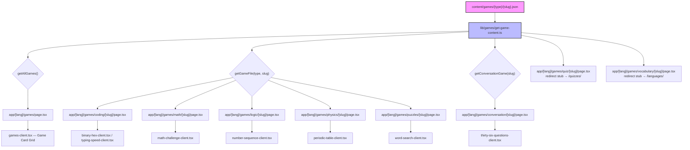
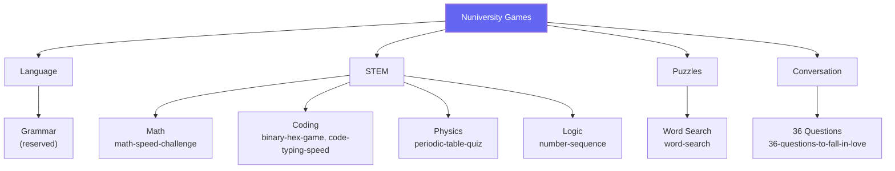
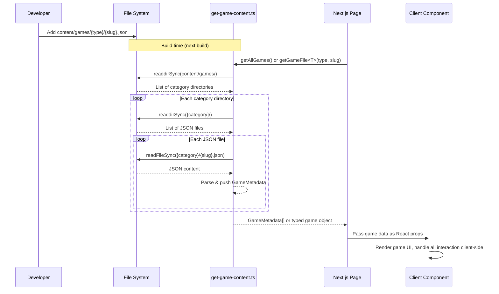

# Nuniversity Games System

Comprehensive documentation of the interactive learning games platform.

## 1. Overview

Nuniversity provides browser-based learning games that users play directly in the web interface. Games are defined as static JSON content files, rendered by dedicated Next.js page routes, and displayed through client-side React components. All games are statically generated at build time (`force-static`) — there is no server-side game logic at runtime.

Certification quizzes moved to the Quizzes app (/{lang}/quizzes/, content/quizzes/, see docs/assessment/2026-app-review/DESIGN-QUIZZES-APP.md) — legacy /games/quiz/* URLs redirect.

**Key characteristics:**
- Content-driven: games are JSON data files, not application code
- Fully static: generated at build time, zero runtime server cost
- Client-side gameplay: React components handle all game state and interaction
- Internationalized: all pages are routed under `/{lang}/games/`
- Searchable: the games listing page includes client-side filtering by title, description, and category

## 2. System Architecture



### Data Layer

| File | Purpose |
|------|---------|
| `lib/games/get-game-content.ts` | All data-fetching functions and TypeScript interfaces |
| `content/games/**/*.json` | Static game data files organized by category |
| `content/games/coding/` | Binary/hex and typing speed JSON files |
| `content/games/conversation/` | Conversation game JSON files |
| `content/games/math/` | Math challenge JSON files |
| `content/games/logic/` | Number sequence JSON files |
| `content/games/physics/` | Periodic table quiz JSON files |
| `content/games/puzzles/` | Word search JSON files |

### Page Routes

| Route | Description |
|-------|-------------|
| `app/[lang]/games/page.tsx` | Games listing — fetches all games at build time |
| `app/[lang]/games/games-client.tsx` | Client component — card grid with search/filter |
| `app/[lang]/games/vocabulary/[slug]/page.tsx` | Legacy vocabulary route — renders redirect stub to /languages/ |
| `app/[lang]/games/conversation/[slug]/page.tsx` | Conversation game detail page |
| `app/[lang]/games/quiz/[slug]/page.tsx` | Legacy quiz route — renders redirect stub to /quizzes/ |
| `app/[lang]/games/coding/[slug]/page.tsx` | Coding game detail page |
| `app/[lang]/games/math/[slug]/page.tsx` | Math game detail page |
| `app/[lang]/games/logic/[slug]/page.tsx` | Logic game detail page |
| `app/[lang]/games/physics/[slug]/page.tsx` | Physics game detail page |
| `app/[lang]/games/puzzles/[slug]/page.tsx` | Puzzles game detail page |

## 3. Game Categories



| Category | Label in UI | Icon | Description |
|----------|------------|------|-------------|
| `grammar` | Language - Grammar | `BookOpen` | Grammar exercises (reserved, no current games) |
| `math` | Mathematics | `Target` | Arithmetic speed challenges |
| `coding` | Coding & Programming | `Code` | Binary/hex conversion, typing speed |
| `physics` | Physics | `Zap` | Periodic table quiz |
| `logic` | Logic & Puzzles | `Brain` | Number sequence memory |
| `fun` | Fun & Games | `Sparkles` | General entertainment games |
| `conversation` | Relationships & Intimacy | `Heart` | Duo or solo intimacy question sets (36 Questions to Fall in Love) |
| `science` | Science | `Atom` | Science-related games (reserved) |
| `puzzles` | Word Puzzles | `Search` | Word search grids |

### Difficulty Levels

| Level | Badge Color | Description |
|-------|------------|-------------|
| `beginner` | Green | Basic concepts, short timers |
| `intermediate` | Yellow | Moderate complexity |
| `advanced` | Red | Challenging content, longer sequences |

## 4. Vocabulary Game Schema (moved)

Vocabulary games are no longer games — they live in the Languages app. The 5 activity JSONs now live in `content/languages/vocabulary/` (moved as-is: snake_case `language_pair`, optional `gameType` defaulting to `matching`), the TypeScript types and loader live in `lib/languages/` (`types.ts`, `get-language-content.ts`), the schema enforced by the validator lives in `.opencode/hooks/validate-languages/references/schema.json`, and the full design (hub, pair pages, players, `languages.*` i18n, progress storage) is documented in `docs/assessment/2026-app-review/DESIGN-LANGUAGES-APP.md`. The player UIs live in `components/languages/` (matching + flashcards), and legacy `/games/vocabulary/[slug]` URLs render a redirect stub to `/{lang}/languages/[pair]/[slug]`.

## 5. Quiz Game Schema (moved)

Certification quizzes are no longer games — they live in the Quizzes app. The quiz TypeScript types now live in `lib/quizzes/types.ts`, the JSON schema enforced by the validator lives in `.opencode/hooks/validate-quiz-json/references/schema.json`, and the full design (schema, practice + mock exam modes) is documented in `docs/assessment/2026-app-review/DESIGN-QUIZZES-APP.md` §4. Quiz content files live in `content/quizzes/` (e.g., `snowpro-core-cof-c03.json`), the practice and mock exam UIs live in `components/quizzes/`, and legacy `/games/quiz/[slug]` URLs render a redirect stub to `/{lang}/quizzes/[slug]`.

## 6. Game Lifecycle

All game state is client-side: each client component owns its own play/restart loop, with no server-side lifecycle. The former quiz game lifecycle (practice and mock exam state machines) moved to the Quizzes app — see `components/quizzes/` and `docs/assessment/2026-app-review/DESIGN-QUIZZES-APP.md` §6.

## 7. Game Data Flow

### Build-Time Data Loading



### Key Function Signatures

```ts
// Returns metadata for all games across all categories
async function getAllGames(): Promise<GameMetadata[]>

// Generic getter for any game type (coding, math, logic, physics, puzzles)
async function getGameFile<T>(type: string, slug: string): Promise<T | null>

// Returns all games in a specific category
async function getGamesByCategory(category: string): Promise<GameMetadata[]>
```

## 8. Adding New Games

### Adding a Language Activity (Languages app)

Language vocabulary activities no longer live in the Games app — author them in the Languages app instead:

1. Create `content/languages/vocabulary/{slug}.json` following the schema in `.opencode/hooks/validate-languages/references/schema.json` (`id` must equal the filename; ≥40 words)
2. Validate it with `OPENCODE_FILE_PATH=content/languages/vocabulary/{slug}.json python .opencode/hooks/validate-languages/scripts/validate_languages.py`
3. Run `next build` — the activity appears on `/{lang}/languages/` and `/{lang}/languages/{pair}/{slug}/`

### Adding a Quiz (Quizzes app)

Quizzes no longer live in the Games app — author them in the Quizzes app instead:

1. Create `content/quizzes/{slug}.json` following the schema in `docs/assessment/2026-app-review/DESIGN-QUIZZES-APP.md` §4
2. Validate it with `OPENCODE_FILE_PATH=content/quizzes/{slug}.json python .opencode/hooks/validate-quiz-json/scripts/validate_quiz_json.py`
3. Run `next build` — the quiz appears on `/{lang}/quizzes/` and `/{lang}/quizzes/{slug}/`

### Adding a Coding Game

1. Create `content/games/coding/{slug}.json`
2. Create a new client component in `app/[lang]/games/coding/[slug]/`
3. Add the route in the `page.tsx` using `getGameFile<T>()` generic getter
4. Register the game type in `GameMetadata['type']` if not already present

### Adding a Math Game

1. Create `content/games/math/{slug}.json`
2. The existing page route and `math-challenge-client.tsx` handle rendering
3. Follow the `math-speed-challenge.json` schema: `operations[]`, `difficultyLevels{}`

### Adding a Logic Game

1. Create `content/games/logic/{slug}.json`
2. The existing page route and `number-sequence-client.tsx` handle rendering
3. Follow the `number-sequence.json` schema: `startingLength`, `maxLength`, `displayTimeMs`

### Adding a Physics Game

1. Create `content/games/physics/{slug}.json`
2. The existing page route and `periodic-table-client.tsx` handle rendering
3. Follow the `periodic-table-quiz.json` schema: `modes[]`, `elements[]`

### Adding a Puzzles Game

1. Create `content/games/puzzles/{slug}.json`
2. The existing page route and `word-search-client.tsx` handle rendering
3. Follow the `word-search.json` schema: `categories{}` with word lists

## 9. Content Quality Standards

### Language Activities (Languages app)

- **Minimum word count:** 40 words per activity (validator-enforced; recommended: 50–300)
- **Context variety:** Use at least 5 different `context` categories
- **Translation accuracy:** Verify native-speaker translations; avoid machine-only output
- **ID uniqueness:** All word IDs must be unique within the file
- **Cognates:** Avoid source/target pairs that are identical (e.g., "Hospital" → "Hospital") — these teach nothing

### Coding Games

- **Code snippets:** Use real, runnable code — not pseudocode
- **Progression:** Include beginner through advanced difficulty levels
- **Diversity:** Cover multiple languages/frameworks where applicable

### General

- **File naming:** Use lowercase kebab-case for filenames (e.g., `en-to-pt.json`)
- **JSON validity:** Run `node -e "JSON.parse(require('fs').readFileSync('path'))"` to validate
- **No secrets:** Never include API keys, credentials, or personal information in game data
- **Character encoding:** UTF-8 only — special characters in Portuguese/Spanish must render correctly

## 10. Existing Games Inventory

| Slug | Category | Type | Difficulty | Description |
|------|----------|------|------------|-------------|
| `binary-hex-game` | coding | `coding` | intermediate | Binary, decimal, hex number system conversion (6 modes) |
| `code-typing-speed` | coding | `coding` | beginner | Code typing speed test (Python, JS, HTML, CSS) |
| `36-questions-to-fall-in-love` | conversation | `conversation` | beginner | Arthur Aron's 36 progressive intimacy questions, duo or solo (3 sets) |
| `number-sequence` | logic | `logic` | beginner | Number sequence memory game (3–15 digits) |
| `math-speed-challenge` | math | `math` | beginner | Arithmetic speed challenge (+, -, ×, ÷) |
| `periodic-table-quiz` | physics | `physics` | intermediate | Periodic table element quiz (4 modes, 28 elements) |
| `word-search` | puzzles | `puzzles` | beginner | Word search puzzle (4 categories) |

### Game File Sizes

| Game | Words/Questions | File Size |
|------|----------------|-----------|
| `binary-hex-game` | Config only | ~0.5 KB |
| `code-typing-speed` | 16 snippets | ~5 KB |
| `number-sequence` | Config only | ~0.3 KB |
| `math-speed-challenge` | Config only | ~0.4 KB |
| `periodic-table-quiz` | 28 elements | ~3 KB |
| `word-search` | 40 words | ~1 KB |
