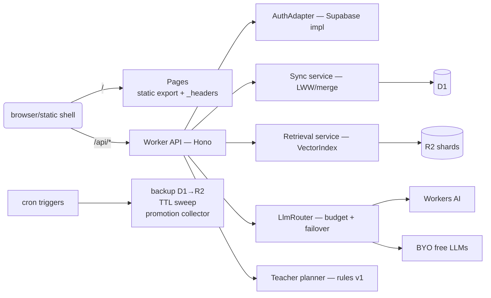
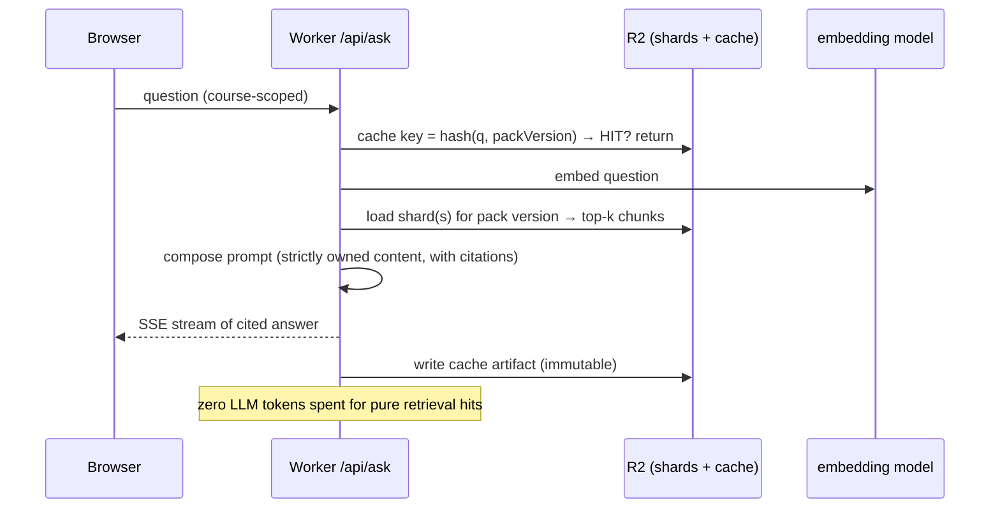
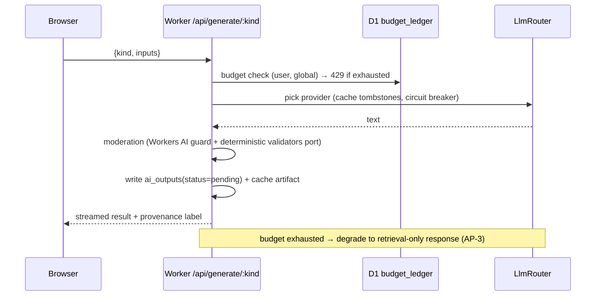
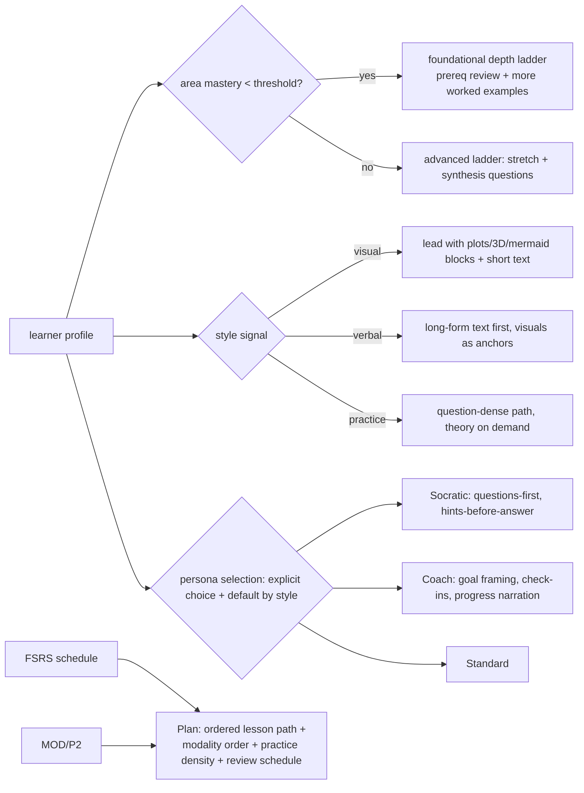

# M2 Target Architecture — deep redesign analysis

> Answers: *how does the M1 static university become an agentic AI education platform, on free
> tiers, without wrecking what M1 got right?*
> Companion docs: assessment (01), decisions (03), contracts (04), plan (05).

---

## Table of contents
1. [Vision decomposition](#1-vision-decomposition)
2. [Architecture principles](#2-architecture-principles)
3. [The two content planes](#3-the-two-content-planes)
4. [Target architecture (C4-style)](#4-target-architecture)
5. [End-to-end flows](#5-end-to-end-flows)
6. [Service selection (verified free tiers, Oct 2026)](#6-service-selection)
7. [Data architecture summary](#7-data-architecture-summary)
8. [Personalization engine design](#8-personalization-engine-design)
9. [The RAG knowledge base (three layers)](#9-the-rag-knowledge-base)
10. [Agentic pipeline evolution](#10-agentic-pipeline-evolution)
11. [Milestone map & M3 seams](#11-milestone-map--m3-seams)
12. [Migration strategy (dual deploy, zero downtime)](#12-migration-strategy)

---

## 1. Vision decomposition

The stated vision — *"AI agentic agents research, generate content, provide the best cognitive
approach, and choose the best way to teach for each learner, using the best agentic solution
like RAG knowledge bases of pre-researched topics and previously generated courses/questions"* —
decomposes into six capabilities:

| # | Capability (vision language) | Technical requirement | M1 state |
|---|---|---|---|
| V1 | Agents research & generate content | Runtime compute + LLM access, budgeted, moderated, cached | CI-only agent harness (authoring) |
| V2 | Provide the best cognitive approach | Learner model (diagnostics × history × style) + curriculum branching rules | Per-browser counters only |
| V3 | Choose the best way to teach each learner | Teacher planner: persona, depth ladder, modality mix, FSRS scheduling | FSRS exists; no profile, no adaptive layer |
| V4 | RAG knowledge base (pre-researched topics, generated courses/questions) | Embeddings over owned corpus + research notes; retrieval service | Build-time JSON indexes only |
| V5 | On-demand, personalized delivery | Accounts + cross-device sync + dynamic assembly | localStorage only |
| V6 | Continuous improvement loop | Generated content graded → moderated → promoted into static curriculum | Harness exists (static side) |

**M2 delivers V1–V6 at "v1" fidelity with free-tier services and explicit degradation behavior.
M3 (cloud portability) changes nothing conceptually — it re-binds the same interfaces to AWS/GCP
free tiers.** That is the key strategic phrasing: *the seams are the milestone*.

---

## 2. Architecture principles

| # | Principle | Rule of thumb | Enforcement |
|---|---|---|---|
| AP-1 | Static-first | If a page can be pre-rendered, it must be pre-rendered; no login required to read | Next export stays; Worker never sits in the HTML hot path |
| AP-2 | Retrieval before generation | LLM calls are an exception justified by a retrieval miss | `/api/ask` + `LlmRouter` implementation detail; eval gate |
| AP-3 | Degradation, not failure | Any exhausted quota or down provider results in M1-quality UX | Degradation ladder (06 §4); e2e outage-mode tests |
| AP-4 | Contracts over replication | All shared shapes live in `packages/shared`; web & workers cannot drift | drift is caught by lint rule against direct duplication |
| AP-5 | Budget-aware everything | Every D1/R2/KV/LLM call has a documented read/write/neuron budget | budgets table (04 §4.4); repo-method annotations |
| AP-6 | Swappable services | Every third party behind an interface: `AuthAdapter`, `VectorIndex`, `LlmRouter`, `PackStore` | DR set (03) |
| AP-7 | The harness is the quality gate | AI→static promotion routes through existing validators, never around them | DR-08; CI wiring |
| AP-8 | Privacy by construction | No third-party cookies/tracking; export & delete exist at GA | Web Analytics + D1 events; P3 features |

---

## 3. The two content planes

The central architectural idea — the response to limitation **L3** (full rebuild per content change):

```mermaid
flowchart TB
    subgraph STATIC["STATIC PLANE (curated, SEO-grade, free forever)"]
        C1[(content/ courses,qm,m games...)] --> BUILD[npm run build<br/>Next export]
        BUILD --> GH[GitHub Pages<br/>+ Cloudflare Pages]
    end

    subgraph DYNAMIC["DYNAMIC PLANE (per-learner, AI outputs, no rebuilds)"]
        D1[(D1: users, learner state, ai_outputs, budgets)]
        R2[(R2: content packs, embeddings, media, AI cache)]
        W[Worker API: auth verify, sync,<br/>retrieval, LLM router, teacher]
    end

    AIOUT[AI output (runtime)] -->|"pending → moderated"| D1Q[D1 ai_outputs]
    D1Q -->|"cron → GitHub issue/PR"| H[Agentic harness<br/>validators + CI]
    H -->|"PR merged"| C1

    CLIENT[Browser] -->|read courses| GH
    CLIENT -->|sync · ask · generate · plan| W
    W --> D1 & R2
```

**Rules of the split:**

| Property | Static plane | Dynamic plane |
|---|---|---|
| Update path | git PR through harness | API writes / pack publish (minutes) |
| Cost per view | ~0 (CDN) | D1 read rows + R2 ops (budgeted) |
| Provenance | validated content | provenance field on every AI output |
| Quality gate | validators + human review | moderation + evaluations + TTL |
| Ownership of truth | repo files | D1 is source of truth; localStorage is cache |

**Promotion loop (AP-7 in action):** an AI output the user/quality process marks `published` is
collected nightly by a cron trigger, which opens a GitHub issue with structured provenance
(model, prompt version, eval scores, source chunks). A maintainer (or the harness's
`platform-engineer` agent) turns it into a PR through the **existing** validators. Nothing
AI-generated gets into the static plane without passing the same gates human content passes.

---

## 4. Target architecture

### 4.1 Context diagram


### 4.2 Container diagram (edge)



### 4.3 Repository layout (light monorepo in place)

```txt
nuniversity.github.io/
├── app|components|content|lib/         # unchanged static web app
├── packages/shared/                    # NEW  contracts: learner v3, packs, API DTOs, zod schemas
├── workers/api/                        # NEW  Hono app (Pages Functions), wrangler envs staging|prod
│   ├── src/routes/{auth,sync,ask,generate,teacher,packs,admin}.ts
│   ├── src/lib/{auth-adapter,llm-router,retrieval,pack-store,budget,rate-limit,moderation}.ts
│   └── migrations/0001_init.sql ...
├── scripts/packs/emit-content-packs.mjs   # NEW build → R2 packs + manifest
├── scripts/embed/build-embeddings.py      # NEW CI embeddings → shards
└── .github/workflows/{nextjs.yml, api.yml, packs.yml}
```

*Rationale (DR-06):* the static app is the product; a second package would force a router/CSM
rewrite with zero learner value. A `packages/shared` boundary buys the contract discipline
(AP-4) with a single-point boundary.

---

## 5. End-to-end flows

### 5.1 Progress sync (signed-in, offline-tolerant)

```mermaid
sequenceDiagram
    participant B as Browser (offline-capable)
    participant W as Worker /api/sync
    participant D1 as D1
    B->>B: edit state (localStorage, rev++, queue op)
    B->>W: POST /api/sync/push {deviceOps[]}
    W->>D1: batch read per-key rows
    W->>W: merge --- default LWW(updAt,devId); XP=max; sets=union; FSRS per-card
    W->>D1: batch write winners + rev
    W-->>B: {applied[], conflicts[], rev}
    B->>B: cache update; conflicts → telemetry
```

### 5.2 Ask (RAG v1) — retrieval-first



### 5.3 On-demand generation (budgeted, moderated)



---

## 6. Service selection

All entitlements verified against official docs — **2026-10-31** (full citation table + math in
`06-CAPACITY-AND-COSTS.md`).

| Role | Selected | Free entitlement (verified) | Runner-up & why rejected |
|---|---|---|---|
| Static host | **Cloudflare Pages** (+ GH Pages fallback) | unlimited bandwidth, ~500 builds/mo (consumed-free wrangler deploys) | GH Pages alone: no real headers, 1 GB ceiling |
| Compute | **Pages Functions (Worker)** | 100k req/day, 10 ms CPU, 128 MB, 50 subrequests | VMs / always-on servers, cold starts |
| User data | **D1** | 5 GB total, 500 MB/db, 5M read+100k write rows/day, 10 dbs | Neon Postgres (off-edge latency, hard cap), Firestore (20k writes/day too small) |
| Object store | **R2** | 10 GB-month, 1M Class A / 10M Class B ops, **zero egress** | S3/GCP: egress costs; Supabase storage 1 GB |
| Sessions/rate | **KV** | 100k reads/day, **1k writes/day** ⚠ | — counters only, never hot-path |
| Index | **R2 shards + Worker in-memory centroid cosine** (VectorIndex A); Supabase pgvector optional B | — | Vectorize: docs say paid-plan-only (Oct 2026) |
| LLM runtime | **LlmRouter**: Workers AI (10k neurons/day, 300 RPM text) + BYO free tiers (Gemini ~15 RPM/Groq, Mistral) | — | single vendor insufficient |
| Identity | **Supabase Auth (IdP only)** | 50k MAU, email+OAuth+MFA, JWKS | Clerk (vendor-embedded UX), Firebase (3k DAU cap post-2026), Cognito (heavier; M3 candidate) |
| Moderation | Workers AI guard/classify + deterministic validators port | in budget | external moderation APIs (paid) |
| Analytics | **CF Web Analytics** + D1 product events | free, no cookies | PostHog free tier is capable but adds a 3rd-party JS pipeline + consent surface; revisit at M3 |
| Cron | Workers Cron (5/account) | — | — |
| Email (magic links) | Supabase Auth built-in | free tier quotas | Resend/Brevo later |

**Decisions in one line each:** DR-01 Identity=Supabase/IdP-only; DR-02 Data=D1+R2 (CF-native);
DR-03 AI=budgeted LlmRouter; DR-04 Index=R2 shards now, Vectorize deferred; DR-05 Dual deploy;
DR-06 Light monorepo; DR-07 Sync before AI; DR-08 Harness-is-the-gate; DR-09 Analytics=CF Web
Analytics (+supersedes PLAN-MODERNIZATION's Clerk/Neon/PostHog); DR-10 Degradation ladder normative.

---

## 7. Data architecture summary

Full schema, pack format and endpoints: [04-CONTRACT.md](./04-CONTRACT.md). The mental model:

- **D1** is the *learning plane*: users (anonymous-first), learner_profiles (FSRS params + style +
  diagnostics), progress_state (per-key LWW-merged JSON blobs + rev), progress_events
  (append-only audit: attempts/XP), ai_outputs (kind, inputs-hash, status lifecycle), budget_ledger
  (user+global daily counters), sync_flags.
- **R2** is the *knowledge plane*: immutable, hash-addressed packs per course×locale under
  `packs/v{N}/`, embeddings shards, media, `cache/ai/{inputsHash}` response artifacts, and nightly
  `exports/d1-YYYYMMDD.sql.gz` backups (extends D1's 7-day Time Travel).
- **KV** holds rate-limit counters and session-revocation markers only.
- **The client** keeps all local `v1:*` state as offline cache; a `SyncEngine` pushes/pulls deltas.
Every mutable learner object carries `{rev, updatedAt, deviceId}` (learner state v3).

---

## 8. Personalization engine design

**Design stance: personalization in M2 is deterministic (rules over signals), not an LLM.** Generative
AI amplifies it later. This keeps quality auditable and cost at zero on the hot path.

### 8.1 Signals (inputs)

| Signal | Source | When |
|---|---|---|
| Placement: per-area prior mastery | `/api/diagnostics/submit` ~10 Q per area | first visit per area; retest offer on drift |
| Learning-style preference (explicit) | 3-question onboarding: prefer visuals / reading / practice | profile creation |
| Format engagement (implicit) | which modalities they actually finish (visual vs text vs practice), pace (answers/sec), retry patterns | derived offline in planner |
| Spacing state | FSRS parameters + card states (existing engine) | continuous |
| Mastery | Beta posterior per node (existing practice engine) | continuous |

### 8.2 Teacher planner (rules v1) — `/api/teacher/plan`



**Contract with static content:** the planner never rewrites lessons; it **orders** and **selects**
pack sections, chooses which interactive blocks to surface first, adjusts practice density, and
sets the FSRS queue. The static pages remain untouched (AP-1); personalization is a dynamic layer
over content — which is also why it degrades gracefully (no profile → default plan = M1 order).

### 8.3 Generative amplification (Phase P5+)

The planner's retrieval query can carry *"explain differently for this learner"* contexts —
that is exactly `/api/generate/explain` mode. Micro-lessons for missing topics plug into the
plan as `ai_outputs` with TTL, clearly labeled, and candidates for harness promotion (§3).

---

## 9. The RAG knowledge base

**Three layers, retrieval preference in that order:**

| Layer | Contents | Freshness | Cost per query |
|---|---|---|---|
| L1 — Research notes | agent-produced topic research (`packs/v{N}/topics/*.md`), the "pre-researched" base | by agents | retrieval only |
| L2 — Owned corpus | the 49 courses + 4,000+ questions + roadmaps, section-chunked & embedded | pack publish | retrieval only |
| L3 — Generated out | on-demand micro-lessons/explanations (cached, TTL, moderated) | on miss of L1/L2 | LLM tokens (budgeted) |

**Chunking:** lesson sections at 100–300 tokens; headings + skills carried as metadata; locale
separate (`{space}/{lang}/shard-…`); hash-dedup so unchanged sections don't re-embed on pack
versions. **Index:** R2 shards `{ids[], vecs[][]}`; Worker loads shards per (space, language) on
demand with Version-Cache headers; centroid shortlist then local cosine re-rank. For 49 courses
(rough est. 6–10k chunks × 384-dim small model) *the whole logic fits in Workers' 128 MB*, no
vector DB required (DR-04 — pgvector backend is optional/config).

---

## 10. Agentic pipeline evolution

```mermaid
flowchart LR
    subgraph TODAY["M1 (unchanged)"]
        H1[skills→validators→CI→Pages]
    end
    subgraph M2ADDS["M2 adds"]
        RT[Runtime generation mode:<br/>same prompt templates,<br/>harness skill = Worker promptSource]
        MODM[moderation + evals in Worker]
        PROM[nightly collector → GH issue/PR<br/>→ harness validators → static]
        NEWCK[Research notes as harness skill output → R2 topics]
    end
    H1 -->-.templates.->RT
    RT --> MODM --> PROM --> H1
```

Concrete changes to the harness: two new skills (`topic-researcher` writes to `docs/...` for the
RAG layer, `runtime-prompt-engineer` keeps the pack prompt templates versioned), plus a validator
naming convention for D1 `ai_outputs` payloads (json-schema parity with the repo-side schemas).
The promotion collector cron requires a fine-grained, read-only GitHub token scoped to
issue/PR creation, stored as a Worker secret (rotation in `08-RUNBOOK.md`).

---

## 11. Milestone map & M3 seams

| Seam (interface) | M2 binding | M3 AWS/GCP binding |
|---|---|---|
| `AuthAdapter` | Supabase Auth | Cognito (10k MAU free) or Firebase Auth free |
| `PackStore` / `VectorIndex` | R2 + in-Worker search | S3/GCS (R2/S3 API-compatible) since R2 matches S3 API; hosted vector as needed |
| `LlmRouter` | Workers AI + BYO free tiers | Bedrock/Gemini free tiers; same interface |
| Data | D1 (SQLite) | Postgres (managed free tiers) — migrations exist as plain SQL |
| Cron / queue | Workers Cron | EventBridge / Cloud Scheduler |
| Email | Supabase built-in | SES 62k/month free (fully in AWS tier) |

M3 is then a **binding drill**, not an architecture rewrite: deploy the same `workers/api` to
Cloud Run (Docker shim) or implement adapter-interfaces alternates, run the portability test suite
(`07-TESTING-QA.md §8`) in a sandbox, and document the outcomes. Because M2 already treats every
service as an adapter, M3 stays mostly mechanical.

---

## 12. Migration strategy

**Zero-downtime, reversible, two-origin** (DR-05):

1. **P2** Cloudflare Pages project created; deploy from GitHub Actions using the **same artifact**
   the GH workflow uploads (`wrangler pages deploy out`);
2. **Origin cutover is DNS-only**: `nuniversity.*` → Pages; GH Pages stays deployed and healthy
   as instant-rollback origin through M2 GA;
3. **`_headers` file on Pages** supersedes meta-CSP (`verify-csp` gate extended for Pages mode);
   custom-domain users see identical URLs (org site root, no basePath drift);
4. API subdomain/same-origin functions appear only when Phase P3 routes exist — *cutover per
   feature, not big bang*;
5. `docs/operations/DEPLOYMENT.md` updated at P6; GH Pages workflow archived (not deleted) after
   a 30-days-stable window.

**Rollback story everywhere:** DNS → GH Pages; packs → previous `manifest.json` version pinned in
D1 `sync_flags`; Workers → last `--env` deploy; D1 → R2 nightly export + Time Travel 7d.

---

*Cross-references: implementation order and per-phase DoD → 05; per-service budgets/alarms → 06.*
