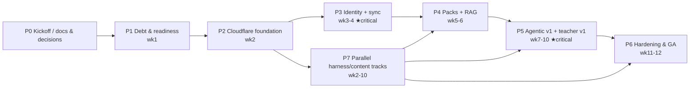

# M2 Implementation Plan — phased, executable

> ~12 weeks of engineering across 8 phases (P0–P7). Every phase ends shippable and demoable.
> Companion docs: contract (04), capacity (06), testing (07), runbook (08).
>
> **Standing engineering constraints** (inherited from repo conventions + `PLAN-MODERNIZATION.md` §0):
> three-locale atomic edits for every UI string (dict parity tests); no new runtime dependency
> without explicit approval (dependency list in §6); never break the CI battery; no API routes /
> middleware in the *static* app (`output: 'export'` stays); no secrets in repo.

---

## 0. Phase map & critical path

| Phase | Weeks | Theme | Inbound repo change volume | Risk |
|---|---|---|---|---|
| P0 | 0 | Accounts, docs, decisions, epics | docs only | — |
| P1 | 1 | Perf debt + readiness | app/ + lib/~20 files | low |
| P2 | 2 | CF Pages + API skeleton + dual deploy | new + CI | medium |
| P3 | 3–4 | Auth adapter + D1 + SyncEngine + UX | workers + lib/sync | **high** |
| P4 | 5–6 | Packs, embeddings, R2, /api/ask | scripts + workers | high |
| P5 | 7–10 | LlmRouter, 4 AI modes, moderation, promotion; teacher v1 | workers + lib | high |
| P6 | 11–12 | Load, security, observability, runbook, GA | workers/CI/docs | medium |
| P7 | parallel | parallel harness/content tracks | skills + prompts | low |

---

## P0 — Kickoff (week 0, docs only)

Goal: the plan is executable without decisions mid-flight.

- [ ] Copy this doc set into `docs/milestone-m2/` (done — status date on README)
- [ ] Review ADR set (03) in a 60-min session; record verdicts
- [ ] Accounts checklist (08 §2.1): Cloudflare account/zone, Supabase project, BYO LLM keys
- [ ] Dependency approval list circulated (`packages/shared` install list — §6)
- **DoD:** all checkboxes ticked; no open decision blocks P1.

---

## P1 — Debt & readiness (week 1)

Goal: clear the audited perf/template debts so later phases build on a clean base; nothing later re-does P1.

| ID | Task | Files | Acceptance |
|---|---|---|---|
| T1.1 | Split dictionaries by namespace + lazy load; only messages used by page load | `dictionaries/*`, `lib/i18n/get-dictionary.ts`, build step `scripts/prebuild-dicts.mjs` | per-page dictionary payload < 12 KB; `verify-css` battery green |
| T1.2 | `MarkdownRenderer` registry + code-split interactive blocks; lazy KaTeX + Mermaid pattern replication | `components/markdown/**` | renderer main file < 300 L; lesson route JS −25% vs 1,294 KB baseline |
| T1.3 | Move `question-index` out of `public/` (ships via packs in P4; interim: feature-scoped fetch) | `scripts/build-question-index.mjs`, `lib/search/*` | −5.7 MB static payload |
| T1.4 | Create `packages/shared`; lift learner v2 → v3 (add `{rev, updatedAt, deviceId}`); local `v1:` storage keeps working; web consumes v3 through a thin adapter | `packages/shared/**`, `lib/practice/**`, `lib/storage/**` | typecheck green; `safe-storage` unchanged semantics; fuzz-lite in vitest |
| T1.5 | Refresh `ARCHITECTURE.md` stale bits (Next 14/daisyUI/middleware); link M2 doc set | docs | ✅ **done 2026-10-31** (docs cleanup) |
| **DoD P1** | build + tests green; route weight reduced; M2 docs reachable from `docs/INDEX.md` |

---

## P2 — Cloudflare foundation + dual deploy (week 2)

Goal: infra skeleton in staging, deploy pipeline ready; no learner-visible changes.

| ID | Task | Detail |
|---|---|---|
| T2.1 | CF zone + Pages project + custom domain; `_headers` (CSP, HSTS, immutable caches) + staging subdomain | DR-05 |
| T2.2 | `workers/api` skeleton (Hono+zod): `/api/health`; structured logging; error envelope (04 §9); maintenance flag | DR-02 |
| T2.3 | `wrangler.jsonc` envs staging|prod; local dev via `wrangler dev` wired to D1-local + R2-local | 07 §2 |
| T2.4 | CI: `api.yml` (typecheck/lint/vitest → deploy via OIDC), `packs.yml` (build artifact → Pages+packs deploy); token scopes per 04 §8 | — |
| T2.5 | Extend verify gates: `verify-csp --mode pages`, size gates for workers bundle, e2e stage passes against staging | 07 §8 |
| T2.6 | Write the shared `PackStore` + `BudgetService` stub type files (compile-only; impl in P4/P5) | contract §5.4–5.5 |
| **DoD P2** | staging Pages serves the exact production artifact; `/api/health` green on custom domain; rollback drill documented (GH Pages origin swap verified) |

---

## P3 — Identity + learner sync (weeks 3–4) ← biggest UX unlock

Goal: signed-in users' progress survives browsers; signed-out users see zero friction/sign-in wall.

| ID | Task | Files | Acceptance |
|---|---|---|---|
| T3.1 | `AuthAdapter` interface in shared + Supabase impl (magic link, Google OAuth, JWKS verify, refresh) | `packages/shared`, `workers/api/src/lib/auth-adapter.ts` | contract tests (07 §3): verify/reject/pause/pass |
| T3.2 | D1 migrations v1 + typed repositories (users, profiles, progress, events) with per-method budget annotations | `workers/api/src/lib/repos/**` | 04 §4.4 budget contract tests |
| T3.3 | **Anonymous-first**: device bootstrap (anon user row) + `merge_token`; session cookie (httpOnly, Secure, SameSite=Lax) | routes + lib | zero-wall journey; merge idempotent under repeats |
| T3.4 | `/api/sync/push` + `/api/sync/pull` with merge strategy implementation + reconcile | lib + routes | property fuzz (3 devices) passes; conflicts telemetered |
| T3.5 | `SyncEngine` client + UI: header "Sign in / Sync on", device list, per-device indicator; offline queue with backoff | `lib/sync/**`, `components/layout/Header.tsx` | offline→reconnect merge journey passes on mobile-throttled e2e |
| T3.6 | Rate limiting (KV) + `Retry-After`; D1 budget rows for AI (used in P5) | `lib/rate-limit.ts` | limits table enforced in integration tests |
| T3.7 | Privacy features: export-my-data (JSON download) + delete-account (cascade) | routes + settings page | GDPR-style wipe verified in e2e |
| T3.8 | Accessibility + i18n for all new UI (3-locale atomic edits) | dictionaries | dict-parity tests green |
| **DoD P3** | staging demo: two browsers; progress made on A appears on B within 2s; merges survive offline; anonymous learner never blocked |

---

## P4 — Content packs + RAG knowledge base (weeks 5–6)

Goal: content dynamics without site rebuilds; cited "Ask" over owned corpus.

| ID | Task | Files | Acceptance |
|---|---|---|---|
| T4.1 | `emit-content-packs.mjs`: compile per course×locale → packs gz + manifest v1; loader fallback to static data when offline (DR-10 rung 5) | `scripts/packs/**`, `lib/courses/**` | pack parity: lesson content identical to static render for 5 sampled courses × 3 locales |
| T4.2 | CI embeddings: section chunking + dedup + bge-small → R2 shards + centroid anchors; pack-version-stamped | `scripts/embed/**` | shard ≤ 8 MB; embedding of unchanged section reuses hash |
| T4.3 | `VectorIndex` impl A (R2 shards, Cache API warm, centroid shortlist + cosine re-rank) | `workers/api/src/lib/retrieval.ts` | top-10 for 20 sample queries inspected by maintainers; P95 < 300 ms warm |
| T4.4 | `/api/ask` SSE: cache-first → embed → k-NN → strict-context prompt → cited stream → R2 response cache | routes + lib | eval pass on golden set L1/L2 only (no LLM); <3 s first token cold, <500 ms warm |
| T4.5 | Ask UI: ⌘K "+ ask" tab; answer provenance chips (sources→lesson URLs); "existing lesson?" cards | `components/search/**` | a11y + i18n green |
| T4.6 | `packs.yml` publishes manifest atomically (single swaps version + D1 flags) | CI + `sync_flags` | no torn reads in smoke |
| **DoD P4** | published pack update (add 1 lesson) reaches clients without any site rebuild; citations resolve |

---

## P5 — Agentic on-demand v1 + teacher v1 (weeks 7–10)

Goal: generation within budget + the first adaptive loop, both degradable to M1.

### P5a — generation infrastructure (wk 7–8)

| ID | Task | Files | Acceptance |
|---|---|---|---|
| T5.1 | `LlmRouter` + budget ledger + circuit breakers + tombstones; per-provider health probes | `lib/llm-router.ts`, `lib/budget.ts` | failover drill in CI mock; budget consumes counters per contract |
| T5.2 | Moderation pipeline: Workers AI guard + deterministic validators ported from `.opencode/hooks` (py→ts) | `lib/moderation/**` | adversarial golden set (injections, off-topic, PII) blocked with reports |
| T5.3 | Prompt registry versioned in `packages/shared/prompts` (parity with harness templates) | prompts | prompt_version recorded on every output |
| T5.4 | `/api/generate/:kind` for `explain` + `qa_rag` (SSE) + UI affordances in lesson client | routes + components | E2E modes e2e; provenance always visible |
| T5.5 | Eval pipeline: golden prompts (20 Q × available modes) run on prompt/model change; gates merges | CI job + `evals/**` | pass-threshold enforced |

### P5b — modes 3–4 + promotion (wk 9)

| ID | Task | Detail |
|---|---|---|
| T5.6 | `micro_lesson` mode (7-day TTL, labeled "AI-draft, not yet curriculum-reviewed") | retrieval miss → research-note context → generated MD → `ai_outputs` |
| T5.7 | `extra_question` mode (Socratic hint first; never direct answer) | extra practice density, feeds FSRS optionally |
| T5.8 | Promotion collector cron: `published` outputs → nightly GitHub issue/PR-draft with provenance (model, prompt_version, evals, source chunks) feeding the harness | cron + token secret |

### P5c — teacher v1 (wk 10)

| ID | Task | Element |
|---|---|---|
| T5.9 | Diagnostics module (per-area placement ~10 Q, 3-style questions) + `/api/diagnostics/submit` | profile wiring |
| T5.10 | `/api/teacher/plan` rules engine (persona, depth ladder, modality mix, FSRS schedule) per 02 §8.2 — no LLM | deterministic; snapshot-tested |
| T5.11 | Plan surfaces: course/lesson ordering variants, practice-density knobs, review queue priority | lesson client consumes plan |
| **DoD P5 final** | the four modes + adaptive plan live under budget; full degrade to M1 behavior proven by outage-mode e2e (DR-10 rung 2–5 scenarios) |

---

## P6 — Hardening, observability & GA (weeks 11–12)

| ID | Task | Detail |
|---|---|---|
| T6.1 | Load replay (1k synthetic DAU profile, 07 §7): budget dashboards; fix top offenders (D1 reads, R2 ops) | gate: cap at <40% daily burn |
| T6.2 | Cron set: nightly D1→R2 export; budget reset; TTL sweep; promotion collector | `08-RUNBOOK.md §5` |
| T6.3 | Security review round (methodology of 2026-10-31-wave): session/space threat model, moderation-bypass audit, R2 path traversal, secret rotations | findings register |
| T6.4 | Observability: Workers analytics dashboards; error-rate alerts latency; uptime monitors; status banner wired to `/api/health` | P6 ops |
| T6.5 | Docs: update `ARCHITECTURE.md`, `DEPLOYMENT.md`, `TESTING.md`; write M2-RUNBOOK (supplied by this set) | — |
| T6.6 | GA: DNS cutover to CF Pages (GH Pages kept warm 30 days), announce, KPI baseline (README §3 metrics) |
| **DoD P6** | KPIs live (README §3); zero-P1 security findings; rollback drill executed end-to-end |

---

## P7 — Parallel content/harness tracks (wk 2–10, interleaved)

- [ ] `topic-researcher` skill (writes `packs/vN topics/**` sources for RAG layer L1)
- [ ] `runtime-prompt-engineer` skill (owning prompt-registry parity)
- [ ] EN library backfill (audit gap; separate track)
- [ ] Harness validator for D1-generated-MD (schema parity with lesson frontmatter)
- [ ] Quiz-writer ability to target `ai_outputs`-authored question candidates

---

## 5. Effort deltas & staffing assumption

Assumption: 1 main implementation agent + owner reviews (60′/phase) + harness runs in parallel.
Estimates above are agent-weeks including tests; P3 and P5 dominate. If capacity is half the plan,
drop order is: T5.6–T5.7 (extra modes) → T5.9–T5.11 (teacher v1) → keep P3+P4 core.

---

## 6. Dependency approval list (no new deps without sign-off)

| Package | Where | Why | Alternatives (why not) |
|---|---|---|---|
| `hono` | workers/api | edge-native, tree-shakable router | itty-router (fewer middlewares), raw fetch (too manual) |
| `zod` | packages/shared + workers | contract validation shared both sides | typebox (weaker error messages) |
| `@supabase/supabase-js` | workers (adapter only) | IdP integration | hand-rolled (auth surface risk) |
| `ts-fsrs` (pinned) | existing | reuse SRS | — |
| `@cloudflare/workers-types`, `wrangler` | dev | types + deploys | — |
| `marked`? | — | **not needed** (packs carry compiled MD) | — |
| `js-yaml` (node scripts only) | scripts/packs | frontmatter handling (already via gray-matter in build) | reuse gray-matter |
| `jose` | workers | JWT/JWKS verify | manual crypto (risky) |

---

## 7. Register of possibly-forgotten items (anti-blind-spots)

- CSV/JSON **exports** of learner data (P3) and their schema documentation.
- `robots.txt`/`sitemap.ts` unaffected by CF origin (no change).
- **AdSense `ads.txt`** remains in place; no policy conflict from CF origin.
- Formspree contact form unchanged (separate track; not M2).
- DNS records: MX under domain unaffected by zone move (confirm at P2).
- `AdSpace` components still render under `_headers` CSP — verify at T2.1.
- Local dev offline mode (no D1 running) must not break the static dev server (T2.3 dev flag).
