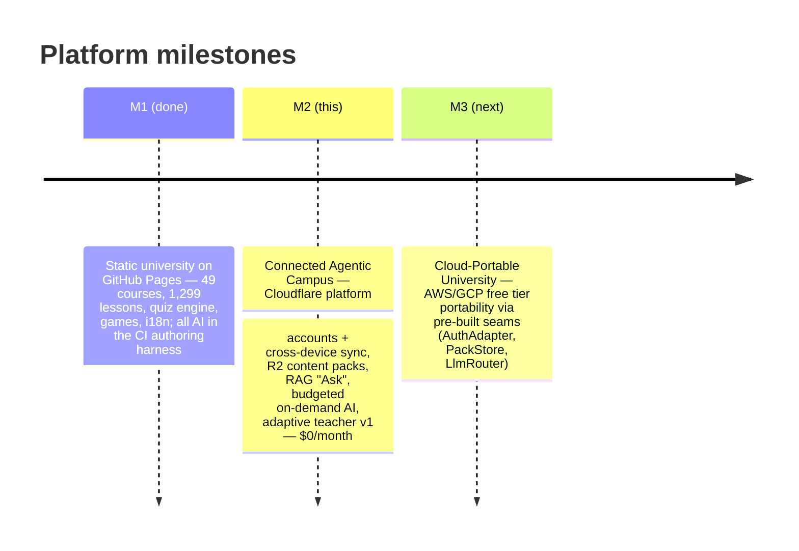

# 🚀 Milestone M2 — "Connected Agentic Campus"

> **Vision:** an agentic AI education platform where AI agents research topics, author courses,
> assess learners, and choose the best way to teach each learner — grounded in a RAG knowledge
> base of pre-researched topics and previously generated courses, questions and assets.
>
> **M2 scope:** keep everything that makes today's site excellent (static-first, validators,
> quality gates) and add the first free-tier cloud platform layer: accounts + cross-device
> sync, R2 content packs, RAG-based retrieval, budgeted on-demand AI generation, and the first
> adaptive teacher loop — **at $0/month, with graceful degradation everywhere**.
>
> **Status:** ACCEPTED · **Date:** 2026-10-31 · **Supersedes:** `docs/archive/2026-app-review/PLAN-MODERNIZATION.md` backend architecture choices (see §How-to-use and `03-DECISIONS.md` DR-09)

---

## Table of contents

| # | Document | What it contains |
|---|---|---|
| 1 | [01-ASSESSMENT-M1.md](./01-ASSESSMENT-M1.md) | Deep assessment of the current MVP (M1): inventory, strengths, debt register, fundamental limitations, risk of the status quo |
| 2 | [02-TARGET-ARCHITECTURE.md](./02-TARGET-ARCHITECTURE.md) | Deep redesign analysis: vision → architecture, two content planes, service selection (verified free tiers), personalization engine, milestone map M1→M2→M3 |
| 3 | [03-DECISIONS.md](./03-DECISIONS.md) | Decision records DR-01…DR-10 in ADR format — every architectural fork, options considered, consequences |
| 4 | [04-CONTRACT.md](./04-CONTRACT.md) | The technical contract: learner-state v3 + merge rules, Cloudflare D1 schema, R2/pack/embedding formats, full API surface, interface definitions, secrets inventory |
| 5 | [05-IMPLEMENTATION-PLAN.md](./05-IMPLEMENTATION-PLAN.md) | Phased implementation plan (P0…P7): goals, task breakdowns with file paths, acceptance criteria, definition-of-done per phase |
| 6 | [06-CAPACITY-AND-COSTS.md](./06-CAPACITY-AND-COSTS.md) | Verified free-tier entitlements (Oct 2026, with sources), capacity math per endpoint, quota alarms, degradation ladder |
| 7 | [07-TESTING-QA.md](./07-TESTING-QA.md) | Test & QA strategy: unit, property-based sync fuzz, D1 local, e2e journeys, AI eval pipeline, security testing, CI gates |
| 8 | [08-RUNBOOK.md](./08-RUNBOOK.md) | Operations: environments, secrets, deploy procedures, monitoring, cron jobs, backup/restore, incident playbook, rollback |

---

## 1. Milestone map

| | Milestone | Theme | Headline definition of done |
|---|---|---|---|
| ✅ | **M1** (shipped) | Static university | 49 courses · 1,299 lessons · en/pt/es · games/quizzes/tools/review on GitHub Pages |
| 🚀 | **M2** (this set of docs) | Connected platform | Cloudflare Pages + Worker API in production; accounts + cross-device sync; R2 content packs (content updates without site rebuilds); semantic *Ask* over owned knowledge base; 4 budgeted AI modes; diagnostics + rules-based adaptive teacher; dual-deploy, zero downtime, $0/month |
| 📅 | **M3** | Cloud portability | AuthAdapter → Cognito/Firebase; D1 ↔ managed SQL/S3/GCS portability drill documented and rehearsed in sandbox |

**M2 invariants (apply to every task in [05-IMPLEMENTATION-PLAN.md](./05-IMPLEMENTATION-PLAN.md)):**

1. **Static-first stays static** — public reading of courses needs no account, no JS identity, no server.
2. **Retrieval before generation** — owned packs and cached outputs are always used before spending an LLM token.
3. **Graceful degradation** — when any free quota or provider is exhausted, the platform **degrades to M1 behavior**; core UX never depends on AI availability.
4. **The agentic harness remains the quality gate** — static promotion of AI content still flows through `.opencode` validators + CI.
5. **$0/month** — no credit cards, no paid services; alerts burn-rate alarms.
6. **Schemas are contracts** — learner state, packs and API DTOs live in `packages/shared`; web and workers share them.

---

## 2. How to use this document set

| You want to… | Read |
|---|---|
| Understand why we must move beyond M1 | `01-ASSESSMENT-M1.md` |
| Understand the target design and why it looks this way | `02-TARGET-ARCHITECTURE.md` |
| Review/challenge a specific architectural choice | `03-DECISIONS.md` (one ADR per fork) |
| Build against the schemas/APIs | `04-CONTRACT.md` (source of truth until `packages/shared` lands) |
| Execute the work | `05-IMPLEMENTATION-PLAN.md` (phase by phase) |
| Validate feasibility before building | `06-CAPACITY-AND-COSTS.md` |
| Write tests for M2 features | `07-TESTING-QA.md` |
| Operate/rollback/at 2am | `08-RUNBOOK.md` |

### Relationship with prior planning documents

| Prior doc | Relationship |
|---|---|
| `docs/archive/2026-app-review/PLAN-MODERNIZATION.md` (Clerk + Neon + PostHog + Cloudflare Worker API) | **Its backend epic choices (E3–E5) are superseded** by DR-01/DR-02/DR-09. Its still-valid elements — CI battery gates (E0), uptime monitoring, contact-form fix, sign-out behavior-unchanged rule, quota ledger discipline — are **absorbed** into Phases P2/P6 of this plan. |
| `docs/archive/2026-10-26-full-audit/*` (31 findings) | The perf debts it ranked (PERF-01/PERF-02, ARCH-02) are Phase P1 of this plan. Security posture documented there is baseline for the M2 security review (P6). |
| `docs/ai/AGENTS.md`, `docs/ai/OPENCODE-HARNESS.md` | Unchanged and **extended**: M2 adds a runtime generation mode and a promotion loop that feeds generated content back into the harness. |
| `docs/architecture/ARCHITECTURE.md` | Describes M1; will be superseded for deployment topology by this set, then refreshed at P6 close. |

---

## 3. What the user gets (product summary)

- **Every learner keeps their progress forever, on any device** — anonymous-first (no signup wall), optional magic-link/Google account, XP/badges/FSRS review cards merge deterministically.
- **"Ask the University"** — cite-grounded answers over the 49 owned courses; links back to the exact lesson sections. Zero LLM cost for retrieval hits.
- **AI micro-tools inside lessons** — *explain differently*, *lesson Q&A*, *on-demand micro-lesson for topics we don't have yet*, *extra practice question* — all budgeted, moderated, labeled by provenance.
- **An adaptive teacher (v1)** — a placement diagnostic + style signals select persona, depth ladder, modality mix and FSRS scheduling as a dynamic layer over static content.
- **Fresher content, sooner** — packs publish in minutes without a 3,400-file site rebuild; AI-published outputs feed the agent harness for curriculum promotion.

---

*Prepared and verified against official provider pricing/docs pages (Cloudflare, Supabase, AWS, Google) on 2026-10-31. See `06-CAPACITY-AND-COSTS.md` for the citation table.*
