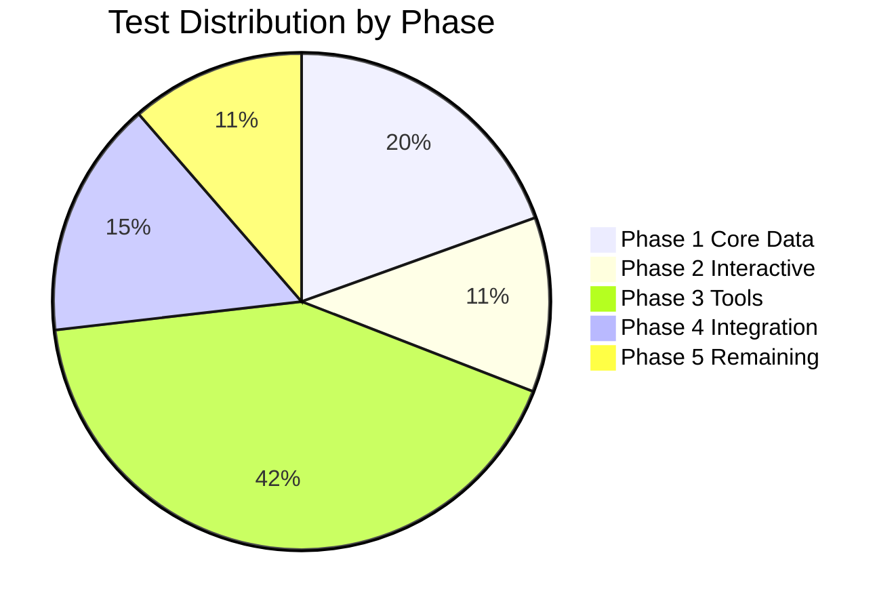

# Testing Plan

## Overview

Add a complete suite of unit tests and integration tests using **Vitest**, **@testing-library/react**, and **Husky** pre-commit hooks to the Nuniversity Next.js 14 static site.

## Integration & E2E layers (artifact + browser)

Three additional layers test the **built artifact** (`out/`) rather than the source tree. They run in the **pre-commit hook** (not in GitHub CI — CI stays fast; see below).

| Layer | What | Where | Runs when |
|---|---|---|---|
| A — Artifact integration | Node-only vitest suites validating the exported `out/`: content-derived routes, internal link graph, shipped search/question indexes, sitemap ↔ export consistency, CSP/security headers, hosting artifacts (`.nojekyll`, 404 stub, robots, og-image), size budgets | `tests/artifact/` via `vitest.artifact.config.ts` | `npm run test:artifact` — skips cleanly if no build exists |
| B — Browser integration | Real Chromium against the served build: hydration, search (hero + ⌘K palette vs the real index JSON), quiz grading + `v1:*` storage, theme persistence, i18n chrome, lesson rendering (KaTeX/highlighter/Mermaid), tools/games smoke | `tests/e2e/integration/` | `npm run test:e2e` |
| C — E2E journeys | Multi-page user journeys with zero mocks (one sanctioned exception: the Formspree endpoint is always intercepted — never hit for real): learner journey, quiz persistence across reload, 404/locale-stub contract, contact form, all-route sweep | `tests/e2e/journeys/` | `npm run test:e2e` |

**Serving:** `tests/support/static-server.mjs` mirrors the GitHub Pages hosting contract (directory index, trailing-slash 301s, `404.html` fallback with HTTP 404). Playwright boots it via the `webServer` option.

**State isolation:** every test starts from a wiped `v1:*` + `theme` localStorage (see `tests/e2e/support/storage.ts` and `fixtures.ts`).

**Local without sudo:** `npm run test:e2e` goes through `scripts/with-playwright-libs.sh`, which no-ops when Chromium's system libraries are present and otherwise extracts them into `~/.local/share/playwright-libs` and sets `LD_LIBRARY_PATH`. One-time browser download: `npx playwright install chromium`.

**Pre-commit wiring:** `.husky/pre-commit` runs lint-staged, then (when `out/index.html` exists) `npm run test:artifact` and `npm run test:e2e`. No build in `out/` → the gates skip with a visible message (a full build is too heavy for a hook). Bypass: `SKIP_INTEGRATION=1 git commit …` or `git commit --no-verify`.

**Deliberately not in GitHub CI:** the deploy workflow keeps its existing gates (type-check, lint, vitest, pytest, content validators, build). Integration/E2E run locally at commit time instead — flip-forward if wanted: paste the `npm run test:artifact` / `npm run test:e2e` steps after the build job (the Playwright config's `webServer` boots the static server itself).

### Known issues surfaced by the suites (waived in tests, real findings)

1. **RSC prefetch 404s**: Next 14.2 static export emits RSC payloads as `{route}/index.txt` while the client prefetches `{route}.txt?_rsc=…` — every prefetch 404s in production (navigation still works via full-page fallback).
2. **Course `/practice/` pages** ship `robots: index,follow`, canonical → locale root, and the EN title in all locales — personalized utility shells should be `noindex` with a localized title.
3. **`out/` is ~967 MB** — above the 900 MB warning band, 96.7% of the 1 GB Pages hard limit.
4. `code-sandbox.html` ships its own stricter sandbox CSP (intentional; asserted separately). `en/404` lacks the referrer meta (pt/es have it).

## Current State

- **Vitest** configured with jsdom environment, `@/` path alias, v8 coverage; `passWithNoTests` removed (a run with zero suites now fails)
- **Husky v9** pre-commit hook runs `lint-staged`
- **lint-staged** runs `vitest related --run` then `eslint --fix` on staged `.ts/.tsx`
- **1,209 vitest tests / 116 skipped in 32 files** (as of Phase 6, 2026-10-24): `tests/i18n/dict-parity.test.ts`, `tests/courses/data-integrity.test.ts` (49 courses / 138 locale dirs / 1,298 lessons), `tests/library/link-check*.test.ts`, `tests/components/*` (question-block, language-switcher, vocabulary-game, interactive-adapter, resume-surfaces, profile-chip, award-toaster, command-palette), `tests/quizzes/*` (storage, exam-questions, lesson-exam, certificates), `tests/languages/storage.test.ts`, `tests/progress/storage.test.ts`, `tests/gamification/{profile,bus}.test.ts`, `tests/lessons/*` (outline, progress, score, feedback, heading-ids/markdown-headings, markdown-sanitize, mermaid-security, slugify, interactive-adapter), `tests/search/{matcher,generator}.test.ts` — all passing via `npm test`
- **566 pytest tests** (Python harness, as of Phase 6, 2026-10-24): `tests/` (incl. `test_validate_quiz_json.py`, `test_validate_languages.py` — 35 cases incl. parametrized real content files, `test_validator_coverage.py` — 31 coverage cases) + `.opencode/skills` suites incl. `validate_course` parametrized over all 49 courses — all passing via `uv run --no-sync pytest` (1 skipped, 1 xfailed). Coverage (`pytest --cov=.opencode`, `fail_under = 80`) is **not wired into CI**; the Phase 6 run sits at **81.04%** (≥ 80 gate green).
- **CI blocks on both**: `.github/workflows/nextjs.yml` runs ESLint → pytest → vitest → build, plus content gates (all-49 course structure, 28 lesson-gate pairs, games/languages/library/roadmap/tools/quizzes validators, dict parity, mermaid, callouts)
- Component-test note: with `jsx: "preserve"`, `.tsx` tests need `vi.stubGlobal('React', React)` (esbuild classic runtime) — see the two component suites for the pattern

---

## Project Architecture

```
app/[lang]/         → Dynamic locale pages (en, pt, es)
components/         → Shared React components
  roadmaps/         → Roadmap timeline + step card (client-side, localStorage)
  tools/            → 10 interactive tools (complex business logic, browser APIs)
  home/             → Landing page sections (framer-motion heavy)
  layout/           → Header (client) + Footer (server)
  contacts/         → Contact form (Formspree API)
  providers/        → Theme context (localStorage + matchMedia)
  language/         → Language switcher (next/navigation)
  markdown/         → Markdown renderer + question blocks
lib/                → Server-only data fetching (fs, path, gray-matter)
  roadmaps/         → Content parsing for roadmaps
  courses/          → Content parsing for courses
  tools/            → Content parsing for tools
  games/            → Content parsing for games
  library/          → Content parsing for library resources
  i18n/             → Locale config + dictionary loading
content/            → Markdown/JSON content files
dictionaries/       → i18n translation JSON
```

---

## Test Distribution by Phase



---

## Phased Implementation

### Phase 1 — Core Data Pipeline (Unit Tests)

Test the 6 server-only lib files. These read the filesystem with `fs`, `path`, and `gray-matter`. Mock the filesystem using `vi.mock`.

| File | Tests | What to Cover |
|---|---|---|
| `lib/roadmaps/get-roadmap-content.ts` | ~8 | Parse frontmatter, return steps, handle missing locale, error on missing slug |
| `lib/roadmaps/types.ts` | ~6 | Constants match expected values, type shape validation |
| `lib/courses/get-course-content.ts` | ~10 | Course metadata loading, all lessons list, single lesson fetch, error handling, locale fallback |
| `lib/tools/get-tool-content.ts` | ~8 | Tool metadata, all tools list, locale fallback, missing slug |
| `lib/games/get-game-content.ts` | ~8 | Game loading by type/slug, category filtering, malformed JSON handling |
| `lib/library/get-library-resources.ts` | ~8 | Resource filtering by type, category, locale |

**Mocking approach**: `vi.mock('fs')` and `vi.mock('path')` with in-memory file trees, or read from actual `content/` directory for closer-to-production tests.

**Estimated**: ~48 tests, ~2 days

---

### Phase 2 — Core Interactive Components (Component Tests)

Test the roadmap client components. These need mocked `localStorage`, `framer-motion`, and `next/link`.

| File | Tests | What to Cover |
|---|---|---|
| `components/roadmaps/RoadmapTimeline.tsx` | ~12 | Renders all steps, progress bar updates, localStorage read/write, empty state, single step |
| `components/roadmaps/RoadmapStepCard.tsx` | ~10 | Expand/collapse toggle, status badges (locked/complete/current), renders "Go to Course" link, relationship display |
| `app/[lang]/roadmaps/roadmaps-client.tsx` | ~6 | Renders roadmap cards, search/filter behavior, empty search results |

**Mocking approach**:
- `vi.mock('framer-motion')`: replace `motion.*` with plain `<div>`, wrap `AnimatePresence` as identity
- `vi.mock('next/link')`: render `<a>` with same props
- `vi.stubGlobal('localStorage', mockStorage)` in setup or per-test

**Estimated**: ~28 tests, ~2 days

---

### Phase 3 — Tools (Component + Integration Tests)

These 10 tool components contain complex business logic (timers, streak calculations, data import/export, localStorage). Extract pure functions for dedicated unit tests, then write component tests around the UI.

| File | Tests | What to Cover |
|---|---|---|
| `components/tools/PomodoroTimer.tsx` | ~14 | Timer start/pause/reset, session logging to localStorage, streak calculation, sound notification |
| `components/tools/HabitTracker.tsx` | ~12 | Habit CRUD, daily logging, streak calculation, calendar rendering, localStorage sync |
| `components/tools/FlashcardMaker.tsx` | ~12 | Deck CRUD, card add/edit/delete, spaced repetition algorithm, study session flow |
| `components/tools/SWOTMatrix.tsx` | ~10 | CRUD for each quadrant, CSV import/export, inline i18n switching |
| `components/tools/EisenhowerMatrix.tsx` | ~10 | CRUD for quadrants, import/export, inline i18n |
| `components/tools/RegexTester.tsx` | ~10 | Pattern input, test string matching, flags toggling, matches list, error display |
| `components/tools/UnitConverter.tsx` | ~8 | All conversion categories, rounding, unit switching |
| `components/tools/DecisionMatrix.tsx` | ~10 | Row/column CRUD, weighted scoring calculation, CSV export |
| `components/tools/BrainWritingSession.tsx` | ~10 | Timer, round management, idea submission, time-up behavior |
| `components/tools/LLMPromptBuilder.tsx` | ~8 | Template assembly, variable insertion, export |

**Mocking approach**:
- `localStorage` stubbed globally
- `navigator.clipboard` stubbed
- `URL.createObjectURL` / `FileReader` stubbed for import/export
- `alert`/`confirm` stubbed

**Estimated**: ~104 tests, ~5 days

---

### Phase 4 — Integration Tests

Test cross-component interactions, external services, and app-wide context.

| File | Tests | What to Cover |
|---|---|---|
| `components/providers/Providers.tsx` | ~8 | Theme toggle, localStorage sync, `matchMedia` detection, children render |
| `components/language/LanguageSwitcher.tsx` | ~8 | Dropdown open/close, locale selection calls router, cookie set |
| `components/layout/Header.tsx` | ~8 | Mobile menu toggle, nav links render, theme button, language switcher |
| `components/contacts/ContactForm.tsx` | ~8 | Form fields, validation, submission to Formspree, success/error states |
| `components/contacts/Contact.tsx` | ~6 | Formspree `useForm` hook integration, social links render |

**Mocking approach**:
- `vi.mock('next/navigation')`: stub `usePathname`, `useRouter`
- Mock `fetch()` or use **MSW (Mock Service Worker)** for HTTP
- Mock `@formspree/react` hook
- `document.cookie` stubbed

**Estimated**: ~38 tests, ~3 days

---

### Phase 5 — Remaining Components

Lower-priority render tests.

| File | Tests | What to Cover |
|---|---|---|
| `components/home/*` (6 files) | ~12 | Render content, animation wrapper presence |
| `components/layout/Footer.tsx` | ~4 | Render links, social icons |
| `components/markdown/MarkdownRenderer.tsx` | ~6 | Render markdown, code blocks, zoom toggle |
| `components/markdown/QuestionBlock.tsx` | ~4 | Question display, answer reveal |
| `components/markdown/FixWrapper.tsx` | ~2 | Syntax highlighting render |

**Estimated**: ~28 tests, ~1 day

---

## Mocking Strategy

| Dependency | Approach |
|---|---|
| **`fs` / `path` / `process.cwd()`** | `vi.mock('fs', () => ({ ... }))` with in-memory file tree |
| **`gray-matter`** | `vi.mock('gray-matter')` — return controlled frontmatter + content |
| **`framer-motion`** | Central mock module at `src/__mocks__/framer-motion.ts` — `motion.*` → `<div>`, `AnimatePresence` → identity, `useAnimation` → noop |
| **`localStorage`** | `vi.stubGlobal('localStorage', { ... })` or per-test `beforeEach` setup |
| **`next/link`** | `vi.mock('next/link')` — `React.forwardRef((props, ref) => <a ref={ref} {...props} />)` |
| **`next/navigation`** | `vi.mock('next/navigation')` — `usePathname` returns `'/'`, `useRouter` returns `{ push: vi.fn(), replace: vi.fn() }` |
| **`window.matchMedia`** | `vi.stubGlobal('matchMedia', ...)` in `src/test-setup.ts` |
| **`@formspree/react`** | `vi.mock('@formspree/react')` — `useForm` returns `[state, handleSubmit]` |
| **`fetch()`** | `vi.fn().mockResolvedValue(...)` or MSW |
| **`URL.createObjectURL`** | `vi.fn().mockReturnValue('blob:...')` |
| **`navigator.clipboard`** | `vi.fn().mockResolvedValue(undefined)` |
| **`react-markdown`** | `vi.mock('react-markdown')` — render children as text |
| **`mermaid`** | Already dynamic, but mock dynamic import in tests |
| **`next/image`** | `vi.mock('next/image')` — render `` |

### Central Mock Modules

```
src/__mocks__/
  framer-motion.ts    → Shared framer-motion mock
  next-link.ts        → Shared next/link mock
  next-navigation.ts  → Shared next/navigation mock
```

---

## Pre-commit Workflow

### Current Flow
```
git commit
  └─ Husky v9 triggers .husky/pre-commit
       └─ npx lint-staged
            ├─ For each staged *.ts / *.tsx:
            │    1. vitest related --run   (tests related to changed files)
            │    2. eslint --fix           (auto-fix lint)
            └─ For each staged *.py:
                 node scripts/security-bandit.mjs
                   └─ Bandit, MEDIUM/HIGH findings block the commit
```

Bandit reads `[tool.bandit]` from `pyproject.toml` (the same section
`.pre-commit-config.yaml` uses). Test files are skipped: they pass fixture paths
such as `/tmp/t.md` as values, which Bandit reports as insecure temp-file usage
(B108) although nothing is written there.

```bash
npm run security:bandit        # whole repository, tests excluded
SKIP_BANDIT=1 git commit ...   # bypass once
```

### Security checks beyond the hook

```bash
npm audit --omit=dev   # shipped dependencies
npm audit              # including build/test tooling
npm run security:bandit
node scripts/verify-csp.mjs    # CSP present on every exported page
```

### Suggested Improvements
| Improvement | Reason |
|---|---|
| Add `.js,.jsx,.json,.css` to lint-staged pattern | Only `.ts/.tsx` are covered; other files slip through |
| Add `--max-warnings 0` to eslint command | Currently warnings don't block commits |
| Swap order: lint first, then test | Tests are slower; fail fast on lint |
| Add `pre-push` hook | Block pushes that break tests or lint (optional, team preference) |

---

## CI Integration

Shipped in Phase 1 — `.github/workflows/nextjs.yml` runs, in order (after `npm ci`):

```yaml
- name: Lint (ESLint)          # npm run lint — 0 warnings, CI-blocking
- name: Python tests (pytest harness)   # uv run --no-sync pytest
- name: Run tests              # vitest run (683)
- name: Build with Next.js     # next build — type-checks, ignoreBuildErrors removed
```

All three are blocking; content-validation gates run before them (see workflow for the full list).

---

## File Tree (New Files)

```
src/
  __mocks__/                      ← Mock helper modules
    framer-motion.ts
    next-link.ts
    next-navigation.ts
  test-setup.ts                   ← Already exists
lib/
  i18n/__tests__/                 ← (stale; i18n suites live in tests/i18n/ as of Phase 1)
tests/                            ← Phase 1 (root-level suites)
  courses/data-integrity.test.ts
  i18n/dict-parity.test.ts
  library/link-check.test.ts
  components/question-block.test.tsx
  components/language-switcher.test.tsx
  test_opencode_courses.py        ← pytest (49-course parametrized)
components/
  roadmaps/__tests__/             ← Phase 2
  tools/__tests__/                ← Phase 3
    PomodoroTimer.test.tsx
    HabitTracker.test.tsx
    FlashcardMaker.test.tsx
    ...
  providers/__tests__/            ← Phase 4
  language/__tests__/             ← Phase 4
  layout/__tests__/               ← Phase 4
  contacts/__tests__/             ← Phase 4
  home/__tests__/                 ← Phase 5
  markdown/__tests__/             ← Phase 5
docs/
  INDEX.md                           # Master documentation index
  architecture/                      # System design, components
    ARCHITECTURE.md
    COMPONENTS.md
  features/                          # Content, i18n, roadmaps, games
    CONTENT-MANAGEMENT.md
    INTERNATIONALIZATION.md
    ROADMAPS.md
    GAMES.md
    MARKDOWN-RENDERER.md
  operations/                        # Deployment, testing, contributing
    DEPLOYMENT.md
    TESTING.md                       # This file
    CONTRIBUTING.md
  ai/                                # Agents, OpenCode harness
    AGENTS.md
    OPENCODE-HARNESS.md
  assessment/
    ASSESSMENT.md
  getting-started/
    GETTING-STARTED.md
  reference/
    remaining-courses-documentation.md
    roadmap-implementation-status.md
```

---

## Key Constraints

1. **Static export**: No Next.js server runtime in production. Tests must not depend on `next start`.
2. **`typescript.ignoreBuildErrors: true`**, **`strict: false`**: The production build is lenient. Tests may surface type issues the build ignores — this is intentional and desirable.
3. **Content-driven**: 37 courses, 10 tools, 7 game categories, 1 roadmap, and 1 quiz JSON (content/quizzes/). Tests can leverage actual content files for realistic data.
4. **`framer-motion` pervasive**: Every client component wraps content in `motion.*` elements. The central mock is essential for all component tests.

---

## Effort Summary

| Phase | Files | Tests (est.) | Effort |
|---|---|---|---|
| 1 — Core Data Pipeline | 6 lib files | ~48 | 2 days |
| 2 — Core Interactive | 3 components | ~28 | 2 days |
| 3 — Tools | 10 components | ~104 | 5 days |
| 4 — Integration | 5 components | ~38 | 3 days |
| 5 — Remaining | ~10 components | ~28 | 1 day |
| Infrastructure | CI, mocks, config | — | 1 day |
| **Total** | **~34 source files** | **~246 tests** | **~14 days** |
